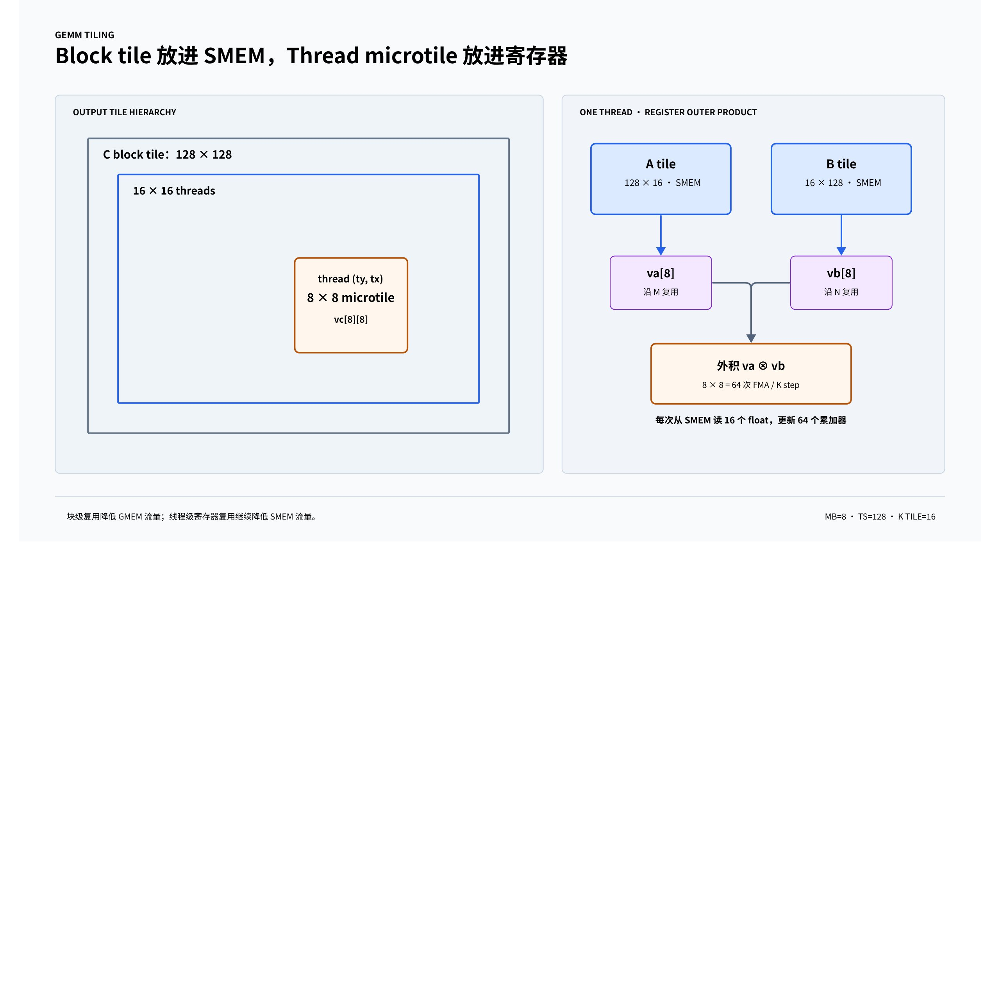
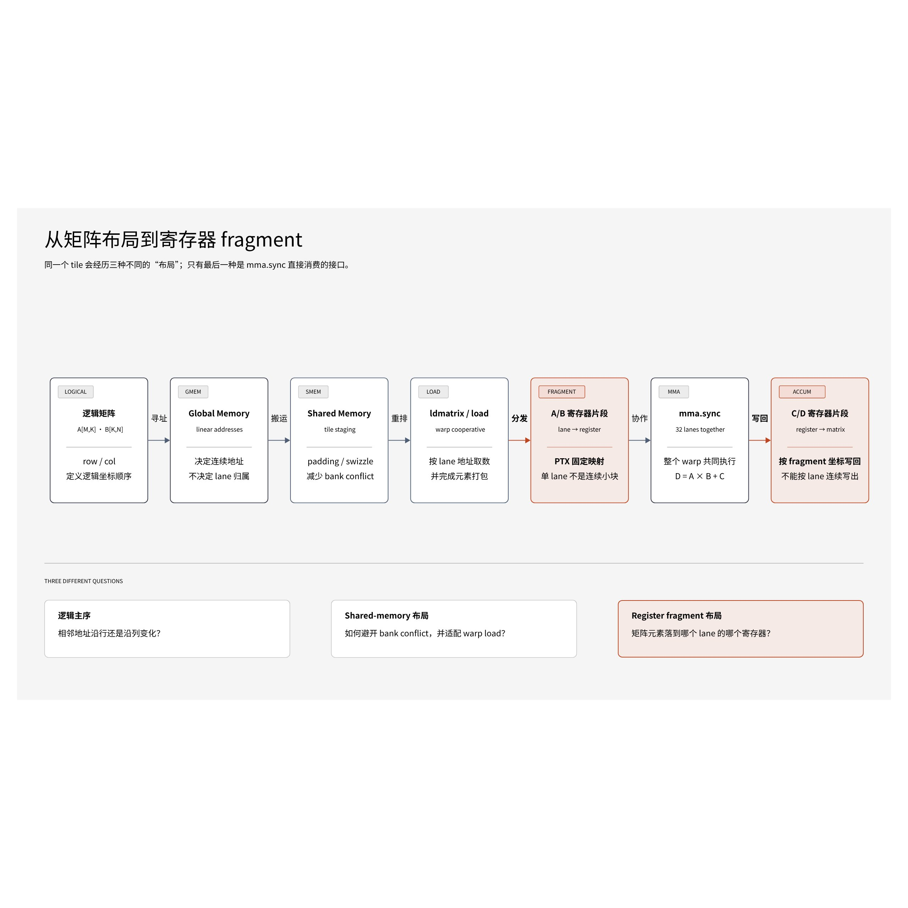
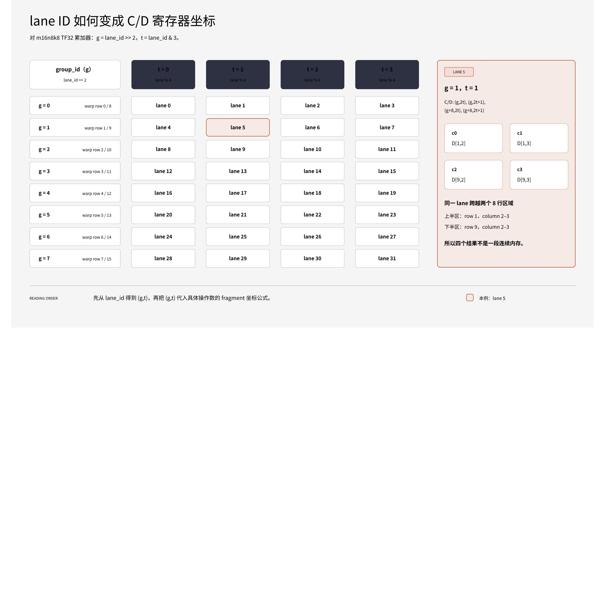
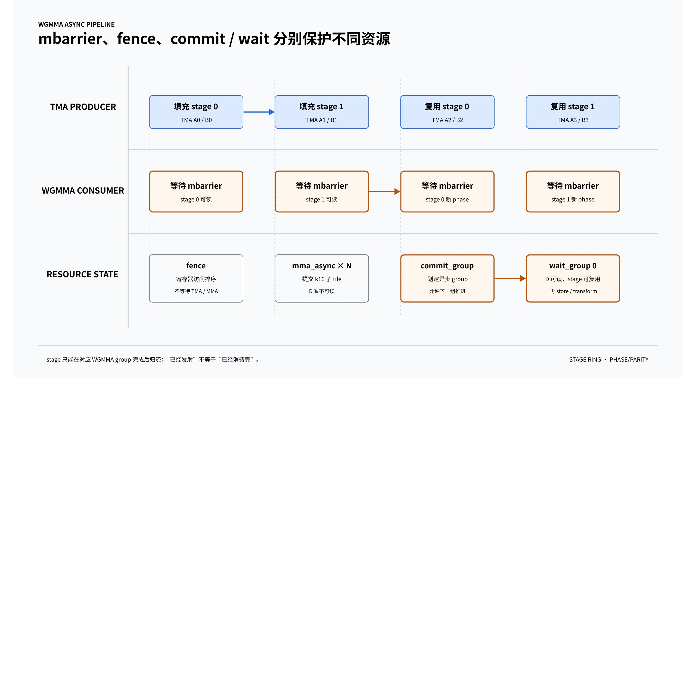

# 高级 cuda 特性 —— 从矩阵乘法(gemm)说起

```{contents} 本页目录
---
depth: 2
local: true
---
```

以优化矩阵乘法 general matrix multiplication (gemm) 为切入点，介绍高级 cuda 特性在性能优化中的使用。

## 使用Roofline Model对矩阵乘法进行性能分析。

矩阵乘法 C = AB（其中 A, B, C 均为 n 行 n 列）的计算量是固定的，但**访存量**取决于内存访问的实现方式（即数据复用程度）。

- **计算量 (FLOPS)**：总计约 2n^3 次浮点运算。
- **数据大小**：假设使用 `float`（4 字节）。

### 情况 A：无缓存/无复用的实现 (Naive)

每个线程计算 $C_{ij}$ 时都从全局内存读取 $A$ 的一行和 $B$ 的一列。

- **访存量**：计算每个 C_ij 需要读取 2n 个元素。总访存为 2n^3 个元素。
- **字节数**： 8n^3 Bytes。
- $\text{OI}_{naive} = \frac{2n^3}{8n^3} = 0.25 \text{ FLOPs/Byte}$

> **结论**：如果不使用缓存，无论 n 多大，OI 始终极低，永远是 **Memory-bound**。

### 情况 B：理想状态/完全复用 (Ideal Cache)

假设 $A$ 和 $B$ 只从全局内存加载一次并完全留在缓存中。

- **访存量**：读取 A, B 并写入 C，总共 3n^2 个元素。
- **字节数**：12n^2 Bytes。
- $\text{OI}_{ideal} = \frac{2n^3}{12n^2} = \frac{n}{6} \text{ FLOPs/Byte}$

> **结论**：OI 随 n 线性增长。这意味着随规模扩大，算法会从内存受限转为计算受限。

### 从 Memory-bound 到 Compute-bound 的转变

要找到这个转折点，我们需要对比**算法的 OI** 和 **GPU 的硬件拐点 (Ridge Point)**。

以 RTX 4000 Ada 为例.

- **Peak FP32 Performance**: 26.7 TFLOPS
- **Peak Memory Bandwidth**: 360 GB/s
- **硬件拐点:** $\text{OI}_{gpuhw} = \frac{26700 \text{ GFLOPS}}{360 \text{ GB/s}} \approx 74.17 \text{ FLOPs/Byte}$

$$\frac{n}{6} \ge 74.17$$

$$n \ge 74.17 \times 6$$

$$n \ge 445$$

> 结论：理论上当 n>=445 时，程序进入 **Compute-bound** 区域。


## 显性的矩阵乘法性能分析

接着对 3072 * 3072 矩阵乘法（GEMM）在 **RTX 4000 Ada** 上进行性能分析，涵盖了从理论峰值到不同缓存层级限制下的深度计算。

### 基本数据

- **计算峰值 (Peak FP32)**: 26.7 TFLOPS (忽略 Tensor Cores)
- **内存带宽 (Peak DRAM Bandwidth)**: 360 GB/s
- **L2 缓存带宽**: ～2.5 TB/s
- **矩阵规模**: n = 3072
- **总运算量**: 2n^3 = 5.798 * 10^10  FLOPs

### 理论极限分析

#### (1) 如果是计算受限 (Compute-bound)，最快运行时间？

假设程序能完美跑满 26.7 TFLOPS：

$$\text{Time}_{comp} = \frac{2n^3}{\text{Peak GFLOPS}} = \frac{57.98 \text{ GFLOPs}}{26700 \text{ GFLOPS}} \approx \mathbf{2.17 \text{ ms}}$$

#### (2) 如果是 DRAM 受限且具备理想复用，最快运行时间？

理想情况下，每个元素A, B, C 仅从 DRAM 读写一次。总数据量为 3n^2 个 `float`：

$$\text{Bytes} = 3 \times (3072)^2 \times 4 \text{ Bytes} \approx 113.25 \text{ MB} = 0.11325 \text{ GB}$$

$$\text{Time}_{ideal_dram} = \frac{0.11325 \text{ GB}}{360 \text{ GB/s}} \approx \mathbf{0.31 \text{ ms}}$$

#### (3) 结论：谁统治了运行时间？

比较 (1) 和 (2)：**计算时间 2.17 ms 远大于 DRAM 搬运时间 (0.31 ms)**。

这意味着，在经过良好优化（如 Shared Memory Tiling）并实现高数据复用的情况下，该工作负载的运行时间应由**计算（Compute）主导**。此时，数据的搬运被隐藏在计算背后。

### 缓存缺失与带宽约束分析

#### (4) 若完全不复用数据，总访存量是多少？

如果不利用缓存，每次 $C_{i,j} = \sum A_{i,k} \times B_{k,j}$ 都要从 DRAM 重新读取 $A$ 和 B：

- 每次乘加操作加载 2 个元素（8 字节）。
- 总操作次数为 n^3（乘加对）。
- $\text{Total Bytes} = 8 \times n^3 = 8 \times (3072)^3 \approx \mathbf{231.87 \text{ GB}}$

#### (5) 无复用情况下，DRAM 带宽约束下的最快时间？

$$\text{Time}_{no_reuse_dram} = \frac{231.87 \text{ GB}}{360 \text{ GB/s}} \approx \mathbf{644.08 \text{ ms}}$$

这比计算受限的理论时间慢了近 **300 倍**，说明了不进行 Tiling 优化的代价。

#### (6) 若所有操作直接命中 L2 缓存，最快运行时间？

假设 L2 提供 $2.5 \text{ TB/s}$ 2500  GB/s) 的带宽：

$$\text{Time}_{L2_bound} = \frac{231.87 \text{ GB}}{2500 \text{ GB/s}} \approx \mathbf{92.75 \text{ ms}}$$

---

### 综合对比总结


| 场景 | 限制因素 | 理论最快耗时 | 与计算极限 (2.17ms) 相比 |
| --- | --- | --- | --- |
| 理想 Tiling 优化 | Compute | 2.17 ms | 1.0x (瓶颈在 ALU) |
| 无复用 (Naive) | DRAM Bandwidth | 644.08 ms | ~296x 慢 |
| 无复用 (L2 命中) | L2 Bandwidth | 92.75 ms | ~42x 慢 |


**核心结论：**

- (5) 和 (6) 均远慢于 (1)。这证明了**内存层次结构（Memory Hierarchy）**存在的意义。
- 即使是极快的 L2 缓存，如果在算法层面上不通过 **Shared Memory** 或 **Register Tiling** 来实现寄存器级别的数据复用，其带宽依然无法支撑 GPU 庞大的算力。
- **优化目标**：将访存模式从场景 (5) 推动到场景 (2)，使得最终瓶颈落在场景 (1) 的计算曲线上。


## 矩阵乘法中的分块与数据复用



- **核心挑战**：矩阵乘法的计算复杂度是 O(N^3)，而数据量是 N^2。如果直接从全局内存（Global Memory）读取数据(数据访问量退化成O(N^3))，程序将受限于内存带宽（Memory Bound），而非算力。
- **优化思路**：利用 **Shared Memory (L1 SRAM)** 和 **Registers** 进行数据复用，减少对低速全局内存的访问。

两个层级的复用：

### Shared Memory Tiling (块级复用)

- **原理**：将大矩阵划分为较小的 Tile（例如 16 * 16） 。每个 Thread Block 负责计算 C 的一个 Tile。
- **操作**：

  1. 从全局内存加载 A 的一个小块和 B 的一个小块到 Shared Memory。
  2. 调用 `__syncthreads()` 同步，确保块内所有线程都完成了加载。
  3. 在 Shared Memory 中进行计算。
  4. 重复上述过程，直到完成 K 维的遍历。
- **收益**：全局内存的访问次数减少了 Tile_Size 倍 (从 2N^3 下降到 2N^3/Tile_size)。例如tile为16*16时，内存访问此时减少约93%。

**参考实现：**

```c++

__global__ void matmul_l1(
    int32_t size_i,
    int32_t size_j,
    int32_t size_k,
    float const *a,
    float const *b,
    float *c) {
        extern __shared__ float sh[];
        float *sh_a = sh;
        float *sh_b = sh + blockDim.x * blockDim.y;

        int row = blockIdx.y * blockDim.y + threadIdx.y;
        int col = blockIdx.x * blockDim.x + threadIdx.x;
        float vc = 0.0f;

        for (int k=0; k<(size_k + blockDim.x - 1)/blockDim.x; ++k) {
            int gy_a = blockIdx.y * blockDim.y + threadIdx.y;
            int gx_a = k * blockDim.x + threadIdx.x;
            if (gy_a < size_i && gx_a < size_k) {
                sh_a[threadIdx.y * blockDim.x + threadIdx.x] = a[gy_a * size_k + gx_a];
            } else {
                sh_a[threadIdx.y * blockDim.x + threadIdx.x] = 0.0f;
            }

            int gy_b = k * blockDim.y + threadIdx.y;
            int gx_b = blockIdx.x * blockDim.x + threadIdx.x;
            if (gy_b < size_k && gx_b < size_j) {
                sh_b[threadIdx.y * blockDim.x + threadIdx.x] = b[gy_b * size_j + gx_b];
            } else {
                sh_b[threadIdx.y * blockDim.x + threadIdx.x] = 0.0f;
            }

            __syncthreads();

            #pragma unroll
            for (int t_i=0; t_i < blockDim.x; ++t_i) {
                vc += sh_a[threadIdx.y * blockDim.x + t_i] * sh_b[t_i * blockDim.x + threadIdx.x];
            }
            __syncthreads();
        }

        if (row < size_i && col < size_j) {
            c[row * size_j + col] = vc;
        }
}

void launch_matmul_l1(
    int32_t size_i,
    int32_t size_j,
    int32_t size_k,
    float const *a,
    float const *b,
    float *c) {
        static constexpr int32_t block_size = 32;
        int32_t grid_y = (size_i + block_size - 1) / block_size;
        int32_t grid_x = (size_j + block_size - 1) / block_size;

        static constexpr int32_t share_mem_bytes = 2 * block_size * block_size * sizeof(float);

        CUDA_CHECK(cudaFuncSetAttribute(
            matmul_l1,
            cudaFuncAttributeMaxDynamicSharedMemorySize,
            share_mem_bytes));

        dim3 block(block_size, block_size);
        dim3 grid(grid_x, grid_y);
        matmul_l1<<<grid, block, share_mem_bytes>>>(size_i, size_j, size_k, a, b, c);
        CUDA_CHECK(cudaGetLastError());
}
```

#### **代码逐段解读**

**启动端 launch_matmul_l1**

- `block_size = 32`：每个 block 是 32×32 = 1024 个线程，接近单 block 线程数上限。
- grid 维度按 C 的行列切分：`grid_x = ceil(size_j/32)`，`grid_y = ceil(size_i/32)`。
- 动态共享内存 2 × 32 × 32 × 4B = 8KB，`sh_a` 和 `sh_b` 各占一半。由于 8KB 可能超过默认动态 shared memory 上限，先用 `cudaFuncSetAttribute` 提升 `MaxDynamicSharedMemorySize`。

**kernel 主体 matmul_l1**

**shared memory 划分**

`sh_a` 占前 `blockDim.x * blockDim.y` 个 float，`sh_b` 紧随其后。

**线程到输出元素的映射**

`row = blockIdx.y * blockDim.y + threadIdx.y`，`col = blockIdx.x * blockDim.x + threadIdx.x`。每个线程负责算 C[row][col] 一个元素，`vc` 是累加器。

**沿 K 方向分块循环**

`k` 是当前处理的 K 方向 tile 索引，每个 tile 宽 32，循环次数 `ceil(size_k/32)`。

**加载 A 的 tile 到 sh_a**

全局坐标 `gy_a = blockIdx.y*32 + threadIdx.y`（A 的行），`gx_a = k*32 + threadIdx.x`（A 的列，即 K 方向当前 tile）。越界判断 `gy_a < size_i && gx_a < size_k`，否则填 0。32×32 线程恰好搬完一个 32×32 tile。

**加载 B 的 tile 到 sh_b**

全局坐标 `gy_b = k*32 + threadIdx.y`（B 的行 = K 方向），`gx_b = blockIdx.x*32 + threadIdx.x`（B 的列）。同样越界补 0。

**__syncthreads() 的作用**

等所有线程把 tile 加载完才能读 sh_a/sh_b 做计算，否则会读到未初始化数据。

**点积累加**

对当前 32×32 的 A tile 和 B tile 做矩阵乘，累加到 `vc`。`#pragma unroll` 让编译器展开循环。注意 `sh_a` 行索引固定为 `threadIdx.y`、列遍历 `t_i`；`sh_b` 列索引固定为 `threadIdx.x`、行遍历 `t_i`，正好对应 `C[row][col] = Σ A[row][t_i] * B[t_i][col]`。

**第二次 __syncthreads()**

等所有线程用完 shared memory 后再进入下一轮循环覆盖 sh_a/sh_b，避免加载还没算完就被覆盖。

**写回结果**

越界线程不写，只写合法的 `C[row][col]`。

**关键设计点**

- **为什么用 shared memory**：naive 实现每个 C 元素要读 K 次 A 和 K 次 B，全局内存访问量 2*I*J*K。分块后每个 tile 的 A/B 数据在 shared memory 中被复用 32 次，全局内存访问降为 2*I*J*K/32。
- **两次 __syncthreads()**：一次保证加载完成再算，一次保证计算完成再覆盖，少一次都会出错。
- **越界补 0**：让尺寸不是 32 整数倍的矩阵也能正确计算，不需要 padding。
- **#pragma unroll**：固定 32 次的小循环展开，减少循环开销，也利于指令调度。

**潜在改进点（基础 L1 版本）**

- 没有使用寄存器分块（一个线程算多个 C 元素），寄存器复用率低。
- 没有向量化加载（float4），内存带宽利用率一般。
- 这是 FP32 版本，modern GPU 上可用 Tensor Core（wmma/mma）获得数量级提升。

**性能测试：**

```yaml
matmul_l1:

  size  256 *  256 *  256:
    correctness: 0.00e+00 relative RMSE
    run time:   0.02 ms
    throughput:  1.82 TFLOP/s

  size 3072 * 3072 * 3072:
    correctness: 1.03e-06 relative RMSE
    run time:  18.93 ms
    throughput:  3.06 TFLOP/s
```

### Register Tiling (线程级复用)

- **原理**：在 Thread Block 内部，进一步让每个线程负责输出 C 矩阵中的多个元素（例如 8 * 8 的微块）。
- **操作**：每个线程维护一组寄存器作为累加器（Accumulators）。在计算时，将 Shared Memory 中的数据加载到寄存器中进行多次计算。
- **收益**：

  - 极大减少了对 Shared Memory 的访问频率(寄存器的访问延迟比shared memory更低)
  - 通过增加每个线程的计算量（Compute Intensity），更好地隐藏指令延迟。也就是提高算术强度(参考roofline model章节)，降低memory bound。

**参考实现：**

```c++
template <int MB, int TS>
__global__ void matmul_l1_reg(
    int32_t size_i,
    int32_t size_j,
    int32_t size_k,
    float const *a,
    float const *b,
    float *c) {
        const int block_size = blockDim.x;

        extern __shared__ float sh[];
        float* sh_a = sh;
        float* sh_b = sh + TS * block_size;

        int row_start = blockIdx.y * TS + threadIdx.y * MB;
        int col_start = blockIdx.x * TS + threadIdx.x * MB;

        float vc[MB][MB];
        #pragma unroll
        for (int i=0; i<MB; ++i) {
            #pragma unroll
            for (int j=0; j<MB; ++j) {
                vc[i][j] = 0.0f;
            }
        }

        for (int k=0; k<(size_k + blockDim.x - 1)/blockDim.x; ++k) {
            #pragma unroll
            for (int i=0; i<MB; ++i) {
                int gy_a = row_start + i;
                int gx_a = k * block_size + threadIdx.x;
                int sh_idx = threadIdx.y * TS + i * block_size + threadIdx.x;
                if (gy_a < size_i && gx_a < size_k) {
                    sh_a[sh_idx] = a[gy_a * size_k + gx_a];
                } else {
                    sh_a[sh_idx] = 0.0f;
                }
            }
            #pragma unroll
            for (int i=0; i<MB; ++i) {
                int gy_b = k * block_size + threadIdx.y;
                int gx_b = col_start + i;
                int sh_idx = threadIdx.y * TS + threadIdx.x * MB + i;
                if (gy_b < size_k && gx_b < size_j) {
                    sh_b[sh_idx] = b[gy_b * size_j + gx_b];
                } else {
                    sh_b[sh_idx] = 0.0f;
                }
            }
            __syncthreads();

            float va[MB], vb[MB];
            for (int i=0; i<blockDim.x; ++i) {
                #pragma unroll
                for (int j=0; j<MB; ++j) {
                    va[j] = sh_a[threadIdx.y * TS + j * block_size + i];
                    vb[j] = sh_b[i * TS + threadIdx.x * MB + j];
                }
                #pragma unroll
                for (int j=0;j<MB; ++j) {
                    #pragma unroll
                    for (int k=0;k<MB; ++k) {
                        vc[j][k] += va[j] * vb[k];
                    }
                }
            }
            __syncthreads();
        }

        #pragma unroll
        for (int i=0; i<MB; ++i) {
            int row = row_start + i;
            #pragma unroll
            for (int j=0; j<MB; ++j) {
                int col = col_start + j;
                if (row < size_i && col < size_j) {
                    c[row * size_j + col] = vc[i][j];
                }
            }
        }
}

void launch_matmul_l1_reg(
    int32_t size_i,
    int32_t size_j,
    int32_t size_k,
    float const *a,
    float const *b,
    float *c) {
        constexpr int block_size = 16;
        constexpr int micro_block_size = 8;
        constexpr int tile_size = block_size * micro_block_size;

        const int grid_y = (size_i + tile_size - 1) / tile_size;
        const int grid_x = (size_j + tile_size - 1) / tile_size;

        const int share_mem_bytes = 2 * tile_size * block_size * sizeof(float);
        CUDA_CHECK(cudaFuncSetAttribute(
            matmul_l1_reg<micro_block_size, tile_size>,
            cudaFuncAttributeMaxDynamicSharedMemorySize,
            share_mem_bytes));

        dim3 block(block_size, block_size);
        dim3 grid(grid_x, grid_y);
        matmul_l1_reg<micro_block_size, tile_size><<<grid, block, share_mem_bytes>>>(size_i, size_j, size_k, a, b, c);
        CUDA_CHECK(cudaGetLastError());
}
```

#### 一个线程计算 8×8 个输出

这版 kernel 在 Shared Memory Tiling 上又加了一层 Register Tiling。共享内存负责 block 级数据复用，寄存器负责线程级数据复用。当前实例化参数是 `MB=8`、`TS=128`，block 为 16×16 个线程。因此，一个 block 计算 C 的 128×128 tile，每个线程计算其中连续的 8×8 微块。

| 层级 | 负责范围 | 当前大小 |
|-|-|-|
| Grid | 完整矩阵 C | ceil(M/128) × ceil(N/128) |
| Thread Block | C 的一个 block tile | 128×128 |
| Thread | C 的一个 register tile | 8×8 |
| K 方向 tile | 一次搬入共享内存的 K 范围 | 16 |

`row_start = blockIdx.y * TS + threadIdx.y * MB`，`col_start = blockIdx.x * TS + threadIdx.x * MB`。线程坐标 `(ty, tx)` 对应输出行 `ty*8 ... ty*8+7` 和输出列 `tx*8 ... tx*8+7`。16 个线程组乘以每组 8 行或 8 列，正好覆盖 128×128 的 block tile。

#### 共享内存保存两个 K tile

动态共享内存被分成 `sh_a` 和 `sh_b`：

- `sh_a` 的逻辑形状是 128×16，对应 A 的 `[M tile, K tile]`。
- `sh_b` 的逻辑形状是 16×128，对应 B 的 `[K tile, N tile]`。

每个线程从 A 搬 8 个元素：行坐标由 `row_start+i` 决定，K 坐标由 `threadIdx.x` 决定。256 个线程一共搬入 `256×8=2048` 个元素，恰好填满 128×16 的 A tile。

B 的搬运方式与此对称：每个线程负责同一 K 行上的连续 8 列，256 个线程同样搬入 2048 个元素，填满 16×128 的 B tile。矩阵边缘或最后一个不完整 K tile 越界时写入 0，所以计算主体不需要再做分支判断。

第一次 `__syncthreads()` 保证 A、B tile 全部就绪后再开始计算。第二次同步保证所有线程已经用完当前 tile，随后才能覆盖共享内存并加载下一轮数据。

#### 寄存器外积完成线程级复用

`vc[8][8]` 是每个线程的 64 个累加器。对当前 K tile 中的每个位置 `i`，线程先从共享内存读取：

- `va[0..7]`：当前线程负责的 8 行 A 数据。
- `vb[0..7]`：当前线程负责的 8 列 B 数据。

随后执行一个 8×8 外积：

```c++
for (int row = 0; row < 8; ++row)
  for (int col = 0; col < 8; ++col)
    vc[row][col] += va[row] * vb[col];
```

一次内层迭代只从共享内存读取 16 个 float，却完成 64 次 FMA。每个 `va[row]` 被 8 个输出列复用，每个 `vb[col]` 被 8 个输出行复用。与一个线程只计算一个输出元素的版本相比，MB=8 时，每次 FMA 对共享内存的读取量从 2 个 float 降到 `2/8=0.25` 个 float，减少 8 倍。

一个 K tile 有 16 个位置，因此每个线程每轮完成 `16×8×8=1024` 次 FMA；整个 block 完成 `128×128×16` 次 FMA。所有 K tile 累加结束后，线程把自己的 8×8 微块写回 C，并用边界判断处理 M、N 不是 128 整数倍的情况。

#### 启动参数如何对应 kernel

| 参数 | 值 | 含义 |
|-|-|-|
| `block_size` | 16 | block 为 16×16，共 256 个线程；K tile 宽度也是 16 |
| `micro_block_size` | 8 | 每个线程计算 8×8 个 C 元素 |
| `tile_size` | 128 | `16×8`，即 block 的 M/N tile 边长 |
| `share_mem_bytes` | 16384 B | A、B 各占 `128×16×4 B`，合计 16 KiB |

`matmul_l1_reg<micro_block_size, tile_size>` 选择具体模板实例，grid 则按 128×128 切分输出矩阵。当前 16 KiB 动态共享内存在 V100 上通常低于默认的 48 KiB 上限，因此这里的 `cudaFuncSetAttribute` 往往不是必需的；当动态共享内存超过默认上限时，这个 opt-in 设置才是关键。

#### 性能收益和实现边界

寄存器分块减少了共享内存读取，也让一条 A 或 B 数据参与更多 FMA。代价是寄存器压力明显增加：仅 `vc` 就有 64 个 float，再加上 `va`、`vb` 和索引变量。编译器通常会把这些固定长度数组放进寄存器，但寄存器不足时可能 spill 到 local memory，反而拖慢 kernel。实际是否溢出应查看 `ptxas` 的寄存器统计或 Nsight Compute 指标。

这段实现还有几个隐含约束和优化空间：

- `TS == blockDim.x * MB`，并且代码默认 `blockDim.x == blockDim.y`。当前启动参数满足这些条件，但 kernel 没有显式检查。
- B 的全局内存加载在同一条 load 指令中以 8 个 float 为步长跨线程访问，合并效果不如连续加载；`sh_b` 的读取也可能出现 bank conflict。可以把协作加载映射与计算映射分开，并对共享内存布局做 transpose 或 swizzle。
- 小矩阵无法摊薄更大的线程微块、寄存器初始化和调度开销，所以性能测试中 256×256 的输入反而更慢；3072×3072 时才体现出 2.88 倍加速。

**性能测试：（对比Shared Memory Tiling）**

寄存器复用比shared memory复用，带来了2.88x倍性能提升。

```yaml
./matmul 
matmul_l1:

  size  256 *  256 *  256:
    correctness: 0.00e+00 relative RMSE
    run time:   0.02 ms
    throughput:  1.82 TFLOP/s

  size 3072 * 3072 * 3072:
    correctness: 1.03e-06 relative RMSE
    run time:  18.93 ms
    throughput:  3.06 TFLOP/s

matmul_l1_reg:

  size  256 *  256 *  256:
    correctness: 0.00e+00 relative RMSE
    run time:   0.09 ms
    throughput:  0.37 TFLOP/s

  size 3072 * 3072 * 3072:
    correctness: 1.03e-06 relative RMSE
    run time:   6.57 ms
    throughput:  8.82 TFLOP/s

speedups on largest problem size:

  speedup matmul_l1 -> matmul_l1_reg: 2.88x
```


## 利特尔法则与占用率控制

无论是多线程并行还是指令级并行（ILP），其核心目标都是让硬件保持忙碌，不让计算单元因等待内存数据而“空转”。

### **利特尔法则 (Little's Law)：**

要实现峰值吞吐量，我们需要多少并行度？利特尔法则给出了简洁的答案：

$$\text{Required Parallelism} = \text{Latency} \times \text{Throughput}$$

**应用举例：**计算 DRAM 饱和所需的在途字节数

**已知参数：**

- **DRAM 延迟**: 800 cycles
- **GPU 时钟频率**: 2175 MHz
- **DRAM 带宽**: 360 GB/s

**推导过程：**

1. 首先计算每个时钟周期的理想吞吐量（Throughput per cycle）：
2. $\frac{360 \times 10^9 \text{ bytes/s}}{2.175 \times 10^9 \text{ cycles/s}} \approx 165.52 \text{ bytes/cycle}$
3. 根据利特尔法则，计算在途（In-flight）字节数：
4. $\text{Required Parallelism} = 800 \text{ cycles} \times 165.52 \text{ bytes/cycle} \approx 132,414 \text{ bytes}$

**结论：** 硬件必须在任何时刻都有约 **132.4 KB** 的内存请求正在处理中，才能填满 DRAM 带宽的流水线。

### 占用率 (Occupancy) 的计算

占用率衡量了 SM（流式多处理器）的利用程度。

假设：

- **Max Warps/SM**: 48
- **Max Shared Memory/SM**: 100 KB
- 每个 Block 运行 64 线程（即 2 个 Warps），不限制寄存器。


**应用举例：共享内存对活跃 Block 数的影响**

活跃 Block 数受限于 min(线程总数限制, Shared Memory 限制)。


| 每个 Block 共享内存 | 基于 Shmem 的限制 (102400 / x) | 活跃 Block 数 (上限 24) | 活跃 Warps 数 (Block × 2) | 占用率 (Warps / 48) |
| --- | --- | --- | --- | --- |
| 1,000 字节 | 102 | 24 | 48 | 100% |
| 10,000 字节 | 10.24 | 10 | 20 | 41.70% |
| 30,000 字节 | 3.41 | 3 | 6 | 12.50% |


### 人工控制占用率

通过控制每个block中的共享内存大小，block中thread数目，可以决定gpu的占用率。如果是memory bound型计算，占用率过低将导致延迟无法被并行掩盖。


**达到峰值带宽所需的最小占用率：**

在内存密集型任务（如 `memcpy`）中，通常 **33% - 50%** 的占用率就足以达到峰值带宽。这是因为一旦“在途数据”满足了利特尔法则计算出的 132 KB 阈值，进一步增加线程只会增加排队时间，而不会提升吞吐量。


### 总结

1. **并行度不只是越大越好**：超过饱和点后的占用率提升对带宽没有贡献。
2. **利特尔法则是调优的指南针**：它告诉了我们硬件流水线的“深度”。
3. **资源权衡**：通过 Shared Memory 或寄存器限制 Occupancy 是调试性能瓶颈的常用技巧。

在实际开发中，建议优先使用 `float4` 等向量化手段增加每个线程的指令级并行度（ILP），这样可以在较低的占用率下就实现带宽饱和，从而为其他计算密集型指令留出更多的寄存器空间。


在高性能计算（HPC）与 GPU 编程领域，矩阵乘法（Matrix Multiplication）的优化始终是衡量硬件利用率的核心基准。在完成基础的数据复用优化后，进一步的性能提升往往取决于对硬件调度（Scheduling）**与**占用率（Occupancy）的深度掌控。


## 调度优化

通过优化GPU调度可以进一步优化矩阵乘法。以下是三种进阶调度方案：

### 隐藏访存延迟（Hiding Latency）

- **批处理访存（Batching）：** 避免创建细碎的访存与计算串行链。与其一次加载单行/单列，不如在 k 维度上一次性发射（issue）一批内存请求，随后集中处理计算。
- **访存层次结构：** Global Memory 延迟约 700-800 周期，而 L1/Shared Memory 仅需约 35 周期。优化目标是尽量让计算逻辑在等待 Global Data 到达时有其他任务可做。

### 重叠计算与搬运（Overlapping Data Movement & Computation）

这是提升硬件利用率最高效的手段，主要有三种实现路径：

- **路径 A：多 Block 调度（Multi-block Scheduling）**

  - 通过控制每个 Block 的资源占用，使得多个 Block 能同时驻留在单个 SM 上。当一个 Block 在等待内存同步（`__syncthreads()`）时，硬件会自动切换到另一个 Block 的 Warp 执行计算。开发者可以使用 `launch_bounds` 提示编译器进行寄存器优化。
- **路径 B：Warp 特化（Warp Specialization）**

  - 在同一个 Block 内手动划分 Warp 的职责：一部分 Warp 专门负责从 Global Memory 搬运数据到 L1，另一部分 Warp 专门负责执行计算逻辑。这种设计通常需要双缓冲（Double Buffering）技术，以避免数据在计算完成前被覆盖。
- **路径 C：异步拷贝（Async Copy）**

  - 利用 Ampere 架构引入的 `cp.async` 指令，数据可以直接从 Global Memory 传输到 Shared Memory，无需经过寄存器中转。
  
    - **优势：** 减少了寄存器压力，且 Warp 在拷贝期间不会被阻塞。
    - **管理：** 通过“提交组”（Commit Group）批量管理异步任务，并使用显式的等待（Wait）指令确保数据就绪。

以上优化思路的展开讨论和具体实现将留到后续章节。

## Tensor Cores

### 什么是 Tensor Core？

- **非传统核心**：它不是像 CPU/GPU 核心那样拥有独立指令流的处理器，而是一个**专用数学函数单元**（类似于高级 FPU/ALU）。
- **协作执行**：Tensor Core 指令以 **Warp（线程束，32 个线程）** 为基本单位。单线程无法独立调用，必须由 Warp 内的所有线程协同完成一个矩阵块的操作。
- **计算模式**：主要执行 **D = A * B + C** 的矩阵乘加运算。

### TF32 (TensorFloat-32) 精度

Tensor core 支持使用 TF32，它是专门为保持 FP32 兼容性而设计的格式：

- **特点**：接受 FP32 输入，但在内部计算时，将尾数（Mantissa）截断为 10 位（与 FP16 精度相当），同时保持 8 位指数（与 FP32 范围相当）。
- **权衡**：计算吞吐量远高于 FP32 FMA，但会有不可避免的精度损失。

### 关键指令详解：`mma.sync`

主要使用以下两条指令：

- **`mma.sync.aligned.m16n8k8...`**：

  - **矩阵尺寸**：(沿用**D = A * B + C**的表示方法) A(16 * 8) * B(8 * 8) + C(16 * 8)。
  - **寄存器消耗**：
  
    - **A**：由 Warp 分担，每线程需 4 个寄存器。
    - **B**：每线程需 2 个寄存器。
    - **C/D**：每线程需 4 个寄存器。

### 寄存器布局（Register Layout）—— 最难点

先把“布局”分清。这里同时存在三套不同的映射：矩阵的行主序或列主序、数据在 shared memory 中的排布、矩阵元素在 32 个 lane 的寄存器中的分布。`mma.sync` 直接消费的是第三种，也就是 **register fragment layout**。前两种布局最终都要转换成它要求的 fragment。



#### 一条 MMA 指令由整个 warp 共同完成

以 `mma.sync.aligned.m16n8k8.row.col.f32.tf32.tf32.f32` 为例，一个 warp 共同计算：

```
D[16, 8] = A[16, 8] × B[8, 8] + C[16, 8]
```

这 32 个线程各自只持有 A、B、C/D 的一小片 fragment。单个线程手里的寄存器既不是完整的一行，也不是一个连续的小矩形；只有把整个 warp 的寄存器合起来，才构成逻辑矩阵。32 个 lane 必须一致地执行同一条 `mma.sync`。如果 warp 在此处分支，只有部分 lane 到达指令，或者不同 lane 执行了不同的 MMA，结果是未定义的。

| 操作数 | 逻辑形状 | TF32 每 lane 持有的元素 | 32 位寄存器数 | 全 warp 覆盖 |
|-|-|-|-|-|
| A | 16 × 8 | 4 | 4 | 32 × 4 = 128 个元素 |
| B | 8 × 8 | 2 | 2 | 32 × 2 = 64 个元素 |
| C/D | 16 × 8 | 4 | 4 | 32 × 4 = 128 个元素 |

上表也解释了前文的“每线程 4/2/4 个寄存器”：它对应 TF32 输入和 FP32 累加。若输入改为 FP16 或 BF16，PTX 会把两个 16 位元素装进一个 32 位寄存器。此时 A 的 4 个元素只占 2 个寄存器，B 的 2 个元素只占 1 个寄存器；若累加器仍为 FP32，C/D 仍占 4 个寄存器。讨论寄存器数量时，必须把指令 shape、输入类型和累加类型一起写全。

#### lane ID 决定每个寄存器对应的矩阵坐标

对上述 `m16n8k8` TF32 指令，先把 lane ID 拆成两部分：

```
group_id = lane_id >> 2     // 0..7
thread_in_group = lane_id & 3 // 0..3
```

可以把一个 warp 看成 8 个四线程小组。令 `g = group_id`、`t = thread_in_group`，每个 lane 中的寄存器与逻辑坐标对应如下：

| 寄存器 | 逻辑坐标 |
|-|-|
| `a0, a1, a2, a3` | `(g,t), (g+8,t), (g,t+4), (g+8,t+4)` |
| `b0, b1` | `(t,g), (t+4,g)` |
| `c0, c1, c2, c3` | `(g,2t), (g,2t+1), (g+8,2t), (g+8,2t+1)` |

例如，lane 5 有 `g=1`、`t=1`，它持有：

- A：`A[1,1]`、`A[9,1]`、`A[1,5]`、`A[9,5]`；
- B：`B[1,1]`、`B[5,1]`；
- C/D：`C/D[1,2]`、`C/D[1,3]`、`C/D[9,2]`、`C/D[9,3]`。

这个例子能直接看出两个特点：同一 lane 负责的元素往往跨越相距 8 行或 4 列的位置；A、B 和累加器的映射也不相同。因此，不能用“每个线程负责一个连续小块”来理解 Tensor Core。



#### FP16/BF16 的元素映射和物理寄存器数量不同

对 `m16n8k8` 的 FP16/BF16 输入，A 的四个逻辑元素仍分布在上下两个 8 行区域，但坐标公式变为 `(g,2t)`、`(g,2t+1)`、`(g+8,2t)`、`(g+8,2t+1)`；B 的两个元素位于 `(2t,g)` 和 `(2t+1,g)`。相邻的两个半精度值会打包到同一个 `.f16x2` 或 `.bf16x2` 寄存器中。由此可见，fragment 布局由 **指令 shape 与数据类型共同决定**，不能把 TF32 的坐标公式直接套到 FP16/BF16 上。

#### row/col、shared-memory swizzle 和 fragment 是三回事

| 层次 | 它回答的问题 | 常见写法 |
|-|-|-|
| 逻辑矩阵布局 | 相邻地址沿行还是沿列变化 | `row` / `col` |
| Shared Memory 布局 | warp 搬运 tile 时是否产生 bank conflict，地址是否适合批量加载 | padding、XOR swizzle、permuted layout |
| 寄存器 fragment 布局 | 某个矩阵元素最终落到哪个 lane 的哪个寄存器 | PTX ISA 为具体的 `mma` shape/type 固定定义 |

`row.col` 描述 A 和 B 的逻辑主序，并不表示每个线程会拿到一段连续行或连续列。shared-memory swizzle 主要解决 bank conflict；register fragment layout 则是 MMA 指令的输入接口。二者可能看起来都在“重排数据”，目标却不同。

#### `ldmatrix` 把 shared-memory tile 分发到正确的 lane

FP16/BF16 kernel 常用 `ldmatrix.sync.aligned.m8n8.x1/x2/x4.shared.b16`，由整个 warp 协作把一个或多个 8 × 8 tile 从 shared memory 装入寄存器。它的价值不只是一次读很多数据，还会把读到的元素直接分发到 MMA 需要的 lane/register 位置；`.trans` 变体可用于转置式加载。

不过，`ldmatrix` 不会替你设计 shared-memory 地址。kernel 仍需保证各 lane 提供的地址指向正确行，并通过 padding 或 swizzle 避免 bank conflict。对 TF32 这类 32 位输入，常见实现会使用普通的 shared-memory load、编译器内建原语或库封装，不应照搬 `.b16` 的 `ldmatrix` 路径。

#### 完整的数据路径

| 阶段 | 主要目标 | 常见错误 |
|-|-|-|
| Global Memory → Shared Memory | 合并访存，搬入当前 K tile | 越界、非合并访问、异步拷贝同步错误 |
| Shared Memory 内部布局 | 减少 bank conflict，为 warp 级加载准备地址 | 只改 swizzle，忘了同步修改读写两端的索引 |
| Shared Memory → Register | 用 `ldmatrix` 或普通 load 形成 A/B fragment | 转置标记、lane 地址或打包顺序错误 |
| `mma.sync` | warp 共同执行 `D=A×B+C` | shape/type 不匹配，warp 分支导致参与线程不一致 |
| Accumulator → Shared/Global Memory | 按 C/D 的 fragment 坐标写回输出 tile | 误以为每个 lane 的四个结果在内存中连续 |

#### 最稳妥的验证方法是给每个元素编码

寄存器布局出错时，数值通常仍然“像是算出来的”，只是在行、列或象限之间被交换，因此随机输入不容易定位问题。调试时可以给每个元素写入带坐标的唯一值，例如 `A[r,k] = 1000r + k`、`B[k,n] = 1000k + n`，然后让各 lane 把自己的寄存器写回调试缓冲区。按上面的坐标表逐项核对，转置错误、上下半区交换和元素打包顺序错误会很明显。

还可以用 one-hot 输入做端到端检查：A 和 B 各只保留一个非零元素，理论上只有一个输出位置会得到非零贡献。这个方法能同时验证加载、fragment 映射和写回。确认正确性后，再用 Nsight Compute 分别观察 global load 合并情况、shared-memory bank conflict 和寄存器占用；这三类指标对应的是三层不同的布局问题。

#### 读寄存器布局时抓住这条主线

先写全 PTX 指令签名，再查该 shape/type 的官方 fragment 表；随后从 `lane_id` 推导每个寄存器的逻辑坐标，最后反推 shared-memory 的加载方式。这样读代码时，`mma` 操作数就不再是一组来历不明的寄存器，而是一张可以逐元素核对的坐标映射表。


### **`wgmma`：warp-group level tensor core instructions**

`wgmma` 是 Hopper 架构上的 warpgroup 级矩阵乘加指令，在 PTX 8.0 中引入，目标架构要求 `sm_90a`。它不只是把 `mma.sync` 的 tile 放大：参与计算的线程从一个 warp 扩展为四个连续 warp，输入可以直接来自 shared memory，计算在 async proxy 中异步推进。理解它时，最好同时抓住四件事：128 个线程如何合作、A/B/D 放在哪里、矩阵描述符描述了什么，以及程序怎样判断数据和结果真正可用。

#### 一条 WGMMA 由 128 个线程共同完成

PTX 把四个连续 warp 定义为一个 **warpgroup**，共 128 个线程，而且第一个 warp 的 warp-rank 必须是 4 的倍数。warpgroup 中所有线程必须一致地执行同一条带 `.aligned` 的 WGMMA 指令；如果部分线程绕过指令，或者不同线程执行了不同的 WGMMA，行为是未定义的。

`wgmma.mma_async` 计算下面两种形式之一：

```
D = A × B + D
D = A × B          // 关闭旧累加器输入
```

这里的 `scale-d` 决定旧的 D 是否参与累加。第一次处理 K 方向的 tile 时，可以关闭旧 D，相当于把累加器初始化为 `A × B`；后续 K tile 再让旧 D 参与，逐步得到完整结果。它不是另外读取一个独立的 C 矩阵，输入累加器和输出累加器都写作 D。

| 维度 | `mma.sync` | `wgmma.mma_async` |
|-|-|-|
| 协作范围 | 一个 warp，32 个线程 | 一个 warpgroup，4 个连续 warp、128 个线程 |
| 执行方式 | 同步发射，结果作为指令输出返回 | 在 async proxy 中推进，需要 commit/wait 管理完成状态 |
| 输入位置 | A、B、C/D 都是寄存器 fragment | A 可在寄存器或 shared memory；B 必须在 shared memory；D 在寄存器 |
| 典型 FP16/BF16 shape | 常见为 `m16n8k16` | `m64nNk16`，N 从 8 到 256，以 8 递增 |
| Shared-memory 布局 | 通常先通过 `ldmatrix` 形成寄存器 fragment | 通过 64 位 descriptor 直接描述地址、步长和 swizzle |

WGMMA 的 shape 仍用 `M × N × K` 表示：A 是 `M × K`，B 是 `K × N`，D 是 `M × N`。FP16/BF16 的 K 通常为 16，TF32 的 K 为 8，FP8 和整数类型还有各自的 K 与 shape 约束，因此不能只看 `m64n64` 就判断寄存器数量。

#### `m64n64k16` 到底算了多少数据

以 `wgmma.mma_async.sync.aligned.m64n64k16.f32.bf16.bf16` 为例，一条指令让整个 warpgroup 共同完成：

```
A[64,16] × B[16,64] + D[64,64] → D[64,64]
```

| 对象 | 总元素数 | 在 warpgroup 中的分布 |
|-|-|-|
| A | `64 × 16 = 1024` 个 BF16 | 若采用寄存器 A，每线程持有 8 个 BF16，打包在 4 个 32 位寄存器中 |
| B | `16 × 64 = 1024` 个 BF16 | 保存在 shared memory，由 B descriptor 描述 |
| D | `64 × 64 = 4096` 个 FP32 | 平均每线程持有 32 个 FP32 累加器寄存器 |

这条指令包含 `64 × 64 × 16 = 65,536` 次乘加。若一次乘法和一次加法各按一个浮点操作计算，就是 131,072 FLOPs。D 的 4096 个元素分散在 128 个线程中，所以每线程正好保存 32 个 FP32 结果。和 `mma.sync` 一样，这 32 个值不是随意切出来的一段连续矩阵，而是 PTX 固定规定的 register fragment；写回结果时仍要按官方 fragment 映射恢复矩阵坐标。

真实 GEMM 的 K 往往大于 16。例如 K 为 64 时，可以连续发射四条 `k16` WGMMA，分别消费四对 A/B 子 tile，并累加到同一组 D 寄存器。第一条关闭旧 D，后三条启用旧 D，就完成了一个 `64 × 64 × 64` 的局部乘法。

#### SS 与 RS：A 有两种来源，B 只有一种

WGMMA 常见的两种操作数形式可以记成：

| 形式 | A | B | 适用场景 |
|-|-|-|-|
| SS | shared-memory descriptor | shared-memory descriptor | A、B 都由 TMA 等机制搬入 shared memory，减少显式寄存器搬运 |
| RS | register fragment | shared-memory descriptor | A 已经在寄存器中，或希望在寄存器中生成、变换 A |

B 必须放在 shared memory；A 才能在 SS 和 RS 之间选择。D 始终是分布在 128 个线程上的寄存器 fragment。所谓“WGMMA 直接从 shared memory 计算”，并不等于所有操作数都不占寄存器：至少累加器 D 会占用大量寄存器，RS 形式还会额外占用 A fragment。

shared-memory 操作数不是传入普通指针，而是传入一个保存在寄存器中的 **64 位 matrix descriptor**。descriptor 编码了矩阵起始地址、leading-dimension 字节偏移、stride-dimension 字节偏移、base offset 和 32B/64B/128B swizzle 模式。矩阵起始地址至少要满足 16 字节对齐。descriptor 只描述“怎样解释这块 shared memory”，数据本身仍在 shared memory 中。

<callout emoji="💡">
descriptor 必须和生产者使用的物理布局完全一致。TMA 若按某种 swizzle 写入 tile，WGMMA descriptor 就要用同一种规则读取；只改 descriptor 而不改写入布局，结果通常不是轻微误差，而是元素被系统性地读错位置。
</callout>

FP16/BF16 的部分 WGMMA 变体支持对 descriptor 操作数做转置，但这不是所有类型、所有操作数都通用的能力。SS 形式可以带 A、B 的转置限定；RS 形式的 A 已经是固定 register fragment，因此只剩 B 的 descriptor 转置选项。代码中看到 transpose 标记时，要把数据类型和 SS/RS 形式一起核对。

#### 异步的真正含义：发射之后，D 还不能马上读

`wgmma.mma_async` 在 async proxy 中执行。线程发射指令后可以继续执行后续指令，但这时既不能假定 D 已经更新，也不能立刻改写仍被 WGMMA 使用的 A 寄存器或 shared-memory stage。程序需要把若干条 WGMMA 打成一个 group，再显式控制在途 group 的数量。

| 指令 | 它保证什么 | 它不保证什么 |
|-|-|-|
| `wgmma.fence.sync.aligned` | 先前对 A fragment 或 D 寄存器的访问，排在后续 WGMMA 对同一寄存器的访问之前 | 不等待 TMA，也不表示 MMA 已完成 |
| `wgmma.commit_group.sync.aligned` | 把此前尚未提交的 WGMMA 归入一个新的 wgmma-group | 提交不等于完成，D 仍不可读取 |
| `wgmma.wait_group.sync.aligned N` | 等待到只剩不超过 N 个较新的 group 在途，并保证更早的 group 已完成 | 不负责等待未来才发射的 TMA 数据 |

`wait_group 0` 会等待此前所有已提交 group 完成。只有包含目标 WGMMA 的 group 已被正确等待后，线程才能读取或覆盖对应的 D/A 寄存器。流水化内核也可以用非零 N 保留少量在途 group，在计算延迟和寄存器生命周期之间折中。

同一 shape 的多条 WGMMA 若连续累加到同一组 D，指令之间默认提供累加器次序，不需要在每一条之间插入 `wgmma.fence`。但第一次使用前必须 fence；如果线程在中途用普通寄存器指令读取或改写了同一组 A/D 寄存器，再交给 WGMMA 使用，也必须重新建立顺序。

#### TMA、fence、commit、wait 管的是三条不同的依赖

把 TMA 和 WGMMA 组成流水线时，最重要的是不要把不同同步原语混为一谈：

| 依赖 | 典型机制 | 要回答的问题 |
|-|-|-|
| TMA → shared-memory tile | `mbarrier` 的到达、期望字节数和 phase/parity 等待 | 这一 stage 的 A/B 数据是否已经搬完，可以被消费者读取了吗？ |
| 普通寄存器访问 → WGMMA | `wgmma.fence.sync.aligned` | A fragment 或 D 寄存器的先前访问，是否排在本次 WGMMA 之前？ |
| WGMMA 发射 → 结果/资源复用 | `wgmma.commit_group` 与 `wgmma.wait_group` | 异步矩阵乘是否完成，D 能否读取，相关输入和 stage 能否安全复用？ |

因此，消费者通过 `mbarrier` 等到 TMA 完成后，通常仍要执行 WGMMA 所要求的寄存器顺序和 group 管理。反过来，执行了 `wgmma.fence` 也不能跳过 TMA 的 barrier 等待。若 shared memory 由普通 generic proxy 的 store 写入，而不是由已正确握手的 TMA 流水线生产，还需要按 PTX 内存模型使用适当的 async-proxy fence，让这些写入对 WGMMA 的 async proxy 可见。

#### 一个双缓冲流水线的简化顺序



下面是示意流程，省略了 barrier 初始化、descriptor 构造和边界处理。它表达的是依赖关系，不是一段可以直接复制编译的完整 PTX：

```
// Producer：把下一对 A/B tile 搬入 stage[s]
TMA_copy_async(A_next, B_next, stage[s], mbar[s]);

// Consumer：等待本 stage 的 TMA 事务完成
mbarrier_wait(mbar[s], phase[s]);

// 建立 A/D 寄存器访问到 WGMMA 的顺序
wgmma.fence.sync.aligned;

// 同一输出 tile 沿 K 方向累加若干个 k16 子 tile
wgmma.mma_async ... D, A_desc_or_regs_0, B_desc_0, scale_d_0;
wgmma.mma_async ... D, A_desc_or_regs_1, B_desc_1, scale_d_1;
wgmma.commit_group.sync.aligned;

// 此处可准备后续 descriptor，或让下一 stage 的 TMA 继续推进
do_independent_work();

// 在读取 D，或复用仍被该 group 使用的资源之前等待
wgmma.wait_group.sync.aligned 0;
store_or_transform(D);
```

双缓冲的核心是让 producer 填充 `stage[next]` 时，consumer 正在使用 `stage[current]`。但 stage 不能只因 WGMMA 已经“发射”就立刻归还给 producer；WGMMA 可能还在异步读取它。实现时要把 stage 的释放点和相应 group 的完成条件绑定起来，否则 TMA 会覆盖尚未消费完的数据。

#### WGMMA 为什么可能更快

- **tile 更大：**128 个线程共同计算固定 M=64 的输出块，能在更大的范围复用 A/B 数据。
- **少一次显式搬运：**SS 形式直接消费 shared-memory descriptor，不必先把 A/B 都通过 `ldmatrix` 搬成传统 MMA 的寄存器 fragment。
- **复制和计算可重叠：**TMA 负责异步填充后续 stage，WGMMA 在 async proxy 中处理当前 stage，普通线程还能穿插地址计算和其他独立工作。
- **group 允许批量管理：**多条 K-slice MMA 可以先连续发射，再以 group 为单位等待，减少逐条同步。

这些优势不是免费的。以刚才的 `m64n64k16` FP32 累加为例，仅 D 就占每线程 32 个 32 位寄存器；更大的 N 会继续增加累加器数量，可能降低 occupancy。shared-memory stage 数量、swizzle、TMA 吞吐、寄存器压力和在途 group 深度必须一起调。WGMMA 的目标不是让单条指令看起来更大，而是让整条 GEMM 主循环形成稳定的搬运—计算流水线。

#### 常见错误与排查方法

| 现象 | 优先检查 |
|-|-|
| 结果像是被分块转置或周期性打乱 | descriptor 的 leading/stride offset、swizzle、base offset 是否与 TMA 写入布局一致 |
| 偶发错误，增加同步后消失 | 是否只做了 `wgmma.fence`，却漏掉 TMA 的 `mbarrier` 等待；stage 是否过早复用 |
| 读取 D 得到旧值或未定义值 | 对应指令是否已经 commit，读取前是否由正确的 `wait_group` 覆盖 |
| kernel 挂起或行为不一致 | 四个 warp 是否一致到达带 `.aligned` 的 fence、MMA、commit 和 wait |
| 数值正确但性能不高 | 寄存器是否导致低 occupancy，TMA 与 WGMMA 是否真正重叠，shared-memory swizzle 是否产生 bank conflict |

正确性验证仍推荐使用带坐标的输入和 one-hot 输入。性能分析时则把问题分成三层：TMA 是否持续供数、WGMMA 是否持续发射、等待点是否让流水线频繁排空。只看 Tensor Core 利用率，很难判断瓶颈究竟出在搬运、descriptor 布局还是 group 深度。
