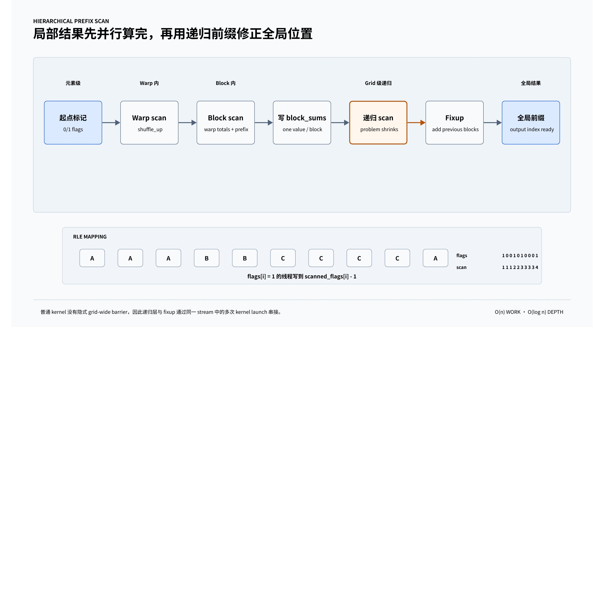

# GPU 上动态的调度 —— 从run-length-compression说起

```{contents} 本页目录
---
depth: 2
local: true
---
```

之前的例子中，我们对GPU的HBM的访问模式是**静态可确定**的，比如访问多少数据，访问的频率、模式等在代码编译阶段就已经确定。

现实中另外一类常见的case是，GPU对HBM的访问模式需要在runtime时，根据输入的计算结果，动态决定，也就是GPU的动态调度问题。

接下来我们用run-length encoding（RLE，游程压缩）的实现来说明这里动态调度的高性能计算如何在GPU上高效实现。

## 并行扫描问题



RLE 需要先判断每个位置是否为新 run 的起点，再把这些起点压缩写入连续的输出位置。每个线程可以独立完成判断，但它只有知道“前面已经出现了多少个起点”，才能确定自己的输出下标。这个从标记到位置的转换，就是 scan。

**Scan 把前缀依赖改写成树形归并**

给定输入 `x[0..n-1]`、二元运算 `⊕` 和单位元 `e`，scan 有两种常见定义：

| 类型 | 定义 | 输入 [3, 1, 7, 0] |
|-|-|-|
| Inclusive scan | `y[i] = x[0] ⊕ ... ⊕ x[i]` | `[3, 4, 11, 11]` |
| Exclusive scan | `y[i] = e ⊕ x[0] ⊕ ... ⊕ x[i-1]` | `[0, 3, 4, 11]` |

本节代码实现的是 **inclusive scan**。RLE 的起点标记是 0/1 数组，因此 `scanned_flags[i]` 表示从位置 0 到位置 i 一共出现了多少个 run。

scan 能够并行化，依赖的是运算符的**结合律**：

```
(a ⊕ b) ⊕ c = a ⊕ (b ⊕ c)
```

结合律允许算法先并行合并相邻片段，再逐层合并片段结果。运算不必满足交换律，因为 `Op::combine(left, right)` 始终保留输入顺序。加法、最大值和逻辑或都可以作为 scan 运算；减法不满足结合律，不能直接套用这套算法。

**GPU 用三级层次处理不同范围的数据依赖**

| 范围 | 通信方式 | 本节实现 | 同步边界 |
|-|-|-|-|
| Warp 内 | 寄存器之间交换 | `__shfl_up_sync` | warp 级原语 |
| Block 内 | 只把每个 warp 的总和放入 shared memory | 两次 warp scan | `__syncthreads()` |
| Grid 内 | 把每个 block 的总和写入 global memory | 递归 scan + fixup | 同一 CUDA stream 中的 kernel 顺序 |

这套层次化结构把一个长度为 n 的问题不断缩小：线程先在 warp 内合并，warp 再在 block 内合并，最后只对数量很少的 `block_sums` 递归执行同样的过程。固定 warp 和 block 大小时，总工作量随 n 线性增长；每一级的依赖深度则是对数级。

### Warp scan

使用 `__shfl_up_sync`，每一轮从 `delta` 个 lane 之前拿一个值过来，然后与当前线程的局部前缀合并：

```c++
template <typename Word, typename T>
__device__ __forceinline__ Word pack_bits(const T &v) {
    static_assert(
        sizeof(Word) >= sizeof(T),
        "Word size must be greater than or equal to size of T");
    static_assert(std::is_trivially_copyable_v<T>, "type T should be trivally copyable");
    Word word;
    std::memcpy(&word, &v, sizeof(T));
    return word;
}

template <typename Word, typename T>
__device__ __forceinline__ T unpack_bits(const Word &bits) {
    static_assert(
        sizeof(Word) >= sizeof(T),
        "Word size must be greater than or equal to size of T");
    static_assert(std::is_trivially_copyable_v<T>, "type T should be trivally copyable");
    T v;
    std::memcpy(&v, &bits, sizeof(T));
    return v;
}

template <typename T>
__device__ __forceinline__ T shuffle_up_any(unsigned int mask, T v, int delta) {
    static_assert(
        sizeof(T) <= sizeof(uint64_t),
        "do not support type that size is greater than 8");
    if constexpr (sizeof(T) <= sizeof(int)) {
        auto bits = pack_bits<int, T>(v);
        auto other_bits = __shfl_up_sync(mask, bits, delta);
        return unpack_bits<int, T>(other_bits);
    }
    auto bits = pack_bits<long long, T>(v);
    auto other_bits = __shfl_up_sync(mask, bits, delta);
    return unpack_bits<long long, T>(other_bits);
}

template <typename Op> __device__ typename Op::Data warp_scan(typename Op::Data v) {
    using Data = typename Op::Data;
    unsigned int mask = 0xffffffff;

    int lane = threadIdx.x & (WARP_SIZE - 1);
#pragma unroll
    for (int i = 1; i < WARP_SIZE; i *= 2) {
        Data other = Op::identity();
        other = shuffle_up_any(mask, v, i);
        if (lane >= i) {
            v = Op::combine(other, v);
        }
    }

    return v;
}
```

#### pack_bits 复制位模式，不做数值转换

`pack_bits` 和 `unpack_bits` 为 shuffle 准备传输载体。它们使用 `std::memcpy` 复制对象表示，不执行 `static_cast`，因此浮点数或小结构体的每一位都能原样保留，也不会触发违反 strict aliasing 的类型重解释。

| 约束 | 作用 |
|-|-|
| `sizeof(Word) >= sizeof(T)` | 载体必须容纳 T 的全部字节 |
| `std::is_trivially_copyable_v<T>` | 保证对象表示可以通过 `memcpy` 复制和恢复 |

`unpack_bits` 把相同数量的字节复制回 T，完成位模式的往返。

#### shuffle_up_any 把小对象接入 warp shuffle

`shuffle_up_any` 把不超过 8 字节的 trivially copyable 类型分成两条路径：

- `sizeof(T) <= 4`：打包成 32 位 `int`。
- `4 < sizeof(T) <= 8`：打包成 64 位 `long long`。

`if constexpr` 在编译期选择分支，没有运行时判断。`__shfl_up_sync(mask, bits, delta)` 让当前 lane 读取物理编号为 `lane-delta` 的寄存器值，数据直接经过 warp shuffle 网络传递，不经过 shared memory。

这个封装 shuffle 的是对象位模式，因此不仅能处理 `uint32_t`，也能处理大小不超过 8 字节的小型结构体。它不支持更大的类型；更大对象需要拆成多个 32 位或 64 位 word，分别执行 shuffle。

#### 五轮倍增构造 inclusive scan

`warp_scan` 是一个 warp 内的 inclusive scan。假设 lane `j` 的输入是 `x[j]`，返回值为：

```c++
lane 0: x[0]
lane 1: combine(x[0], x[1])
lane 2: combine(combine(x[0], x[1]), x[2])
...
lane 31: combine(x[0], ..., x[31])
```

循环中的距离依次为 1、2、4、8、16。每轮结束后，一个 lane 已知的连续前缀长度翻倍：

| `i` | 当前 lane 最多合并的连续元素数 |
|-|-|
| 1 | 2 |
| 2 | 4 |
| 4 | 8 |
| 8 | 16 |
| 16 | 32 |

当 `lane >= i` 时，当前 lane 才拥有合法的左侧来源，于是执行 `Op::combine(other, v)`。参数顺序很重要：`other` 是左侧较早出现的前缀，`v` 是右侧当前前缀。这样即使 `combine` 不满足交换律，也能保持从 lane 0 到当前 lane 的顺序。算法要求 `combine` 满足结合律，否则并行分组可能改变结果。

`Op` 需要提供 `Data` 类型和 `combine(left, right)`。

#### 八个 lane 的求和示例

用前 8 个 lane 演示加法 scan，初始输入为 `[1,2,3,4,5,6,7,8]`：

```text
初始：    [1, 2, 3, 4, 5, 6, 7, 8]
delta=1：[1, 3, 5, 7, 9, 11, 13, 15]
delta=2：[1, 3, 6, 10, 14, 18, 22, 26]
delta=4：[1, 3, 6, 10, 15, 21, 28, 36]
```

每个 lane 最终得到包含自身的前缀和，因此这是 inclusive scan。最后一个有效 lane 的结果同时也是整个 warp 的 reduction。若要得到 exclusive scan，可以把 inclusive 结果再向上移动一个 lane，并让 lane 0 返回单位元。

#### 使用前提和代码边界

- `mask = 0xffffffff` 要求 32 个 lane 都处于活动且收敛的状态，并以相同 mask 执行该 intrinsic。部分 warp 或分支内调用需要构造正确的参与者 mask；仅替换成 `__activemask()` 也不会自动把稀疏 lane 压缩成连续序列。
- `threadIdx.x & (WARP_SIZE-1)` 只在一维 block，或 `blockDim.x` 是 warp 大小整数倍时，才能等价于真实 lane ID。多维 block 的稳妥写法是先计算线性 thread ID，再对 32 取模。
- 循环假设 `WARP_SIZE` 是 2 的幂；在 NVIDIA CUDA 上通常取 32。当前文件中没有给出它的定义，需要由外部头文件或常量提供。
- 低于 `delta` 的 lane 会忽略 shuffle 返回值，因此不需要先把 `other` 设成 `Op::identity()`。可以直接写成 `Data other = shuffle_up_any(mask, v, i);`。
- 算法只在 warp 内交换寄存器，不需要 shared memory，也不需要 `__syncthreads()`。跨 warp 的 block scan 仍需额外的 warp totals、共享内存和 block 级同步。


### Block scan

只做 warp 内 scan 还不够，因为一个 block (通常)有 1024 个线程，也就是 32 个 warp。当前实现的 `block_scan` 使用了标准的两级结构：

1. 每个 warp 先独立做自己的 inclusive scan。
2. 每个 warp 的最后一个 lane 把该 warp 的总和写入 shared memory。
3. 第 0 个 warp 再对这些 warp sums 做一次 scan。
4. 除了第 0 个 warp 之外，其他 warp 再把自己的 warp prefix 加回本 warp 内的局部结果。

这就是一个很典型的 hierarchical scan。

```c++
template <typename Op>
__device__ typename Op::Data
block_scan(typename Op::Data v, typename Op::Data *shared_warp_sums) {
    using Data = typename Op::Data;

    int lane = threadIdx.x & (WARP_SIZE - 1);
    int warp_id = threadIdx.x / WARP_SIZE;

    v = warp_scan<Op>(v);
    if (lane == WARP_SIZE - 1) {
        shared_warp_sums[warp_id] = v;
    }

    __syncthreads();

    Data *scaned_warp_sums = shared_warp_sums;

    if (warp_id == 0) {
        Data warp_sum =
            lane < NUM_WARPS_PER_BLOCK ? shared_warp_sums[lane] : Op::identity();
        Data sum = warp_scan<Op>(warp_sum);
        scaned_warp_sums[lane] = sum;
    }

    __syncthreads();

    if (warp_id > 0) {
        Data prefix = scaned_warp_sums[warp_id - 1];
        v = Op::combine(prefix, v);
    }

    return v;
}
```

#### 两个 warp 如何拼成一个 block scan

为了缩短例子，假设一个 block 有 8 个线程，每个 warp 只有 4 个 lane。输入为：

```
warp 0: [2, 1, 3, 4]
warp 1: [5, 2, 1, 6]
```

| 阶段 | warp 0 | warp 1 | shared_warp_sums |
|-|-|-|-|
| 各自做 local scan | `[2, 3, 6, 10]` | `[5, 7, 8, 14]` | `[10, 14]` |
| warp 0 扫描各 warp 总和 | 不变 | 不变 | `[10, 24]` |
| 加回前面 warp 的总和 | `[2, 3, 6, 10]` | `[15, 17, 18, 24]` | `[10, 24]` |

warp 1 需要的前缀是 `scanned_warp_sums[0] = 10`，也就是它前面所有 warp 的总和。warp 0 前面没有数据，因此不做修正。最终结果为 `[2, 3, 6, 10, 15, 17, 18, 24]`。

这一实现只在 shared memory 中保存每个 warp 的一个总和。一个 1024 线程 block 有 32 个 warp，因此第二次 scan 最多处理 32 个值，正好由 warp 0 一次完成。两次 `__syncthreads()` 分别保证：

- warp 0 开始读取前，所有 warp 都已经写出自己的总和；
- 其他 warp 读取前，warp 0 已经写完 `scanned_warp_sums`。

数组最后一个 block 可能只有部分有效元素。代码仍启动完整的 `BLOCK_SIZE` 个线程，让越界线程贡献单位元。只要单位元满足 `e ⊕ x = x`，最后一个线程得到的值仍是该 block 所有有效元素的总和。

#### warp_id-1 把 inclusive 总和变成跨 warp 偏移

第二次 `warp_scan` 结束后，`scanned_warp_sums[q]` 表示从 warp 0 到 warp q 的 inclusive 总和。warp p 的局部结果已经包含本 warp 的数据，因此只需要补上它之前所有 warp 的总和：

```text
warp 0 的偏移：identity
warp 1 的偏移：scanned_warp_sums[0]
warp 2 的偏移：scanned_warp_sums[1]
...
warp p 的偏移：scanned_warp_sums[p-1]
```

这就是第 82 行读取 `warp_id-1` 的原因。warp 0 前面没有其他 warp，所以通过 `if (warp_id > 0)` 保留原来的局部前缀。`Op::combine(prefix, v)` 中，跨 warp 前缀放在左边，本 warp 的局部前缀放在右边；对于不满足交换律、但满足结合律的运算，这个顺序仍能保持原始线程顺序。

#### 共享数组被原地改写为 warp 前缀

`scaned_warp_sums` 只是 `shared_warp_sums` 的别名，没有申请第二块 shared memory。数据在同一个数组中经历两个状态：

| 阶段 | 数组含义 |
|-|-|
| 第一次同步前 | 每个 warp 的最后一个 lane 写入本 warp 总和 |
| warp 0 执行第二次 scan 后 | 数组被覆盖为各 warp 总和的 inclusive 前缀 |

这种原地复用是安全的，因为第一次 `__syncthreads()` 之后，warp 0 先把需要的 warp totals 读入寄存器，再执行 warp scan 和写回。第二次 `__syncthreads()` 保证其他 warp 读取时，覆盖后的前缀已经可见。变量名中的 `scaned` 是拼写问题，可以改为 `scanned_warp_sums`，不影响执行结果。

### grid 级 scan：递归扫描 block sums

单个 block 的结果还只是局部前缀和。要把整个数组拼起来，当前代码进一步引入了两个全局缓冲区：

- `block_sums`：每个 block 的总和
- `scanned_block_sums`：对 `block_sums` 再做一次 scan 的结果

整个流程是：

1. `blocks_scan_no_fixup` 对每个 block 内做扫描，并写出 `output` 和 `block_sums`。
2. `launch_scan_recursive` 递归地对 `block_sums` 做同样的扫描，得到 `scanned_block_sums`。
3. `fixup_kernel` 把前面所有 block 的前缀值加回当前 block 的每个元素。

```c++
template <typename Op>
__global__ void blocks_scan_no_fixup(
    const typename Op::Data *input,
    size_t n,
    typename Op::Data *output,
    typename Op::Data *block_sums) {

    using Data = typename Op::Data;
    extern __shared__ unsigned char sh_mem_raw[];

    int tid = blockIdx.x * blockDim.x + threadIdx.x;

    Data v = tid < n ? input[tid] : Op::identity();

    Data *shared_warp_sums = reinterpret_cast<Data *>(sh_mem_raw);
    v = block_scan<Op>(v, shared_warp_sums);

    if (tid < n) {
        output[tid] = v;
    }

    if (threadIdx.x == blockDim.x - 1 && block_sums != nullptr) {
        block_sums[blockIdx.x] = v;
    }
}

template <typename Op>
__global__ void
fixup_kernel(typename Op::Data *output, typename Op::Data *scanned_block_sums, size_t n) {
    using Data = typename Op::Data;
    int tid = blockIdx.x * blockDim.x + threadIdx.x;

    if (tid >= n) {
        return;
    }

    if (blockIdx.x == 0) {
        return;
    }

    Data prefix = scanned_block_sums[blockIdx.x - 1];
    output[tid] = Op::combine(prefix, output[tid]);
}
```

#### 跨 block 拼接仍然使用同一个模式

沿用上面的 8 个输入，假设每个 block 处理 4 个元素：

| 阶段 | block 0 | block 1 |
|-|-|-|
| 局部 scan | `[2, 3, 6, 10]` | `[5, 7, 8, 14]` |
| 写出 block 总和 | `10` | `14` |
| 扫描 `block_sums` | `10` | `24` |
| fixup | 不加前缀 | 每个元素加 `10` |
| 全局结果 | `[2, 3, 6, 10]` | `[15, 17, 18, 24]` |

如果 `block_sums` 仍然超过一个 block 能处理的范围，`launch_scan_recursive` 会再次生成更高一层的 block sums。输入规模每递归一层大约缩小为原来的 `1 / BLOCK_SIZE`，直到只剩一个 block。

CUDA 没有供普通 kernel 使用的隐式 grid-wide barrier，因此这段实现把全局同步拆成多次 kernel launch。同一 stream 中，后提交的 kernel 会在前一个 kernel 完成后再观察其结果。实际提交顺序为：

```
scan level 0 local blocks
  → scan level 1 block_sums
    → scan level 2 block_sums
    → fixup level 1
  → fixup level 0
```

递归发生在 host 端，它负责依次提交 kernel，并不表示 GPU 线程在 kernel 内递归。若这些 kernel 被改到不同 stream，需要用 event 或其他同步方式显式建立依赖。

#### 局部扫描同时产出 output 和 block_sums

`blocks_scan_no_fixup` 让一个线程对应一个输入元素，`tid = blockIdx.x * blockDim.x + threadIdx.x`。每个 block 调用前一节的 `block_scan`，因此此时得到的 `v` 只包含当前 block 内的 inclusive prefix，还没有计入更早的 block。

这个 kernel 写出两类结果：

| 输出 | 写入者 | 含义 |
|-|-|-|
| `output[tid]` | 每个有效线程 | 当前 block 内的局部 inclusive prefix |
| `block_sums[blockIdx.x]` | block 的最后一个线程 | 整个 block 的 reduction |

`block_sums != nullptr` 让第二类输出成为可选项。当上层不再需要继续递归时，可以传入空指针，避免写出 block totals。函数名中的 `no_fixup` 表示第一类输出仍是局部前缀，必须等更高层的 block sums 被扫描后再修正。

#### 尾块用单位元保持完整同步结构

最后一个 block 往往装不满。代码没有让越界线程提前返回，而是让它们参与完整的 `block_scan`：

```c++
Data v = tid < n ? input[tid] : Op::identity();
```

这样所有线程仍会到达 `block_scan` 内的两次 `__syncthreads()`，不会产生 barrier divergence。只要 `identity` 满足 `combine(x, identity) = x`，位于有效数据之后的填充线程就不会改变 block 总和。越界线程不写 `output`，但最后一个物理线程仍可把有效元素的总和写进 `block_sums`。

#### fixup 把局部前缀改成全局前缀

递归扫描完成后，`scanned_block_sums[b]` 表示 block 0 到 block b 的 inclusive 总和。block b 的每个局部结果需要加上它之前所有 block 的总和，因此读取：

```c++
Data prefix = scanned_block_sums[blockIdx.x - 1];
output[tid] = Op::combine(prefix, output[tid]);
```

block 0 前面没有数据，原来的局部前缀已经等于全局前缀，所以直接返回。越界线程也可以提前返回，因为 `fixup_kernel` 中没有 block barrier。这里的 `scanned_block_sums` 只读不写，参数可以声明为 `const Data *`。

fixup 必须使用与局部扫描相同的 block 切分，使 `blockIdx.x` 仍对应同一段输入。`Op::combine(prefix, output[tid])` 的顺序也必须保持不变，才能支持满足结合律但不满足交换律的操作。

#### 动态 shared memory 要同时满足容量与对齐

`sh_mem_raw` 是启动 kernel 时传入的动态 shared memory，随后被解释成 `Data *`，供 `block_scan` 保存 warp totals。结合当前 `block_scan` 的写法，容量至少应为：

```text
WARP_SIZE * sizeof(Data)
```

原因是 warp 0 的全部 32 个 lane 都会写 `shared_warp_sums[lane]`。如果前一节按实际 warp 数量限制写回，容量才可以缩小为 `NUM_WARPS_PER_BLOCK * sizeof(Data)`。

将 `unsigned char *` 转为 `Data *` 还要求起始地址满足 `alignof(Data)`。为了让约束明确，可以直接声明动态共享数组为 `Data` 类型，或为原始字节数组指定足够的 alignment。否则，对于对齐要求较高的自定义 `Data`，单靠 `reinterpret_cast` 不能保证访问合法。

### 整体scan 流程

```c++
template <typename Op>
void launch_scan_recursive(
    typename Op::Data *input,
    size_t n,
    typename Op::Data *output,
    unsigned char *workspace,
    size_t workspace_offset) {
    using Data = typename Op::Data;
    // int tid = blockIdx.x * blockDim.x + threadIdx.x;

    if (n == 0) {
        return;
    }

    int num_blocks = (n + BLOCK_SIZE - 1) / BLOCK_SIZE;
    size_t shared_bytes = 2 * NUM_WARPS_PER_BLOCK * sizeof(Data);
    if (num_blocks == 1) {
        blocks_scan_no_fixup<Op>
            <<<1, BLOCK_SIZE, shared_bytes>>>(input, n, output, nullptr);
        CUDA_CHECK(cudaGetLastError());
        return;
    }

    Data *block_sums = reinterpret_cast<Data *>(workspace + workspace_offset);
    workspace_offset += num_blocks * sizeof(Data);
    workspace_offset = (workspace_offset + 256) & ~255;

    Data *scanned_block_sums = reinterpret_cast<Data *>(workspace + workspace_offset);
    workspace_offset += num_blocks * sizeof(Data);
    workspace_offset = (workspace_offset + 256) & ~255;

    blocks_scan_no_fixup<Op>
        <<<num_blocks, BLOCK_SIZE, shared_bytes>>>(input, n, output, block_sums);
    CUDA_CHECK(cudaGetLastError());

    launch_scan_recursive<Op>(
        block_sums,
        num_blocks,
        scanned_block_sums,
        workspace,
        workspace_offset);
    CUDA_CHECK(cudaGetLastError());

    fixup_kernel<Op>
        <<<num_blocks, BLOCK_SIZE, shared_bytes>>>(output, scanned_block_sums, n);
    CUDA_CHECK(cudaGetLastError());
}

template <typename Op>
typename Op::Data *launch_scan(
    size_t n,
    typename Op::Data *x, // pointer to GPU memory
    void *workspace       // pointer to GPU memory
) {
    using Data = typename Op::Data;
    Data *output = reinterpret_cast<Data *>(workspace);
    size_t workspace_offset = n * sizeof(Data);
    launch_scan_recursive<Op>(
        x,
        n,
        output,
        reinterpret_cast<unsigned char *>(workspace),
        workspace_offset);
    return output;
}

```

#### RLE 例子：scan 怎样把动态输出变成确定下标

输入字符串为 `AAABBCCCCA`。每个线程只比较当前位置与前一个位置，得到 run 起点标记：

```
index:          0 1 2 3 4 5 6 7 8 9
raw:            A A A B B C C C C A
flags:          1 0 0 1 0 1 0 0 0 1
inclusive scan: 1 1 1 2 2 3 3 3 3 4
```

只有 `flags[i] == 1` 的线程参与写出。它的输出下标为 `scanned_flags[i] - 1`：

| 输入位置 | 字符 | scan 值 | 输出下标 |
|-|-|-|-|
| 0 | A | 1 | 0 |
| 3 | B | 2 | 1 |
| 5 | C | 3 | 2 |
| 9 | A | 4 | 3 |

于是 `compressed_data = [A, B, C, A]`，`run_starts = [0, 3, 5, 9]`。相邻起点相减得到 `compressed_lengths = [3, 2, 4, 1]`。最后一个 scan 值 4 同时就是 run 的数量。

#### 这套实现为什么高效

| 设计 | 减少的成本 |
|-|-|
| Warp 中用 shuffle | 避免为每一轮前缀传播读写 shared memory |
| Block 中只保存 warp totals | shared memory 用量从每线程一个元素缩小到每 warp 一个元素 |
| 只递归扫描 block totals | 更高层输入迅速缩小，绝大多数数据只参与底层扫描 |
| 单独执行 fixup | 用规则、合并的全局内存访问把 block 前缀批量加回 |
| 尾部线程使用单位元 | 主循环无需为最后一个 block 维护另一套算法 |

对固定的 warp 和 block 大小，算术工作量为 O(n)，额外的 block summaries 形成几何递减序列。当前递归多 kernel 实现便于理解和验证，代价是额外的 kernel launch、`block_sums` 流量以及一次 fixup 读写。

#### 递归只处理逐层缩小的 block_sums

`launch_scan_recursive` 是 host 函数，不是 GPU kernel。它每一层先计算 `num_blocks = ceil(n / BLOCK_SIZE)`。当 `num_blocks == 1` 时，一个 block 已经能扫描完整输入，直接启动一次 `blocks_scan_no_fixup`，并把 `block_sums` 设为空指针；此时局部前缀就是全局前缀，不需要继续递归，也不需要 fixup。

当输入需要多个 block 时，本层先生成长度为 `num_blocks` 的 `block_sums`，再递归扫描这段更短的数据。递归规模满足：

```text
n_next = ceil(n_current / BLOCK_SIZE)
```

因此递归深度约为 `log_BLOCK_SIZE(n)`。对于当前 `BLOCK_SIZE=1024`，每深入一层，元素数量约缩小 1024 倍。

#### workspace_offset 让各递归层互不覆盖

当前层从 `workspace + workspace_offset` 依次切出两段 GPU 缓冲区：

| 缓冲区 | 元素数 | 用途 |
|-|-|-|
| `block_sums` | `num_blocks` | 保存当前层每个 block 的 reduction |
| `scanned_block_sums` | `num_blocks` | 保存递归扫描后的 block 前缀 |

两段空间分配完成后，更新后的 `workspace_offset` 被传给下一层递归，所以更高层只会从后续地址继续分配。递归返回时，本层的 `scanned_block_sums` 仍然有效，可供 `fixup_kernel` 使用。

代码使用 `(offset + 256) & ~255` 做 256 字节对齐。它能得到对齐地址，但当 offset 原本已经对齐时，仍会额外跳过 256 字节。标准的 align-up 写法是 `(offset + 255) & ~size_t{255}`。两种写法都可以工作，但 workspace 大小计算必须与实际切片公式完全一致，否则可能少分配或浪费空间。

#### 递归向下提交 scan，返回时向上提交 fixup

多 block 分支的 host 执行顺序是：

```text
提交当前层 blocks_scan_no_fixup
  → 递归提交下一层 scan
    → 下一层继续递归并提交自己的 fixup
  → 提交当前层 fixup_kernel
```

kernel launch 对 host 是异步的，所以 C++ 递归返回不代表 GPU 已经算完。正确性依赖这些 kernel 被提交到同一 stream：同一 stream 保证执行顺序，当前层 fixup 会在递归层生成 `scanned_block_sums` 后执行。如果以后给接口增加 stream 参数，所有递归 launch 必须沿用同一个 stream；跨 stream 时需要 event 建立依赖。

`cudaGetLastError()` 只检查 launch 配置等即时错误，不会等待 kernel 完成，也不能在这里发现大多数异步执行错误。调用链末端仍需要通过同步点或后续 CUDA API 检查运行期错误。递归调用后的那次 `cudaGetLastError()` 通常也是冗余的，因为递归内部已经逐次检查自己的 launch。

#### launch_scan 把 workspace 首段作为最终输出

`launch_scan` 不单独分配输出数组，而是把调用方提供的 GPU workspace 起始地址解释成 `Data *`：

```c++
Data *output = reinterpret_cast<Data *>(workspace);
size_t workspace_offset = n * sizeof(Data);
```

因此 workspace 的布局从长度为 n 的最终输出开始，递归临时区紧随其后。函数返回的指针仍指向这块 workspace，生命周期由调用方管理。调用方必须保证 workspace 位于 GPU 可访问内存、起始地址满足 `alignof(Data)`，并且总容量覆盖输出区、每层两段 block sums 以及所有对齐空隙。`n == 0` 时不会启动 kernel，但返回值仍是 workspace 的起始地址，调用方不应解引用任何元素。

#### 当前启动代码还有三个可收紧之处

- `num_blocks` 使用 `int`，而 `n` 是 `size_t`。超大输入可能在窄化转换时溢出；可以使用 `size_t` 计算，并在传给 grid 维度前检查设备限制。
- 当前 `block_scan` 只使用一段 warp totals 数组，但 `shared_bytes` 按 `2 * NUM_WARPS_PER_BLOCK` 个 `Data` 计算。对于当前 32 个 warp 的 block，它会保留 64 个元素，容量安全但有一半未使用。
- `fixup_kernel` 没有动态 shared memory，却仍以 `<<<num_blocks, BLOCK_SIZE, shared_bytes>>>` 启动。这段共享内存不会被访问，可以把第三个 launch 参数去掉，避免无意义的资源预留。

### workspace size

#### Workspace 对应递归树上的每一层

scan 自身首先需要长度为 n 的输出区。随后，每个递归层级都需要两段临时空间：一段保存该层的 `block_sums`，另一段保存扫描后的 `scanned_block_sums`。忽略对齐时，空间可以写成：

```
n × sizeof(Data)
+ Σlevel 2 × ceil(n_level / BLOCK_SIZE) × sizeof(Data)
```

实际代码在每次分配后把 offset 向上对齐到 256 字节，所以精确计算器也应逐段执行相同的对齐。示例中的 `total += 4096` 是为多层对齐预留的安全余量，并不是算法本身固定需要 4096 字节。

RLE 还会在 scan workspace 之前分配 `flags`、`scanned_flags` 和 `run_starts`。调用方必须按与执行路径相同的顺序和对齐规则计算大小，否则小规模测试可能正常，大规模输入却会让后一级缓冲区覆盖前一级结果。

```c++
template <typename Op> size_t get_workspace_size(size_t n) {
    using Data = typename Op::Data;

    size_t total = n * sizeof(Data);
    while (n > 1) {
        size_t num_blocks = (n + BLOCK_SIZE - 1) / BLOCK_SIZE;
        total += 2 * num_blocks * sizeof(Data);
        n = num_blocks;
    }
    total += 4096;
    return total;
}
```

#### 正确性边界和工程选择

| 检查项 | 当前代码的要求 |
|-|-|
| 运算符 | `combine` 满足结合律，并提供左右都成立的单位元 |
| 浮点加法 | 数学上可结合，但有限精度下改变归并顺序会改变末位舍入，结果可能与 CPU 串行累加略有差异 |
| Warp 参与者 | 所有掩码中标出的 lane 必须执行同一 warp 原语；当前全掩码依赖完整 warp 参与 |
| Block 形状 | 当前实现按 `BLOCK_SIZE = 1024` 和 32 个 warp 编译、分配空间并启动；改动 block 大小时必须同步重算 warp 数，并让不存在的 warp total 使用单位元 |
| 尾部处理 | 越界线程必须输入单位元，写回时仍要检查 `tid < n` |
| Kernel 顺序 | local scan、递归 scan 和 fixup 位于同一 stream，或由 event 显式同步 |

生产代码通常优先使用 CUB 的 `cub::DeviceScan` 或 Thrust 的 scan。CUB 的 device-wide scan 采用 decoupled look-back，把局部扫描和跨分区前缀传播重叠起来，可以减少多轮 kernel 和全局内存流量。本节的递归实现更适合学习层次化 scan、定制小型数据结构，或者验证特殊 `Op`；追求通用性能时，应先用成熟库建立基线。


## Run length compression

run-length compression 可以很好展示了“如何把一个动态调度问题变成 scan 能解决的问题”。

run-length compression本身很简单，对应的cpu实现如下：

```c++
void rle_compress_cpu(
    uint32_t raw_count,
    char const *raw,
    std::vector<char> &compressed_data,
    std::vector<uint32_t> &compressed_lengths) {
    compressed_data.clear();
    compressed_lengths.clear();

    uint32_t i = 0;
    while (i < raw_count) {
        char c = raw[i];
        uint32_t run_length = 1;
        i++;
        while (i < raw_count && raw[i] == c) {
            run_length++;
            i++;
        }
        compressed_data.push_back(c);
        compressed_lengths.push_back(run_length);
    }
}


```

这正是 GPU 最头疼的一类问题：不规则输出定位。

下面介绍一种并行算法设计中的经典套路。它并不直接问“每个 run 应该写到哪里”，而是先构造一个辅助视角：哪些位置是一个 run 的起点？

如果当前位置是某个新 run 的开始，就标记为 1；否则标记为 0。这样一来，原始问题就变成了一个 0/1 数组上的计数问题。而一旦是计数问题，scan 就能派上用场了。

对这个 0/1 数组做前缀和后，每个位置都会知道“到我这里为止，已经出现了多少个 run”。于是，如果某个位置恰好是 run 的起点，那么它在压缩输出中的下标就等于这个前缀和减一。原本那个“必须等前面都做完才知道写哪里”的动态问题，就这样被转换成了一个可以并行计算的索引问题。

这一步转化非常关键，也非常有代表性。它说明很多不规则问题的难点，不在于“GPU 不能算”，而在于你有没有找到一个合适的中间表示。这里的中间表示就是 run boundary，也就是“run 起点标记”。一旦找到它，后面的工作就重新回到了 GPU 擅长的轨道上：局部判断、前缀扫描、按索引写入。

事实上，这种“标记 + scan + 压缩写出”的模式在 GPU 编程里极其常见。比如过滤满足条件的元素、删除无效项、紧凑存储、生成输出索引，背后都常常能看到 scan 的影子。scan 并不是一个孤立的算法题，而更像是并行程序设计中的一种通用基础设施。

完整的实现可以参考：

```c++
constexpr int WARP_SIZE = 32;
constexpr int BLOCK_SIZE = 1024;
constexpr int NUM_WARPS_PER_BLOCK = (BLOCK_SIZE + WARP_SIZE - 1) / WARP_SIZE;

__global__ void mark_flags(char const *raw, uint32_t *flags, uint32_t raw_count) {
    int tid = blockIdx.x * blockDim.x + threadIdx.x;
    if (tid >= raw_count) {
        return;
    }
    flags[tid] = (tid == 0 || raw[tid] != raw[tid - 1]) ? 1u : 0u;
}

__global__ void scatter_run_starts(
    char const *raw,
    uint32_t const *flags,
    uint32_t const *scanned_flags,
    uint32_t *run_starts,
    char *compressed_data,
    uint32_t raw_count) {

    int tid = blockIdx.x * blockDim.x + threadIdx.x;
    if (tid >= raw_count || flags[tid] == 0) {
        return;
    }

    uint32_t run_idx = scanned_flags[tid] - 1;
    run_starts[run_idx] = tid;
    compressed_data[run_idx] = raw[tid];
}

__global__ void finalize_run_lengths(
    uint32_t const *run_starts,
    uint32_t compressed_count,
    uint32_t raw_count,
    uint32_t *compressed_lengths) {
    int tid = blockIdx.x * blockDim.x + threadIdx.x;
    if (tid >= compressed_count) {
        return;
    }

    uint32_t start = run_starts[tid];
    uint32_t end = tid + 1 < compressed_count ? run_starts[tid + 1] : raw_count;
    compressed_lengths[tid] = end - start;
}

// Returns desired size of scratch buffer in bytes.
size_t get_workspace_size(uint32_t raw_count) {
    size_t total = 0;

    total += raw_count * sizeof(uint32_t); // flags
    total = (total + 255) & ~size_t(255);

    total += raw_count * sizeof(uint32_t); // scanned_flags
    total = (total + 255) & ~size_t(255);

    total += raw_count * sizeof(uint32_t); // run_starts
    total = (total + 255) & ~size_t(255);

    uint32_t n = raw_count;
    while (n > 1) {
        size_t num_blocks = (n + BLOCK_SIZE - 1) / BLOCK_SIZE;
        total += 2 * num_blocks * sizeof(uint32_t);
        total = (total + 255) & ~size_t(255);
        n = num_blocks;
    }

    total += 4096;
    return total;
}

template <typename Word, typename T>
__device__ __forceinline__ Word pack_bits(const T &v) {
    static_assert(
        sizeof(Word) >= sizeof(T),
        "Word size must be greater than or equal to size of T");
    static_assert(std::is_trivially_copyable_v<T>, "type T should be trivally copyable");
    Word word;
    std::memcpy(&word, &v, sizeof(T));
    return word;
}

template <typename Word, typename T>
__device__ __forceinline__ T unpack_bits(const Word &bits) {
    static_assert(
        sizeof(Word) >= sizeof(T),
        "Word size must be greater than or equal to size of T");
    static_assert(std::is_trivially_copyable_v<T>, "type T should be trivally copyable");
    T v;
    std::memcpy(&v, &bits, sizeof(T));
    return v;
}

template <typename T>
__device__ __forceinline__ T shuffle_up_any(unsigned int mask, T v, int delta) {
    static_assert(
        sizeof(T) <= sizeof(uint64_t),
        "do not support type that size is greater than 8");
    if constexpr (sizeof(T) <= sizeof(int)) {
        auto bits = pack_bits<int, T>(v);
        auto other_bits = __shfl_up_sync(mask, bits, delta);
        return unpack_bits<int, T>(other_bits);
    }
    auto bits = pack_bits<long long, T>(v);
    auto other_bits = __shfl_up_sync(mask, bits, delta);
    return unpack_bits<long long, T>(other_bits);
}

template <typename Op> __device__ typename Op::Data warp_scan(typename Op::Data v) {
    using Data = typename Op::Data;
    unsigned int mask = 0xffffffff;

    int lane = threadIdx.x & (WARP_SIZE - 1);
#pragma unroll
    for (int i = 1; i < WARP_SIZE; i *= 2) {
        Data other = Op::identity();
        other = shuffle_up_any(mask, v, i);
        if (lane >= i) {
            v = Op::combine(other, v);
        }
    }

    return v;
}

template <typename Op>
__device__ typename Op::Data
block_scan(typename Op::Data v, typename Op::Data *shared_warp_sums) {
    using Data = typename Op::Data;

    int lane = threadIdx.x & (WARP_SIZE - 1);
    int warp_id = threadIdx.x / WARP_SIZE;

    v = warp_scan<Op>(v);
    if (lane == WARP_SIZE - 1) {
        shared_warp_sums[warp_id] = v;
    }

    __syncthreads();

    Data *scaned_warp_sums = shared_warp_sums;

    if (warp_id == 0) {
        Data warp_sum =
            lane < NUM_WARPS_PER_BLOCK ? shared_warp_sums[lane] : Op::identity();
        Data sum = warp_scan<Op>(warp_sum);
        scaned_warp_sums[lane] = sum;
    }

    __syncthreads();

    if (warp_id > 0) {
        Data prefix = scaned_warp_sums[warp_id - 1];
        v = Op::combine(prefix, v);
    }

    return v;
}

template <typename Op>
__global__ void blocks_scan_no_fixup(
    const typename Op::Data *input,
    size_t n,
    typename Op::Data *output,
    typename Op::Data *block_sums) {

    using Data = typename Op::Data;
    extern __shared__ unsigned char sh_mem_raw[];

    int tid = blockIdx.x * blockDim.x + threadIdx.x;

    Data v = tid < n ? input[tid] : Op::identity();

    Data *shared_warp_sums = reinterpret_cast<Data *>(sh_mem_raw);
    v = block_scan<Op>(v, shared_warp_sums);

    if (tid < n) {
        output[tid] = v;
    }

    if (threadIdx.x == blockDim.x - 1 && block_sums != nullptr) {
        block_sums[blockIdx.x] = v;
    }
}

template <typename Op>
__global__ void
fixup_kernel(typename Op::Data *output, typename Op::Data *scanned_block_sums, size_t n) {
    using Data = typename Op::Data;
    int tid = blockIdx.x * blockDim.x + threadIdx.x;

    if (tid >= n) {
        return;
    }

    if (blockIdx.x == 0) {
        return;
    }

    Data prefix = scanned_block_sums[blockIdx.x - 1];
    output[tid] = Op::combine(prefix, output[tid]);
}

template <typename Op>
void launch_scan_recursive(
    typename Op::Data *input,
    size_t n,
    typename Op::Data *output,
    unsigned char *workspace,
    size_t workspace_offset) {
    using Data = typename Op::Data;
    // int tid = blockIdx.x * blockDim.x + threadIdx.x;

    if (n == 0) {
        return;
    }

    int num_blocks = (n + BLOCK_SIZE - 1) / BLOCK_SIZE;
    size_t shared_bytes = 2 * NUM_WARPS_PER_BLOCK * sizeof(Data);
    if (num_blocks == 1) {
        blocks_scan_no_fixup<Op>
            <<<1, BLOCK_SIZE, shared_bytes>>>(input, n, output, nullptr);
        CUDA_CHECK(cudaGetLastError());
        return;
    }

    Data *block_sums = reinterpret_cast<Data *>(workspace + workspace_offset);
    workspace_offset += num_blocks * sizeof(Data);
    workspace_offset = (workspace_offset + 256) & ~255;

    Data *scanned_block_sums = reinterpret_cast<Data *>(workspace + workspace_offset);
    workspace_offset += num_blocks * sizeof(Data);
    workspace_offset = (workspace_offset + 256) & ~255;

    blocks_scan_no_fixup<Op>
        <<<num_blocks, BLOCK_SIZE, shared_bytes>>>(input, n, output, block_sums);
    CUDA_CHECK(cudaGetLastError());

    launch_scan_recursive<Op>(
        block_sums,
        num_blocks,
        scanned_block_sums,
        workspace,
        workspace_offset);
    CUDA_CHECK(cudaGetLastError());

    fixup_kernel<Op>
        <<<num_blocks, BLOCK_SIZE, shared_bytes>>>(output, scanned_block_sums, n);
    CUDA_CHECK(cudaGetLastError());
}

template <typename Op>
typename Op::Data *launch_scan(
    size_t n,
    typename Op::Data *x, // pointer to GPU memory
    typename Op::Data *output,
    void *workspace,
    size_t workspace_offset) {

    using Data = typename Op::Data;
    launch_scan_recursive<Op>(
        x,
        n,
        output,
        reinterpret_cast<unsigned char *>(workspace),
        workspace_offset);
    return output;
}

__forceinline__ size_t align256(const size_t &offset) {
    return (offset + 255) & ~size_t(255);
}

struct SumOp {
    using Data = uint32_t;

    static __host__ __device__ __forceinline__ Data identity() { return 0; }

    static __host__ __device__ __forceinline__ Data combine(Data a, Data b) {
        return a + b;
    }

    static std::string to_string(Data d) { return std::to_string(d); }
};

// 'launch_rle_compress'
//
// Input:
//
//   'raw_count': Number of bytes in the input buffer 'raw'.
//
//   'raw': Uncompressed bytes in GPU memory.
//
//   'workspace': Scratch buffer in GPU memory. The size of the scratch buffer
//   in bytes is determined by 'get_workspace_size'.
//
// Output:
//
//   Returns: 'compressed_count', the number of runs in the compressed data.
//
//   'compressed_data': Output buffer of size 'raw_count' in GPU memory. The
//   function should fill the first 'compressed_count' bytes of this buffer
//   with the compressed data.
//
//   'compressed_lengths': Output buffer of size 'raw_count' in GPU memory. The
//   function should fill the first 'compressed_count' integers in this buffer
//   with the lengths of the runs in the compressed data.
//
uint32_t launch_rle_compress(
    uint32_t raw_count,
    char const *raw,             // pointer to GPU buffer
    void *workspace,             // pointer to GPU buffer
    char *compressed_data,       // pointer to GPU buffer
    uint32_t *compressed_lengths // pointer to GPU buffer
) {
    if (raw_count == 0) {
        return 0;
    }

    size_t offset = 0;
    unsigned char *ws = reinterpret_cast<unsigned char *>(workspace);

    uint32_t *flags = reinterpret_cast<uint32_t *>(ws + offset);
    offset += raw_count * sizeof(uint32_t);
    offset = align256(offset);

    uint32_t *scanned_flags = reinterpret_cast<uint32_t *>(ws + offset);
    offset += raw_count * sizeof(uint32_t);
    offset = align256(offset);

    uint32_t *run_starts = reinterpret_cast<uint32_t *>(ws + offset);
    offset += raw_count * sizeof(uint32_t);
    offset = align256(offset);

    int num_blocks = (raw_count + BLOCK_SIZE - 1) / BLOCK_SIZE;

    mark_flags<<<num_blocks, BLOCK_SIZE>>>(raw, flags, raw_count);
    CUDA_CHECK(cudaGetLastError());

    launch_scan<SumOp>(raw_count, flags, scanned_flags, workspace, offset);
    CUDA_CHECK(cudaGetLastError());

    uint32_t compressed_count = 0;
    CUDA_CHECK(cudaMemcpy(
        &compressed_count,
        scanned_flags + (raw_count - 1),
        sizeof(uint32_t),
        cudaMemcpyDeviceToHost));

    scatter_run_starts<<<num_blocks, BLOCK_SIZE>>>(
        raw,
        flags,
        scanned_flags,
        run_starts,
        compressed_data,
        raw_count);
    CUDA_CHECK(cudaGetLastError());

    int run_blocks = (compressed_count + BLOCK_SIZE - 1) / BLOCK_SIZE;
    finalize_run_lengths<<<run_blocks, BLOCK_SIZE>>>(
        run_starts,
        compressed_count,
        raw_count,
        compressed_lengths);
    CUDA_CHECK(cudaGetLastError());

    return compressed_count;
}

```


## Run length decompression

Run length decompression则是Run length compression的逆过程。主要过程如下：

1. Scan compress_length 前缀和生成run_starts
2. 并写写数据：对第 i 个run知道了其在原始数据的起点为 run_starts[i], 重点为run_starts[i+1]。

其中并写数据的方案有多种：

1. 每个 thread 负责写一个run
2. 每个 warp 写一个run
3. 每个block写一个run
4. tiled：每个 warp 负责原始数据的一块连续区域

前三种方式很难单独使用，因为run的长度很不均匀，会导致gpu thread负载严重不平衡，通常需要先预先扫描每个run，根据run的工作量来进行灵活的分配。

  
下面给出第4方案的参考代码：

```c++

constexpr int WARP_SIZE = 32;
constexpr int BLOCK_SIZE = 1024;
constexpr int NUM_WARPS_PER_BLOCK = (BLOCK_SIZE + WARP_SIZE - 1) / WARP_SIZE;

template <typename Word, typename T>
__device__ __forceinline__ Word pack_bits(const T &v) {
    static_assert(
        sizeof(Word) >= sizeof(T),
        "Word size must be greater than or equal to size of T");
    static_assert(std::is_trivially_copyable_v<T>, "type T should be trivally copyable");
    Word word;
    std::memcpy(&word, &v, sizeof(T));
    return word;
}

template <typename Word, typename T>
__device__ __forceinline__ T unpack_bits(const Word &bits) {
    static_assert(
        sizeof(Word) >= sizeof(T),
        "Word size must be greater than or equal to size of T");
    static_assert(std::is_trivially_copyable_v<T>, "type T should be trivally copyable");
    T v;
    std::memcpy(&v, &bits, sizeof(T));
    return v;
}

template <typename T>
__device__ __forceinline__ T shuffle_up_any(unsigned int mask, T v, int delta) {
    static_assert(
        sizeof(T) <= sizeof(uint64_t),
        "do not support type that size is greater than 8");
    if constexpr (sizeof(T) <= sizeof(int)) {
        auto bits = pack_bits<int, T>(v);
        auto other_bits = __shfl_up_sync(mask, bits, delta);
        return unpack_bits<int, T>(other_bits);
    }
    auto bits = pack_bits<long long, T>(v);
    auto other_bits = __shfl_up_sync(mask, bits, delta);
    return unpack_bits<long long, T>(other_bits);
}

template <typename Op> __device__ typename Op::Data warp_scan(typename Op::Data v) {
    using Data = typename Op::Data;
    unsigned int mask = 0xffffffff;

    int lane = threadIdx.x & (WARP_SIZE - 1);
#pragma unroll
    for (int i = 1; i < WARP_SIZE; i *= 2) {
        Data other = Op::identity();
        other = shuffle_up_any(mask, v, i);
        if (lane >= i) {
            v = Op::combine(other, v);
        }
    }

    return v;
}

template <typename Op>
__device__ typename Op::Data
block_scan(typename Op::Data v, typename Op::Data *shared_warp_sums) {
    using Data = typename Op::Data;

    int lane = threadIdx.x & (WARP_SIZE - 1);
    int warp_id = threadIdx.x / WARP_SIZE;

    v = warp_scan<Op>(v);
    if (lane == WARP_SIZE - 1) {
        shared_warp_sums[warp_id] = v;
    }

    __syncthreads();

    Data *scaned_warp_sums = shared_warp_sums;

    if (warp_id == 0) {
        Data warp_sum =
            lane < NUM_WARPS_PER_BLOCK ? shared_warp_sums[lane] : Op::identity();
        Data sum = warp_scan<Op>(warp_sum);
        scaned_warp_sums[lane] = sum;
    }

    __syncthreads();

    if (warp_id > 0) {
        Data prefix = scaned_warp_sums[warp_id - 1];
        v = Op::combine(prefix, v);
    }

    return v;
}

template <typename Op>
__global__ void blocks_scan_no_fixup(
    const typename Op::Data *input,
    size_t n,
    typename Op::Data *output,
    typename Op::Data *block_sums) {

    using Data = typename Op::Data;
    extern __shared__ unsigned char sh_mem_raw[];

    int tid = blockIdx.x * blockDim.x + threadIdx.x;

    Data v = tid < n ? input[tid] : Op::identity();

    Data *shared_warp_sums = reinterpret_cast<Data *>(sh_mem_raw);
    v = block_scan<Op>(v, shared_warp_sums);

    if (tid < n) {
        output[tid] = v;
    }

    if (threadIdx.x == blockDim.x - 1 && block_sums != nullptr) {
        block_sums[blockIdx.x] = v;
    }
}

template <typename Op>
__global__ void
fixup_kernel(typename Op::Data *output, typename Op::Data *scanned_block_sums, size_t n) {
    using Data = typename Op::Data;
    int tid = blockIdx.x * blockDim.x + threadIdx.x;

    if (tid >= n) {
        return;
    }

    if (blockIdx.x == 0) {
        return;
    }

    Data prefix = scanned_block_sums[blockIdx.x - 1];
    output[tid] = Op::combine(prefix, output[tid]);
}

template <typename Op>
void launch_scan_recursive(
    typename Op::Data *input,
    size_t n,
    typename Op::Data *output,
    unsigned char *workspace,
    size_t workspace_offset) {
    using Data = typename Op::Data;
    // int tid = blockIdx.x * blockDim.x + threadIdx.x;

    if (n == 0) {
        return;
    }

    int num_blocks = (n + BLOCK_SIZE - 1) / BLOCK_SIZE;
    size_t shared_bytes = 2 * NUM_WARPS_PER_BLOCK * sizeof(Data);
    if (num_blocks == 1) {
        blocks_scan_no_fixup<Op>
            <<<1, BLOCK_SIZE, shared_bytes>>>(input, n, output, nullptr);
        CUDA_CHECK(cudaGetLastError());
        return;
    }

    Data *block_sums = reinterpret_cast<Data *>(workspace + workspace_offset);
    workspace_offset += num_blocks * sizeof(Data);
    workspace_offset = (workspace_offset + 256) & ~255;

    Data *scanned_block_sums = reinterpret_cast<Data *>(workspace + workspace_offset);
    workspace_offset += num_blocks * sizeof(Data);
    workspace_offset = (workspace_offset + 256) & ~255;

    blocks_scan_no_fixup<Op>
        <<<num_blocks, BLOCK_SIZE, shared_bytes>>>(input, n, output, block_sums);
    CUDA_CHECK(cudaGetLastError());

    launch_scan_recursive<Op>(
        block_sums,
        num_blocks,
        scanned_block_sums,
        workspace,
        workspace_offset);
    CUDA_CHECK(cudaGetLastError());

    fixup_kernel<Op>
        <<<num_blocks, BLOCK_SIZE, shared_bytes>>>(output, scanned_block_sums, n);
    CUDA_CHECK(cudaGetLastError());
}

template <typename Op>
typename Op::Data *launch_scan(
    size_t n,
    typename Op::Data *x, // pointer to GPU memory
    typename Op::Data *output,
    void *workspace,
    size_t workspace_offset) {

    using Data = typename Op::Data;
    launch_scan_recursive<Op>(
        x,
        n,
        output,
        reinterpret_cast<unsigned char *>(workspace),
        workspace_offset);
    return output;
}

__forceinline__ size_t align256(const size_t &offset) {
    return (offset + 255) & ~size_t(255);
}

struct SumOp {
    using Data = uint32_t;

    static __host__ __device__ __forceinline__ Data identity() { return 0; }

    static __host__ __device__ __forceinline__ Data combine(Data a, Data b) {
        return a + b;
    }

    static std::string to_string(Data d) { return std::to_string(d); }
};

size_t get_scan_workspace_size(size_t n) {
    size_t total = n * sizeof(uint32_t);
    while (n > 1) {
        size_t num_blocks = (n + BLOCK_SIZE - 1) / BLOCK_SIZE;
        total += 2 * num_blocks * sizeof(uint32_t);
        n = num_blocks;
    }
    total += 4096;
    return total;
}

template <std::totally_ordered T>
__device__ size_t upper_bound(const T *data, const size_t length, const T &key) {
    int l = 0, r = length;
    while (l < r) {
        int m = l + (r - l) / 2;
        auto candidate = data[m];
        if (candidate <= key) {
            l = m + 1;
        } else {
            r = m;
        }
    }
    return l;
}

__global__ void decompress_kernel(
    char const *compressed_data,
    uint32_t compressed_count,
    const uint32_t decompressed_count,
    char *const decompressed_data,
    const uint32_t *run_starts) {

    int tid = blockIdx.x * blockDim.x + threadIdx.x;
    if (tid >= decompressed_count) {
        return;
    }

    size_t run_id = upper_bound<uint32_t>(
                        run_starts,
                        static_cast<size_t>(compressed_count) + 1,
                        static_cast<uint32_t>(tid)) -
        1;
    decompressed_data[tid] = compressed_data[run_id];
}

// 'launch_rle_decompress'
//
// Input:
//
//   'compressed_count': Number of runs in the compressed data.
//
//   'compressed_data': Array of size 'compressed_count' in GPU memory,
//   containing the byte value for each run.
//
//   'compressed_lengths': Array of size 'compressed_count' in GPU memory,
//    containing the length of each run.
//
//   'workspace_alloc_1', 'workspace_alloc_2': 'GpuAllocCache' objects each of
//   which can be used to allocate a single GPU buffer of arbitrary size.
//
// Output:
//
//   Returns a 'Decompressed' struct containing the following:
//
//     'count': Number of bytes in the decompressed data.
//
//     'data': Pointer to the decompressed data in GPU memory. May point to a
//     buffer allocated using 'workspace_alloc_1' or 'workspace_alloc_2'.
//
Decompressed launch_rle_decompress(
    uint32_t compressed_count,
    char const *compressed_data,
    uint32_t const *compressed_lengths,
    GpuAllocCache &workspace_alloc_1,
    GpuAllocCache &workspace_alloc_2) {

    if (compressed_count == 0) {
        return {0, nullptr};
    }

    size_t run_starts_bytes =
        align256((static_cast<size_t>(compressed_count) + 1) * sizeof(uint32_t));
    size_t scan_workspace_bytes = get_scan_workspace_size(compressed_count);
    size_t total_workspace_bytes = run_starts_bytes + scan_workspace_bytes;

    auto *workspace =
        reinterpret_cast<unsigned char *>(workspace_alloc_1.alloc(total_workspace_bytes));
    auto *run_starts = reinterpret_cast<uint32_t *>(workspace);
    auto *scan_workspace = workspace + run_starts_bytes;
    auto *scan_input = reinterpret_cast<uint32_t *>(scan_workspace);

    CUDA_CHECK(cudaMemset(run_starts, 0, sizeof(uint32_t)));
    CUDA_CHECK(cudaMemcpy(
        scan_input,
        compressed_lengths,
        compressed_count * sizeof(uint32_t),
        cudaMemcpyDeviceToDevice));
    launch_scan<SumOp>(
        compressed_count,
        scan_input,
        run_starts + 1,
        scan_workspace,
        compressed_count * sizeof(uint32_t));
    CUDA_CHECK(cudaGetLastError());

    uint32_t decompressed_count = 0;
    CUDA_CHECK(cudaMemcpy(
        &decompressed_count,
        run_starts + compressed_count,
        sizeof(uint32_t),
        cudaMemcpyDeviceToHost));

    if (decompressed_count == 0) {
        return {0, nullptr};
    }

    char *decompressed_data =
        reinterpret_cast<char *>(workspace_alloc_2.alloc(decompressed_count));
    CUDA_CHECK(cudaGetLastError());

    const int n_blocks = (decompressed_count + BLOCK_SIZE - 1) / BLOCK_SIZE;

    decompress_kernel<<<n_blocks, BLOCK_SIZE>>>(
        compressed_data,
        compressed_count,
        decompressed_count,
        decompressed_data,
        run_starts);
    CUDA_CHECK(cudaGetLastError());

    return {decompressed_count, decompressed_data};
}

```
