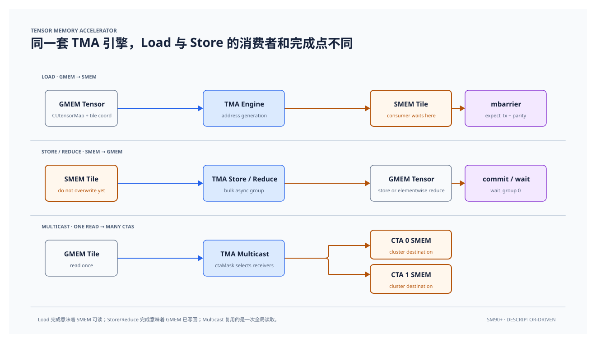

# Cuda TMA （Tensor Memory Accelerator）

```{contents} 本页目录
---
depth: 2
local: true
---
```

Cuda 从 Hopper（compute capability 9.0）引入 Tensor Memory Accelerator，简称 TMA。它是 SM 上的专用拷贝引擎，按 host 端编好的 tensor map，在 global memory 和 shared memory 之间异步搬运一整块 tile。地址生成、越界填充和 shared memory swizzle 都在这块硬件上完成，线程不用再为 tile 里的每个元素算地址。

## 基础介绍

这一章的 TMA 指带 `CUtensorMap` 的张量拷贝，PTX 里是 `cp.async.bulk.tensor`。同一套引擎还能做不带描述符的 `cp.async.bulk`，只搬一段连续字节。张量拷贝有四类。

| 操作 | 数据方向 | PTX | 完成信号 |
|-|-|-|-|
| load | global memory 到 shared memory | `cp.async.bulk.tensor.Nd.shared::cluster.global`，带 `mbarrier::complete_tx::bytes` | shared memory 里的 `mbarrier`，按字节计事务 |
| store | shared memory 到 global memory | `cp.async.bulk.tensor.Nd.global.shared::cta`，带 `bulk_group` | `cp.async.bulk.commit_group` 和 `wait_group` |
| reduce | shared memory 到 global memory，逐元素归约 | `cp.reduce.async.bulk.tensor`，运算由 `.redOp` 指定 | 与 store 相同的 bulk group |
| multicast | 一次 global 读取，写入 cluster 内多个 CTA 的 shared memory | load 上加 `multicast::cluster`，并用 `ctaMask` 选择 CTA | 完成信号送到每个目标 CTA 里、与 `mbar` 相同的偏移 |

和 Ampere 上的 `cp.async`、再早的标量访问放在一起，差别在谁生成地址、一条指令搬多大、完成信号写在哪里。

|  | 标量 ld/st | cp.async（SM80） | TMA tensor copy（SM90 起） |
|-|-|-|-|
| 谁生成地址 | 线程自己算 | 每个 lane 给出 global 地址和 shared 地址 | `CUtensorMap` 加上 tile 坐标，硬件展开 |
| 一条指令搬多少 | 寄存器宽度，常见 4 到 16 字节 | 每个 lane 4、8 或 16 字节 | 一个 box。tiled 模式下每一维 1 到 256 个元素 |
| 谁发射 | 参与的每个线程 | warp 里参与的 lane | 一个线程。再发一次就会把同一块 tile 多搬一份 |
| 布局 | 手写索引 | 手写索引 | rank 1 到 5，第 0 维是最内维 |
| 完成 | 指令返回即完成 | `commit_group` / `wait_group` | load 用 `mbarrier`。store 和 reduce 用 bulk group |
| shared memory 排布 | 自己排 | 自己排 | 描述符里的 `CUtensorMapSwizzle` |
| 越界 | 调用方做 mask | 调用方做 mask | `oobFill`，硬件填 0 或特殊 NaN |
| cluster 内复用 | 没有 | 没有 | `multicast::cluster` |

`cp.async` 已经是异步拷贝，但地址仍由 warp 提供。每个 lane 给出自己的 global 地址和 shared 地址，硬件再把这些小访问合成事务。TMA 把地址生成挪到拷贝引擎上。host 先把基址、维度、stride、tile 和 swizzle 写进 `CUtensorMap`。kernel 里由一个线程提交 smem 地址、描述符和 tile 坐标。线程随后可以做别的计算，等完成信号到了再读 shared memory。tile 内的地址不再占用每个线程的寄存器，拷贝指令也从每个 lane 一条收成整个 box 一条。

`cp.async.bulk.tensor` 用 `shared::cluster.global` 做 load 时，PTX 建议编译目标写成 `sm_90a`。目标只写成 `sm_90` 时，这条路径会慢一截。

## Tensor descriptor：`CUtensorMap`

线程看不到张量在 global memory 里的形状。host 调用 `cuTensorMapEncodeTiled`，把布局压进一个不透明的 `CUtensorMap`，再以 `__grid_constant__` 按值传进 kernel。描述符位于参数空间，PTX 从 `.param` 读取。对象地址按 64 字节对齐。下面的示例使用 `alignas(128)`，满足这个对齐。不要按普通结构体去读写字段。布局不变、只换基址时，用 `cuTensorMapReplaceAddress`。卷积用 `cuTensorMapEncodeIm2col`，这一章只讲 tiled。

| 参数 | 含义 | 本章示例 | 约束 |
|-|-|-|-|
| `tensorDataType` | 元素类型 | `BFLOAT16`，2 字节 | 见 `CUtensorMapDataType`。常用 bf16、fp16、tf32、fp32，也有整型和 4/6-bit packed 类型 |
| `tensorRank` | 维数 | 2 | tiled 为 1 到 5。`interleave` 不是 `NONE` 时至少 3 维 |
| `globalAddress` | 张量基址 | `src` 或 `dest` | 16 字节对齐。`interleave` 为 32B，或某些 packed 类型，要 32 字节对齐 |
| `globalDim` | 每一维的元素个数 | `{TILE_N, TILE_M}` | 第 0 维是地址连续的最内维。每一维非 0，且不超过 `2^32` |
| `globalStrides` | 更高一维的步长，单位是字节 | `{TILE_N * sizeof(bf16)}`，长度为 rank 减 1 | 16 的倍数，小于 `2^40`。`globalStrides[0]` 是第 1 维的步长，不是第 0 维 |
| `boxDim` | 这一次搬运的 tile，单位是元素 | `{TILE_N, TILE_M}` | 每一维 1 到 256。`interleave` 为 `NONE` 时，`boxDim[0]` 乘元素字节数必须是 16 的倍数。bf16 下 `TILE_N` 因此要是 8 的倍数 |
| `elementStrides` | box 内沿各维取样的步长，单位是元素 | `{1, 1}` | 取值 1 到 8。`interleave` 为 `NONE` 时，第 0 维的步长被忽略。某一维步长 `s > 1` 时，实际装载 `ceil(boxDim / s)` 个元素。想装 N 个，把 `boxDim` 设成 `N * s` |
| `interleave` | global memory 中的交错布局 | `INTERLEAVE_NONE` | `NONE`、`16B`、`32B`。稠密矩阵用 `NONE`。`NC/8HWC8`、`NC/16HWC16` 才用 16B 或 32B |
| `swizzle` | 写入 shared memory 时的 bank 重排 | `SWIZZLE_NONE` | 见后面的 swizzle 一节 |
| `l2Promotion` | L2 从 DRAM 填数据的粒度 | `L2_PROMOTION_NONE` | `NONE`、`64B`、`128B`、`256B`。多个 CTA 会反复读同一块 tile 时再打开 |
| `oobFill` | box 超出张量边界时如何填充 | `FLOAT_OOB_FILL_NONE` | `NONE` 填 0。`NAN_REQUEST_ZERO_FMA` 填特殊 NaN，只允许浮点类型。这个 NaN 进入 FMA 时按 0 处理，避免越界元素污染累加 |

维度顺序以第 0 维为最内维。示例是行主序的二维 tile，一行有 `TILE_N` 个 bf16，数组下标和坐标这样对应。

| 下标 | 对应的维 | 示例 |
|-|-|-|
| 0 | 最内维，一行里连续的 N | `globalDim[0] = TILE_N`，坐标 `c0` |
| 1 | 行方向的 M | `globalDim[1] = TILE_M`，`globalStrides[0] = TILE_N * sizeof(bf16)`，坐标 `c1` |

`cp.async.bulk.tensor.2d` 的坐标顺序和 `globalDim` 相同，先 `c0` 再 `c1`。M、N 写反时编译器不报错，shared memory 里的 tile 会错位。

## TMA 完成异步数据搬运



TMA 指令返回时，数据还没到。load 的完成点在 shared memory，store 和 reduce 的完成点在 global memory，两边用的同步原语不同。

load 把完成信号写进 shared memory 里的 `mbarrier`。store 和 reduce 把完成信号记在拷贝引擎的 bulk group 上，不再写回 shared memory 里的 barrier。

`__syncthreads()` 把到达和等待绑在一条指令上，范围是整个 block。`mbarrier` 把 arrive 和 wait 拆开。init 时单独给出要等的线程数，可以只等发出拷贝的那一个线程。TMA load 另外登记一笔事务字节。phase 翻转要两件事同时成立：参与的线程都已经 arrive，`expect_tx` 登记的字节也已经被硬件 complete。

| 步骤 | 指令 | 谁来做 | 作用 |
|-|-|-|-|
| 1 | `mbarrier.init.shared::cta.b64` | 一个线程 | 设定这一轮要等几个线程。初始化后 phase 为 0 |
| 2 | `fence.proxy.async.shared::cta` | 紧接在 init 之后 | init 是普通的 shared 写，async proxy 默认看不见。这条 fence 把它交给 async proxy |
| 3 | `mbarrier.expect_tx` | 发出拷贝之前 | 登记预期到达的字节数。示例调用的是 `expect_bytes`，里面没有附带 arrive |
| 4 | `cp.async.bulk.tensor`，带 `complete_tx::bytes` | 一个线程 | 提交 tile。拷贝完成时，硬件按实际字节数做 complete-tx |
| 5 | `mbarrier.arrive` | 参与同步的线程 | 线程侧到达。改用 `arrive.expect_tx` 时，这一步已经包含在里面，不要再 arrive 一次 |
| 6 | `mbarrier.try_wait.parity` | 要读这块 shared memory 的线程 | 等 phase。成功返回带 acquire |

第一轮 `wait` 的 parity 传 0。这一轮完成后 phase 变成 1，下一轮传 1，再下一轮回到 0。多 stage pipeline 复用同一条 barrier，靠的是这个翻转，不必每轮重新 init。第 11 章的 K-loop 会用到。

`expect_tx` 的字节数要等于这次拷贝写入本 CTA shared memory 的字节数。多了或少了，`wait` 都不返回。每个线程都发同一条 TMA 时，同一块 tile 会被搬多次，complete-tx 的字节数也对不上。

complete-tx 在 cluster scope 上带 release，`try_wait.parity` 成功返回带 acquire。两边配对之后，普通 shared load 才能看到这次写入。示例在 `wait` 返回后直接读 `share_mem`，靠的就是这个配对。

### 单 block、单 lane、单 tile 的 TMA load

下面的 kernel 用 `<<<1, 1>>>` 把一条 load 走通。一个线程把坐标 `(0, 0)` 的 tile 从 global memory 搬进 shared memory，等 barrier 之后，再用普通 store 写回 `dest`。写回是单个线程的标量循环，测出来的带宽不能代表 TMA。

对照代码，顺序是 `init_barrier(&barrier, 1)`、`async_proxy_fence()`、`expect_bytes(&barrier, tileSize)`、`cp_async_bulk_tensor_2d_global_to_shared`、`arrive(&barrier, 1)`、`wait(&barrier, 0)`。`tileSize` 等于 `TILE_M * TILE_N * sizeof(bf16)`，也就是 box 的字节数。arrival count 设成 1，因为只有这一个线程 arrive。`share_mem` 使用 `alignas(128)`，按 128 字节对齐，后面打开 swizzle 时仍然合法。

host 侧 `global_dim` 是 `{TILE_N, TILE_M}`，`global_stride` 只有一项 `TILE_N * sizeof(bf16)`。第 0 维连续，长度是一行的元素数。

示例代码：

```c++
__device__ static __forceinline__ void async_proxy_fence() {
  asm volatile("fence.proxy.async.shared::cta;\n" ::: "memory");
}

__device__ static __forceinline__ void init_barrier(uint64_t *bar,
                                                    int arrival_count) {
  uint32_t bar_ptr = static_cast<uint32_t>(__cvta_generic_to_shared(bar));
  asm volatile("mbarrier.init.shared::cta.b64 [%0], %1;\n" ::"r"(bar_ptr),
               "r"(arrival_count)
               : "memory");
}

__device__ static __forceinline__ void arrive(uint64_t *bar, uint32_t count) {
  uint32_t mbar_ptr = static_cast<uint32_t>(__cvta_generic_to_shared(bar));
  asm volatile("mbarrier.arrive.release.cta.shared::cta.b64 _, [%0],  %1;\n"
               :
               : "r"(mbar_ptr), "r"(count)
               : "memory");
}

__device__ static __forceinline__ int try_wait(uint64_t *bar, int phaseParity) {
  uint32_t mbar_ptr = static_cast<uint32_t>(__cvta_generic_to_shared(bar));
  int result;
  asm volatile("{\n"
               ".reg .pred P1;\n"
               "mbarrier.try_wait.parity.shared::cta.b64 P1, [%1], %2;\n"
               "selp.u32 %0,1,0,P1;"
               "}\n"
               : "=r"(result)
               : "r"(mbar_ptr), "r"(phaseParity));
  return result;
}

__device__ static __forceinline__ int test_wait(uint64_t *bar,
                                                int phaseParity) {
  uint32_t mbar_ptr = static_cast<uint32_t>(__cvta_generic_to_shared(bar));
  int result;
  asm volatile("{\n"
               ".reg .pred P1;\n"
               "mbarrier.test_wait.parity.shared::cta.b64 P1, [%1], %2;\n"
               "selp.u32 %0,1,0,P1;"
               "}\n"
               : "=r"(result)
               : "r"(mbar_ptr), "r"(phaseParity));
  return result;
}

__device__ static __forceinline__ void wait(uint64_t *bar, int phaseParity) {
  uint32_t mbar_ptr = static_cast<uint32_t>(__cvta_generic_to_shared(bar));
  asm volatile("{\n"
               ".reg .pred                P1;\n"
               "LAB_WAIT:\n"
               "mbarrier.try_wait.parity.shared::cta.b64 P1, [%0], %1;\n"
               "@P1                       bra.uni DONE;\n"
               "bra.uni                   LAB_WAIT;\n"
               "DONE:\n"
               "}\n" ::"r"(mbar_ptr),
               "r"(phaseParity));
}

__device__ static __forceinline__ void expect_bytes(uint64_t *bar,
                                                    uint32_t bytes) {
  uint32_t bar_ptr = static_cast<uint32_t>(__cvta_generic_to_shared(bar));
  asm("mbarrier.expect_tx.relaxed.cta.shared::cta.b64 [%0], %1;\n"
      :
      : "r"(bar_ptr), "r"(bytes)
      : "memory");
}

__device__ static __forceinline__ void expect_bytes_and_arrive(uint64_t *bar,
                                                               uint32_t bytes) {
  uint32_t bar_ptr = static_cast<uint32_t>(__cvta_generic_to_shared(bar));
  asm("mbarrier.arrive.expect_tx.release.cta.shared.b64 _, [%0], %1;\n "
      :
      : "r"(bar_ptr), "r"(bytes)
      : "memory");
}

__device__ static __forceinline__ void tma_commit_group() {
  asm volatile("cp.async.bulk.commit_group;");
}

template <int N>
__device__ static __forceinline__ void tma_wait_until_pending() {
  asm volatile("cp.async.bulk.wait_group %0;" : : "n"(N) : "memory");
}

__device__ static __forceinline__ void cp_async_bulk_tensor_1d_global_to_shared(
    void *smem_dest, const CUtensorMap *tensor_map, int c0, uint64_t *bar) {
  uint32_t mbar_ptr = static_cast<uint32_t>(__cvta_generic_to_shared(bar));
  asm volatile(
      "cp.async.bulk.tensor.1d.shared::cluster.global.tile.mbarrier::complete_"
      "tx::bytes "
      "[%0], [%1, {%2}], [%3];\n"
      :
      : "r"(static_cast<uint32_t>(__cvta_generic_to_shared(smem_dest))),
        "l"(tensor_map), "r"(c0), "r"(mbar_ptr)
      : "memory");
}

/**
 * @brief Asynchronously copy a 2D tensor tile from global to shared memory.
 *
 * @param smem_dest Destination address in shared memory.
 * @param tensor_map Tensor map descriptor for the source tensor.
 * @param c0 Coordinate in the first dimension.
 * @param c1 Coordinate in the second dimension.
 * @param bar Pointer to mbarrier for completion tracking.
 * @return This function does not return a value.
 */
__device__ static __forceinline__ void
cp_async_bulk_tensor_2d_global_to_shared(void *smem_dest,
                                         const CUtensorMap *tensor_map, int c0,
                                         int c1, uint64_t *bar) {
  uint32_t mbar_ptr = static_cast<uint32_t>(__cvta_generic_to_shared(bar));
  asm volatile(
      "cp.async.bulk.tensor.2d.shared::cluster.global.tile.mbarrier::complete_"
      "tx::bytes "
      "[%0], [%1, {%2, %3}], [%4];\n"
      :
      : "r"(static_cast<uint32_t>(__cvta_generic_to_shared(smem_dest))),
        "l"(tensor_map), "r"(c0), "r"(c1), "r"(mbar_ptr)
      : "memory");
}

/**
 * @brief Asynchronously copy a 3D tensor tile from global to shared memory.
 *
 * @param smem_dest Destination address in shared memory.
 * @param tensor_map Tensor map descriptor for the source tensor.
 * @param c0 Coordinate in the first dimension.
 * @param c1 Coordinate in the second dimension.
 * @param c2 Coordinate in the third dimension.
 * @param bar Pointer to mbarrier for completion tracking.
 * @return This function does not return a value.
 */
__device__ static __forceinline__ void
cp_async_bulk_tensor_3d_global_to_shared(void *smem_dest,
                                         const CUtensorMap *tensor_map, int c0,
                                         int c1, int c2, uint64_t *bar) {
  uint32_t mbar_ptr = static_cast<uint32_t>(__cvta_generic_to_shared(bar));
  asm volatile(
      "cp.async.bulk.tensor.3d.shared::cluster.global.tile.mbarrier::complete_"
      "tx::bytes "
      "[%0], [%1, {%2, %3, %4}], [%5];\n"
      :
      : "r"(static_cast<uint32_t>(__cvta_generic_to_shared(smem_dest))),
        "l"(tensor_map), "r"(c0), "r"(c1), "r"(c2), "r"(mbar_ptr)
      : "memory");
}

__device__ static __forceinline__ void cp_async_bulk_tensor_4d_global_to_shared(
    void *smem_dest, const CUtensorMap *tensor_map, int c0, int c1, int c2,
    int c3, uint64_t *bar) {
  uint32_t mbar_ptr = static_cast<uint32_t>(__cvta_generic_to_shared(bar));
  asm volatile(
      "cp.async.bulk.tensor.4d.shared::cluster.global.tile.mbarrier::complete_"
      "tx::bytes "
      "[%0], [%1, {%2, %3, %4, %5}], [%6];\n"
      :
      : "r"(static_cast<uint32_t>(__cvta_generic_to_shared(smem_dest))),
        "l"(tensor_map), "r"(c0), "r"(c1), "r"(c2), "r"(c3), "r"(mbar_ptr)
      : "memory");
}

__device__ static __forceinline__ void cp_async_bulk_tensor_5d_global_to_shared(
    void *smem_dest, const CUtensorMap *tensor_map, int c0, int c1, int c2,
    int c3, int c4, uint64_t *bar) {
  uint32_t mbar_ptr = static_cast<uint32_t>(__cvta_generic_to_shared(bar));
  asm volatile(
      "cp.async.bulk.tensor.5d.shared::cluster.global.tile.mbarrier::complete_"
      "tx::bytes "
      "[%0], [%1, {%2, %3, %4, %5, %6}], [%7];\n"
      :
      : "r"(static_cast<uint32_t>(__cvta_generic_to_shared(smem_dest))),
        "l"(tensor_map), "r"(c0), "r"(c1), "r"(c2), "r"(c3), "r"(c4),
        "r"(mbar_ptr)
      : "memory");
}

__device__ static __forceinline__ void
cp_async_bulk_tensor_1d_shared_to_global(const CUtensorMap *tensor_map, int c0,
                                         const void *src) {
  asm volatile("cp.async.bulk.tensor.1d.global.shared::cta.tile.bulk_group "
               "[%0, {%1}], [%2];\n"
               :
               : "l"(tensor_map), "r"(c0),
                 "r"(static_cast<uint32_t>(__cvta_generic_to_shared(src)))
               : "memory");
}

__device__ static __forceinline__ void
cp_async_bulk_tensor_2d_shared_to_global(const CUtensorMap *tensor_map, int c0,
                                         int c1, const void *src) {
  asm volatile("cp.async.bulk.tensor.2d.global.shared::cta.tile.bulk_group "
               "[%0, {%1, %2}], [%3];\n"
               :
               : "l"(tensor_map), "r"(c0), "r"(c1),
                 "r"(static_cast<uint32_t>(__cvta_generic_to_shared(src)))
               : "memory");
}

__device__ static __forceinline__ void
cp_async_bulk_tensor_3d_shared_to_global(const CUtensorMap *tensor_map, int c0,
                                         int c1, int c2, const void *src) {
  asm volatile("cp.async.bulk.tensor.3d.global.shared::cta.tile.bulk_group "
               "[%0, {%1, %2, %3}], [%4];\n"
               :
               : "l"(tensor_map), "r"(c0), "r"(c1), "r"(c2),
                 "r"(static_cast<uint32_t>(__cvta_generic_to_shared(src)))
               : "memory");
}

__device__ static __forceinline__ void
cp_async_bulk_tensor_4d_shared_to_global(const CUtensorMap *tensor_map, int c0,
                                         int c1, int c2, int c3,
                                         const void *src) {
  asm volatile("cp.async.bulk.tensor.4d.global.shared::cta.tile.bulk_group "
               "[%0, {%1, %2, %3, %4}], [%5];\n"
               :
               : "l"(tensor_map), "r"(c0), "r"(c1), "r"(c2), "r"(c3),
                 "r"(static_cast<uint32_t>(__cvta_generic_to_shared(src)))
               : "memory");
}

__device__ static __forceinline__ void
cp_async_bulk_tensor_5d_shared_to_global(const CUtensorMap *tensor_map, int c0,
                                         int c1, int c2, int c3, int c4,
                                         const void *src) {
  asm volatile("cp.async.bulk.tensor.5d.global.shared::cta.tile.bulk_group "
               "[%0, {%1, %2, %3, %4, %5}], [%6];\n"
               :
               : "l"(tensor_map), "r"(c0), "r"(c1), "r"(c2), "r"(c3), "r"(c4),
                 "r"(static_cast<uint32_t>(__cvta_generic_to_shared(src)))
               : "memory");
}


template <int TILE_M, int TILE_N>
__global__ void single_tma_load(__grid_constant__ const CUtensorMap src_map, bf16 *dest) {
    __shared__ alignas(128) bf16 share_mem[TILE_M * TILE_N];
    __shared__ alignas(8) uint64_t barrier;

    constexpr int tileSize = TILE_M * TILE_N * sizeof(bf16);
    init_barrier(&barrier, 1);
    async_proxy_fence();

    expect_bytes(&barrier, tileSize);

    cp_async_bulk_tensor_2d_global_to_shared(share_mem, &src_map, 0, 0, &barrier);
    arrive(&barrier, 1);
    wait(&barrier, 0);

    for (int i = 0; i < TILE_M; ++i) {
        int base = i * TILE_N;
        for (int j = 0; j < TILE_N; ++j) {
            int idx = base + j;
            dest[idx] = share_mem[idx];
        }
    }
}

template <int TILE_M, int TILE_N> void launch_single_tma_load(bf16 *src, bf16 *dest) {
    alignas(128) CUtensorMap tensor_map;
    constexpr cuuint32_t RANK = 2;

    const cuuint64_t global_dim[RANK] = {
        static_cast<cuuint64_t>(TILE_N),
        static_cast<cuuint64_t>(TILE_M)};

    const cuuint64_t global_stride[RANK - 1] = {
        static_cast<cuuint64_t>(TILE_N * sizeof(bf16))};

    const cuuint32_t box_dim[RANK] = {
        static_cast<cuuint32_t>(TILE_N),
        static_cast<cuuint32_t>(TILE_M),
    };

    const cuuint32_t element_stride[RANK] = {1, 1};

    CUDA_CHECK(cuInit(0));
    CUDA_CHECK(cuTensorMapEncodeTiled(
        &tensor_map,
        CU_TENSOR_MAP_DATA_TYPE_BFLOAT16,
        RANK,
        src,
        global_dim,
        global_stride,
        box_dim,
        element_stride,
        CU_TENSOR_MAP_INTERLEAVE_NONE,
        CU_TENSOR_MAP_SWIZZLE_NONE,
        CU_TENSOR_MAP_L2_PROMOTION_NONE,
        CU_TENSOR_MAP_FLOAT_OOB_FILL_NONE));

    single_tma_load<TILE_M, TILE_N><<<1, 1>>>(tensor_map, dest);
}

```

### TMA store

store 把 shared memory 里的 tile 按目标 tensor map 写回 global memory。完成点在 global memory，所以用 bulk group，不用 shared memory 里的 `mbarrier`。

示例先用上一节的 load 把数据放进 shared memory，再发 `cp.async.bulk.tensor.2d.global.shared::cta.tile.bulk_group`。随后 `tma_commit_group()` 把已经发出的 bulk 拷贝收成一组。`tma_wait_until_pending<0>()` 展开成 `cp.async.bulk.wait_group 0`。参数是还允许挂着的组数，传 0 表示全部写完才返回。

`wait_group` 返回之前，不要覆盖这块 shared memory。拷贝引擎还在读它。

示例代码：

```c++
typedef __nv_bfloat16 bf16;

template <int TILE_M, int TILE_N>
__global__ void single_tma_store(__grid_constant__ const CUtensorMap src_map,
                                 __grid_constant__ const CUtensorMap dest_map) {
    __shared__ alignas(128) bf16 share_mem[TILE_M * TILE_N];
    __shared__ alignas(8) uint64_t barrier;

    constexpr int tile_size = TILE_M * TILE_N * sizeof(bf16);
    init_barrier(&barrier, 1);
    async_proxy_fence();

    expect_bytes(&barrier, tile_size);
    cp_async_bulk_tensor_2d_global_to_shared(share_mem, &src_map, 0, 0,
                                             &barrier);
    arrive(&barrier, 1);
    wait(&barrier, 0);

    cp_async_bulk_tensor_2d_shared_to_global(&dest_map, 0, 0, share_mem);
    tma_commit_group();
    tma_wait_until_pending<0>();
}

template <int TILE_M, int TILE_N>
void launch_single_tma_store(bf16 *src, bf16 *dest) {
    alignas(128) CUtensorMap src_map;
    alignas(128) CUtensorMap dest_map;
    constexpr cuuint32_t RANK = 2;

    const cuuint64_t global_dim[RANK] = {
        static_cast<cuuint64_t>(TILE_N),
        static_cast<cuuint64_t>(TILE_M)};

    const cuuint64_t global_stride[RANK - 1] = {
        static_cast<cuuint64_t>(TILE_N * sizeof(bf16))};

    const cuuint32_t box_dim[RANK] = {
        static_cast<cuuint32_t>(TILE_N),
        static_cast<cuuint32_t>(TILE_M),
    };

    const cuuint32_t element_stride[RANK] = {1, 1};

    CUDA_CHECK(cuInit(0));
    CUDA_CHECK(cuTensorMapEncodeTiled(
        &src_map,
        CU_TENSOR_MAP_DATA_TYPE_BFLOAT16,
        RANK,
        src,
        global_dim,
        global_stride,
        box_dim,
        element_stride,
        CU_TENSOR_MAP_INTERLEAVE_NONE,
        CU_TENSOR_MAP_SWIZZLE_NONE,
        CU_TENSOR_MAP_L2_PROMOTION_NONE,
        CU_TENSOR_MAP_FLOAT_OOB_FILL_NONE));
    CUDA_CHECK(cuTensorMapEncodeTiled(
        &dest_map,
        CU_TENSOR_MAP_DATA_TYPE_BFLOAT16,
        RANK,
        dest,
        global_dim,
        global_stride,
        box_dim,
        element_stride,
        CU_TENSOR_MAP_INTERLEAVE_NONE,
        CU_TENSOR_MAP_SWIZZLE_NONE,
        CU_TENSOR_MAP_L2_PROMOTION_NONE,
        CU_TENSOR_MAP_FLOAT_OOB_FILL_NONE));

    single_tma_store<TILE_M, TILE_N><<<1, 1>>>(src_map, dest_map);
}

```

### TMA reduce，把“搬运”和“归约”合并

reduce 和 store 走同一条写回路径。写入 global memory 时，每个元素先和目标地址上的旧值做一次运算，再把结果留下。PTX 是 `cp.reduce.async.bulk.tensor`，运算由 `.redOp` 指定，可以是 `add`、`min`、`max`、`inc`、`dec`、`and`、`or`、`xor`。元素类型决定哪些运算合法。bf16 tile 上常用 `add`。

这是逐元素归约，tile 不会被收成一个标量。split-K 的部分和、多个 CTA 往同一块全局缓冲累加，可以直接做在写回上。完成信号仍是 `commit_group` 和 `wait_group`。

示例先把 `src` 载入 shared memory，再对 `dest` 做 `add`。`dest` 里原有的值会参与运算。调用前要把 `dest` 写成这次归约的初值。

```c++
__device__ static __forceinline__ void
cp_async_reduce_add_bulk_tensor_2d_shared_to_global(
    const CUtensorMap *tensor_map, int c0, int c1, const void *src) {
    asm volatile(
        "cp.reduce.async.bulk.tensor.2d.global.shared::cta.add.tile.bulk_group "
        "[%0, {%1, %2}], [%3];\n"
        :
        : "l"(tensor_map), "r"(c0), "r"(c1),
          "r"(static_cast<uint32_t>(__cvta_generic_to_shared(src)))
        : "memory");
}

template <int TILE_M, int TILE_N>
__global__ void
single_tma_reduce(__grid_constant__ const CUtensorMap src_map,
                  __grid_constant__ const CUtensorMap dest_map) {
    __shared__ alignas(128) bf16 share_mem[TILE_M * TILE_N];
    __shared__ alignas(8) uint64_t barrier;

    constexpr int tile_size = TILE_M * TILE_N * sizeof(bf16);
    init_barrier(&barrier, 1);
    async_proxy_fence();

    expect_bytes(&barrier, tile_size);
    cp_async_bulk_tensor_2d_global_to_shared(share_mem, &src_map, 0, 0,
                                             &barrier);
    arrive(&barrier, 1);
    wait(&barrier, 0);

    cp_async_reduce_add_bulk_tensor_2d_shared_to_global(&dest_map, 0, 0,
                                                        share_mem);
    tma_commit_group();
    tma_wait_until_pending<0>();
}

template <int TILE_M, int TILE_N>
void launch_single_tma_reduce(bf16 *src, bf16 *dest) {
    alignas(128) CUtensorMap src_map;
    alignas(128) CUtensorMap dest_map;
    constexpr cuuint32_t RANK = 2;

    const cuuint64_t global_dim[RANK] = {
        static_cast<cuuint64_t>(TILE_N),
        static_cast<cuuint64_t>(TILE_M)};

    const cuuint64_t global_stride[RANK - 1] = {
        static_cast<cuuint64_t>(TILE_N * sizeof(bf16))};

    const cuuint32_t box_dim[RANK] = {
        static_cast<cuuint32_t>(TILE_N),
        static_cast<cuuint32_t>(TILE_M),
    };

    const cuuint32_t element_stride[RANK] = {1, 1};

    CUDA_CHECK(cuInit(0));
    CUDA_CHECK(cuTensorMapEncodeTiled(
        &src_map,
        CU_TENSOR_MAP_DATA_TYPE_BFLOAT16,
        RANK,
        src,
        global_dim,
        global_stride,
        box_dim,
        element_stride,
        CU_TENSOR_MAP_INTERLEAVE_NONE,
        CU_TENSOR_MAP_SWIZZLE_NONE,
        CU_TENSOR_MAP_L2_PROMOTION_NONE,
        CU_TENSOR_MAP_FLOAT_OOB_FILL_NONE));
    CUDA_CHECK(cuTensorMapEncodeTiled(
        &dest_map,
        CU_TENSOR_MAP_DATA_TYPE_BFLOAT16,
        RANK,
        dest,
        global_dim,
        global_stride,
        box_dim,
        element_stride,
        CU_TENSOR_MAP_INTERLEAVE_NONE,
        CU_TENSOR_MAP_SWIZZLE_NONE,
        CU_TENSOR_MAP_L2_PROMOTION_NONE,
        CU_TENSOR_MAP_FLOAT_OOB_FILL_NONE));

    single_tma_reduce<TILE_M, TILE_N><<<1, 1>>>(src_map, dest_map);
}

```

### Multicast：cluster 里同一块 tile 只读一次 global memory

`.multicast::cluster` 把一次 global 读取写进同一个 thread block cluster 里的多个 CTA。这些 CTA 要用 cluster 启动，例如在 `cudaLaunchKernelEx` 里设置 cluster 维度。任意拼在一起的一组 block 不在这条路径上。Hopper 上一个 cluster 最多 16 个 CTA，实际能同驻的个数还受 SM 上的寄存器和 shared memory 限制。

指令在 TMA load 上加上 `multicast::cluster`，并带一个 `ctaMask`。默认 16 位，每一位对应 cluster 内的 `%cluster_ctarank`。`::32b` 是加宽后的 mask，不属于 Hopper 这条路径。数据写到每个被选中 CTA 的 shared memory 里，偏移和发出方的 `dstMem` 相同。完成信号也送到各 CTA 里、和 `mbar` 相同的偏移。这些 CTA 的 shared memory 布局要一致，barrier 要放在同一位置。

每个接收方先在自己的 barrier 上做 `expect_tx`。字节数是本 CTA 收到的那一份，按 box 的字节数填写，不要乘 cluster 里的 CTA 个数。mask 没有选中的 CTA 不要等这笔事务。

GEMM 里常见的用法是两个 CTA 组成 cluster。A tile 各读各的，B tile 由一个 CTA multicast 给两个 CTA，global memory 少读一遍。第 12 章把 cluster 放进完整流水线，这里只把指令语义说清。

## TMA 中使用 swizzling pattern

Shared memory 有 32 个 bank，每个 bank 4 字节，`bank = (byte_address / 4) % 32`。一个 warp 里多个 lane 落在同一个 bank，访问就串行。第 5 章用 padding 和转置处理这件事。TMA 写入 shared memory 时可以按 `CUtensorMapSwizzle` 重排，kernel 不必再写一套 smem 索引。读的一侧，包括 `ldmatrix` 和 `wgmma`，要使用同一套 swizzle。只改描述符、消费侧仍按线性地址读的话，bank conflict 还在，读到的位置也是错的。

| 模式 | 重排方式 | 最内维字节数 |
|-|-|-|
| `SWIZZLE_NONE` | 按线性地址写入 | 没有 swizzle 窗口限制 |
| `SWIZZLE_32B` | 在 32 字节窗口里重排 16 字节段 | 不超过 32 |
| `SWIZZLE_64B` | 在 64 字节窗口里重排 16 字节段 | 不超过 64 |
| `SWIZZLE_128B` | 在 128 字节窗口里重排 16 字节段 | 不超过 128 |
| `SWIZZLE_128B_ATOM_32B` | 在 128 字节窗口里重排 32 字节段 | 不超过 128 |
| `SWIZZLE_128B_ATOM_32B_FLIP_8B` | 同上，并且隔行交换每个 16 字节内的高低 8 字节 | 不超过 128 |
| `SWIZZLE_128B_ATOM_64B` | 在 128 字节窗口里重排 64 字节段 | 不超过 128 |

Hopper 上的 GEMM 常用 `SWIZZLE_128B`。带 `ATOM` 的模式把重排单位改成 32 或 64 字节，用来对齐更宽的 MMA 原子，编码前先确认设备支持。`interleave` 为 32B 时，swizzle 只能取 `SWIZZLE_32B`。

不带 swizzle 时，shared memory 地址按 16 字节对齐即可。开了 swizzle，地址要对齐到 swizzle 窗口，128B 模式就是 128 字节。示例里的 `alignas(128)` 按这个对齐。

冲突可以从一个 bf16 行主序 tile 看出来。一行 64 个元素，正好 128 字节。相邻两行的同一列相差 128 字节，`128 / 4 = 32`，`32 % 32 = 0`，两行落在同一个 bank。warp 沿列读 32 行，就是 32 路冲突。

`SWIZZLE_128B` 的驱动注释是在 128 字节里重排 16 字节段。按这个窗口把一行分成 8 段，段号与行号的低 3 位异或，列方向的访问会换到别的 bank。下表是第 0 列在前 8 行上换位之后的字节偏移。它用来看 bank 怎么散开。消费侧要跟描述符用同一种 swizzle，地址由这套布局生成，不必照着这张表在 kernel 里再写一份。

| 行 | 段号与行号低 3 位异或 | 字节偏移 | bank |
|-|-|-|-|
| 0 | 0 | 0 | 0 |
| 1 | 1 | 16 | 4 |
| 2 | 2 | 32 | 8 |
| 3 | 3 | 48 | 12 |
| 4 | 4 | 64 | 16 |
| 5 | 5 | 80 | 20 |
| 6 | 6 | 96 | 24 |
| 7 | 7 | 112 | 28 |

8 行落到 8 个不同的 bank。32 行的列访问从 32 路冲突变成 4 路。

## 编码和同步上容易出错的地方

| 现象 | 常见原因 |
|-|-|
| `cuTensorMapEncodeTiled` 返回 `CUDA_ERROR_INVALID_VALUE` | 描述符没有按 64 字节对齐，或 global 地址没有按 16 字节对齐。某一维 `boxDim` 不在 1 到 256。最内维字节数不是 16 的倍数，stride 不是 16 的倍数，或 stride 达到 `2^40`。开了 swizzle，但最内维字节数大于 swizzle 窗口 |
| `wait` 不返回 | `expect_tx` 的字节数和实际写入不一致。arrival count 和 arrive 次数不一致。没有发出 TMA。init 之后没有 `fence.proxy.async`，async proxy 看不见这条 barrier |
| tile 错位 | `globalDim[0]` 不是连续维，或坐标顺序和维度顺序不一致 |
| 同一块 tile 被搬了多次 | 多个线程都执行了 `cp.async.bulk.tensor` |
| shared memory 里还是旧值 | `wait` 返回前就做了普通 load。store 或 reduce 在 `wait_group` 返回前覆盖了 smem |
| 打开 swizzle 后结果不对 | 消费侧仍按线性地址读，或 smem 地址没有按 swizzle 窗口对齐 |
| reduce 的结果比初值加上 src 更大 | `dest` 没有先写成初值，`add` 叠在了原来的数据上 |
| multicast 等不到数据 | kernel 没有按 cluster 启动。接收方的 barrier 不在同一偏移，或没有先 `expect_tx`。字节数乘上了 CTA 个数 |
| `shared::cluster` 的 load 明显偏慢 | 编译目标是 `sm_90`。PTX 对这条路径建议使用 `sm_90a` |

<callout emoji="💡">
这一章的三个 kernel 都是单个线程把一条路径走通。带宽，以及搬运和计算能不能重叠，要到第 11、12 章的多 stage GEMM 里看。那里会把 TMA、`mbarrier` 的 phase 和 warp specialization 放在一起。
</callout>
