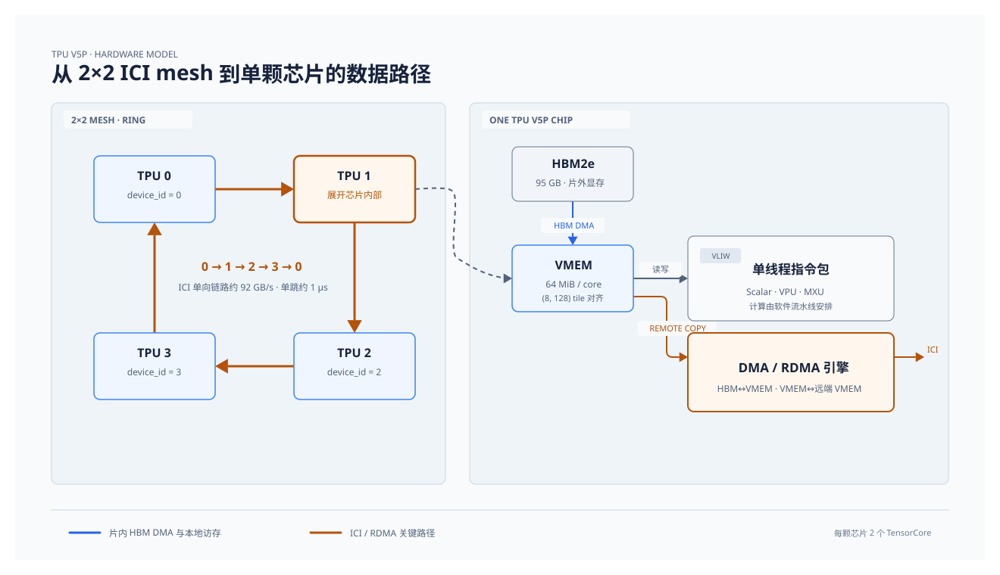
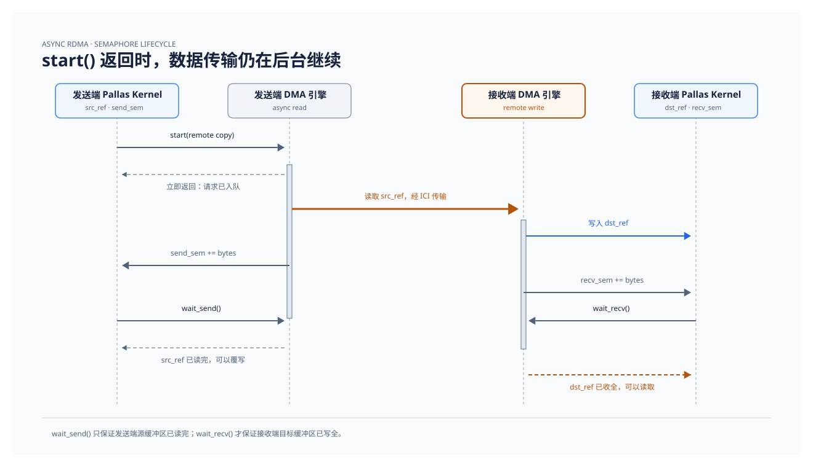
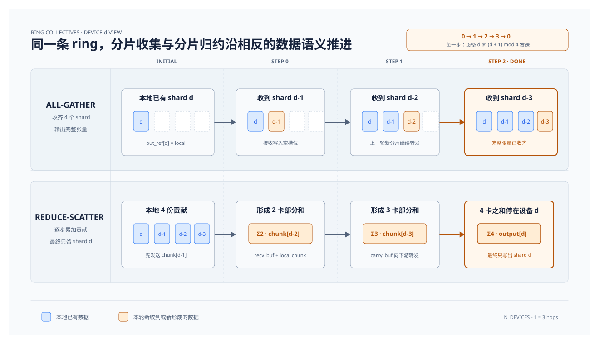
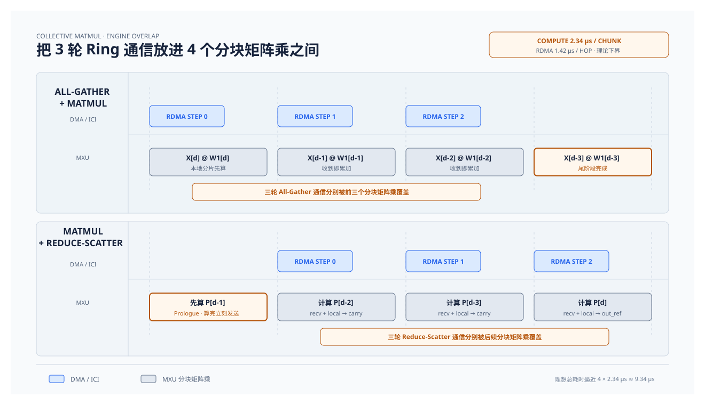

# TPU 与分布式通信原语

```{contents} 本页目录
---
depth: 2
local: true
---
```

前面的章节都在单张 GPU 上展开。到了大模型训练和推理，参数、激活和 KV cache 放不进单卡显存，单卡算力也不够，计算会落到多卡上。这一章用 TPU v5p 和 Pallas 讲分布式通信原语：先看 TPU 的芯片结构、内存层级和片间互联，再看 Pallas 怎么写异步 RDMA，接着在 4 设备 ring 上写出 `all-gather` 和 `reduce-scatter`，最后把它们和矩阵乘拼成张量并行（Tensor Parallelism）里的 collective matmul。

## TPU 的硬件模型

TPU 通过片间互联（ICI，Inter-Chip Interconnect）把多颗芯片连成 2D 或 3D torus/mesh。4 颗设备排成 `2 * 2` 的 mesh 时，沿着四条边走一圈就能嵌入一条长度为 4 的 ring。单条 ICI 链路的单向带宽约为 92 GB/s，单跳（hop）延迟约为 1 微秒。

单颗 TPU v5p 芯片包含 2 个 TensorCore。每个 core 是单线程的 VLIW（超长指令字）处理器，一条指令包可以同时驱动标量单元、向量单元（VPU）、矩阵乘单元（MXU）和 DMA 引擎。它的向量寄存器很宽：在 fp32 下，一次向量运算原生处理 1024 个元素，硬件把它组织成二维的 `(8, 128)` tile，其中第一维 8 叫 sublane，第二维 128 叫 lane。Pallas 里的内存对齐、张量切片和 RDMA 连续性都围绕这个 `(8, 128)` 基本块展开。

TPU 的内存层级比 GPU 简单得多。每个 core 有一块 64 MiB 的高带宽片上 SRAM scratchpad，叫 VMEM（Vector Memory）。整颗芯片还有 95 GB 的 HBM2e。和 H100 单 SM 最大 228 KB 的 shared memory 相比，64 MiB 的 VMEM 大了两个数量级；同时 TPU 没有 GPU 那套靠多 warp 切换和复杂硬件缓存层次隐藏延迟的机制，更接近「HBM + 大容量片上 VMEM」的两级结构。写 TPU kernel 时，核心问题只有三个：哪些权重和激活可以常驻 VMEM，哪些分块要走 HBM DMA 或跨芯片 RDMA，以及怎么排布维度才能对齐 `(8, 128)` tile 并跑满 ICI 带宽。



TPU vs GPU：

| 维度 | NVIDIA Hopper GPU（H100） | Google TPU v5p |
|-|-|-|
| 计算核心与执行模型 | 上百个 SM，SIMT 模型，靠大量并发 warp 切换隐藏访存延迟 | 每颗芯片 2 个 TensorCore，单线程 VLIW 顺序发射，靠软件流水线和异步 DMA 重叠延迟 |
| 基本计算粒度 | Warp（32 线程）与 Tensor Core 矩阵块（如 `wgmma` 的 `64 * N * 16`） | 向量寄存器基本块为 `(8, 128)`（fp32 下 1024 元素），矩阵乘由 MXU 按大块脉动阵列执行 |
| 片上显式缓存 | 每个 SM 最大 228 KB Shared Memory，容量小，需要频繁分块换入换出 | 每个 core 64 MiB VMEM，可直接放下一整层的分片激活、中间缓冲区甚至部分权重 |
| 片外显存 | HBM3 / HBM3e，带硬件管理的大容量 L2 Cache | 每颗设备 95 GB HBM2e，数据进出 VMEM 由显式 DMA 控制 |
| 异步搬运与片间互联 | 片内靠 TMA + `mbarrier`；片间靠 NVLink / NVSwitch | 片内 HBM 到 VMEM、片间 VMEM 到远端 VMEM 均走 DMA / RDMA 引擎 + Semaphore；2D/3D mesh 单向链路约 92 GB/s，单跳约 1 us |

### ICI 与 NVLink 的带宽要先统一口径

<callout emoji="📏">
**核心结论：**前文的 `92 GB/s` 是单条 ICI 链路的单向带宽；NVIDIA 资料中常见的 `900 GB/s` 和 `1.8 TB/s`，通常是单颗 GPU 汇总全部 NVLink 后的双向带宽。两类数字不能直接横向比较。
</callout>

Google Cloud 的 TPU v5p 官方规格给出每颗芯片 `1,200 GB/s` 的双向 ICI 聚合带宽，拓扑为 3D torus。3D torus 在 `±X`、`±Y`、`±Z` 六个相邻方向上各有一条连接，因此折算到单个方向，理论值约为 `100 GB/s` 单向

| 比较口径 | TPU v5p ICI | H100 NVLink 4 | Blackwell NVLink 5 |
|-|-|-|-|
| 单链路单向 | 约 `90–100 GB/s` | `25 GB/s` | 厂商通常以单 GPU 聚合带宽描述 |
| 单芯片聚合双向 | `1,200 GB/s` | `900 GB/s` | `1,800 GB/s` |
| 典型 scale-up 拓扑 | 3D torus，相邻芯片点对点连接；v5p Pod 最多包含 8,960 颗芯片 | HGX / DGX 域内通过 NVSwitch 组成交换式互联 | NVL72 通过 NVLink Switch 组成机架级 all-to-all 互联 |

**交换式 Fabric 与 Torus 解决的问题不同。**NVSwitch 在一个 scale-up 域内提供 all-to-all 连接，通信不需要由中间 GPU 转发。TPU ICI 则把芯片排成 3D torus：每颗芯片只与六个相邻方向直连，访问非相邻芯片时需要经过多条链路。它避免了用一个中央交叉开关连接全部芯片，但路径长度、对分带宽和路由拥塞会直接影响实际性能。

前文的 `2 × 2` mesh ring 正好沿相邻边传递数据，每一步都使用直连链路，因此能较好地利用单链路带宽。全局 `all-to-all` 或不规则点对点通信会同时争用多条路径，实际带宽取决于 slice 形状、张量分片方式和 collective 的映射。TPU v5p 还支持 twisted torus，用更合适的链路连接方式提高某些 slice 的对分带宽。

**延迟也要按路径计算。**前文约 `1 μs` 的数字对应相邻芯片的一跳。非相邻通信需要多跳，链路传播和路由开销会随路径增加；大消息可以流水传输，因此端到端时间不一定严格等于“跳数乘以单跳延迟”。NVSwitch 也有交换开销，但同一交换域内无需让其他 GPU 充当转发节点。

| 通信模式 | ICI 3D torus | NVLink + NVSwitch |
|-|-|-|
| Ring all-reduce、数据并行、流水线并行 | 容易映射到相邻轴，拓扑感知布局可以减少多跳和链路争用 | 同样适合，交换式互联降低了物理邻接约束 |
| Tensor Parallelism、MoE all-to-all | 可以运行，但对 slice 形状、对分带宽和 collective 映射更敏感 | all-to-all 交换域更容易承载高密度跨卡通信 |
| 随机、不规则的跨芯片访问 | 更容易出现多跳和热点，需要软件布局与路由共同规避 | 拓扑约束较弱，但仍受交换域规模、端口、功耗和成本限制 |

## TPU Pallas

Pallas 是 JAX 的底层 kernel 编程接口。它贴近硬件，但采用基于追踪（tracing-based）的编译模型：Python 函数在编译期只跑一次，用来生成并发射底层指令序列，不会在 TPU 运行时逐行解释执行。

写 Pallas 代码时，要把下面四条边界分清：

1. **Python 控制流和 kernel 控制流发生在两个阶段。** 在被追踪的 kernel 里写 Python 的 `if`、`for`、`while`，是在编译追踪阶段（trace time）展开指令。如果分支条件依赖运行时的张量值或动态 `device_id`，就要改用 `pl.when`、`lax.cond`、`lax.fori_loop`，由编译器生成真正的硬件分支或循环指令。反过来，像 4 设备 ring 里的 `for step in range(N_DEVICES - 1)`，循环次数是编译期已知的小常数，用 Python `for` 直接展开成 3 段顺序指令反而省去了运行时循环控制开销。
2. **Python 的 `print` 只在编译期打印追踪对象。** 想在 TPU 运行时打印某块缓冲区的真实数值，要用 `jax.debug.print`，并且打开调试开关（如代码中的 `ENABLE_DEBUG`）。
3. **运行期性能只由展开后的硬件指令序列决定。** 在 Python 里拆辅助函数、用字典传配置、用闭包算下标，只要追踪出来的 DMA、VPU、MXU 指令一样，最终跑出来的耗时就一样。
4. **区分数组引用（Ref）和数组数值（Value）。**`Ref` 是指向 VMEM 或 HBM 缓冲区的带形状句柄，`Value` 是已经读进向量寄存器的数值。RDMA 的源和目标都传 `Ref`；算术运算和 `pl.dot` 操作的是 `Value`。

| 写法 | 返回类型与阶段 | 底层行为 |
|-|-|-|
| `x_ref.at[pl.ds(start, size)]` | 子区域的 `Ref`（编译期构造视图） | 只计算地址偏移和切片形状，不发生内存读写。可直接传给 `make_async_remote_copy` 作为 RDMA 的源或目标 |
| `x_ref[...]` 或 `x_ref[pl.ds(start, size)]` | 寄存器中的 `Value`（运行期访存） | 发射向量加载指令，把 VMEM 中的数据读进向量寄存器，后续才能做加减或传入 `pl.dot` |
| `out_ref[...] = val` | 写入 VMEM（运行期访存） | 发射向量存储指令，把寄存器中的计算结果写回 `out_ref` 指向的 VMEM 区域 |
| `pltpu.VMEM(shape, dtype)` | Scratch 分配声明 | 在 `scratch_specs` 中声明一块片上 VMEM 临时缓冲区，kernel 启动时作为 `scratch_refs` 传入 |
| `pltpu.SemaphoreType.DMA` | DMA 信号量声明 | 声明一个硬件 DMA 计数器，用于跟踪本地 DMA 发送或接收完成的字节数 |

## TPU RDMA

在 Pallas 的多设备程序里，所有设备执行同一份 kernel，并且各设备上的内存布局完全对称（Symmetric Address Space）。同一个 `out_ref` 在设备 0 上指向设备 0 的那块 VMEM，在设备 1 上指向设备 1 同一偏移处的 VMEM。因此发起跨芯片 RDMA 时，不需要像传统网络编程那样先握手交换远端指针，只要给出本地的源 `src_ref`、目标 `dst_ref` 以及目标设备号 `dst_device_id`，DMA 引擎就能直接把本地 `src_ref` 的数据写进远端设备对应的 `dst_ref`。

RDMA 由独立的 DMA 引擎异步执行。`start()` 只是把搬运请求提交给硬件，指令返回时数据还没发完，远端也没收完。为了判断源缓冲区什么时候能安全改写、目标缓冲区什么时候能安全读取，一次远程拷贝会同时绑定两个信号量：发送方本地的 `send_sem` 和接收方本地的 `recv_sem`。



| 操作 | 作用在哪一端 | 硬件做了什么 | 返回后保证什么 |
|-|-|-|-|
| `start()` | 发送方发起 | 启动异步远程拷贝，DMA 引擎从本地 `src_ref` 读数据，经 ICI 发往 `dst_device_id` 的 `dst_ref` | 只表示拷贝已入队，`src_ref` 不能改写，`dst_ref` 也不能读取 |
| `wait_send()` | 发送方等待 `send_sem` | 阻塞到 `send_sem` 累计的已发送字节数等于 `src_ref` 的大小 | 本地 `src_ref` 已被 DMA 读完，后续可以覆写 `src_ref`；不代表远端已经落盘 |
| `wait_recv()` | 接收方等待 `recv_sem` | 远端 DMA 写入本地 `dst_ref` 时同步累加本地 `recv_sem`，阻塞到字节数等于 `dst_ref` 的大小 | 本地 `dst_ref` 已完整收到远端发来的数据，后续可以安全读取 |

示例 TPU RDMA 代码：

```python
import time

import jax
import numpy as np
from jax import lax, numpy as jnp
from jax.experimental import pallas as pl
from jax.experimental.pallas import tpu as pltpu
from jax.sharding import Mesh, PartitionSpec

AXIS_NAME = "i"
N_DEVICES = 4

ENABLE_DEBUG = False


def pallas_get_my_device_id():
    return lax.axis_index(AXIS_NAME)


def pallas_rdma_start(*, src_ref, dst_ref, dst_device_id, src_send_sem, dst_recv_sem):
    pltpu.make_async_remote_copy(
        src_ref=src_ref,
        dst_ref=dst_ref,
        send_sem=src_send_sem,
        recv_sem=dst_recv_sem,
        device_id=dst_device_id,
        device_id_type=pltpu.DeviceIdType.LOGICAL,
    ).start()


def pallas_rdma_wait_send(*, src_ref, src_send_sem):
    pltpu.make_async_remote_copy(
        src_ref=src_ref,
        dst_ref=src_ref,  # ignored by 'wait_send'
        send_sem=src_send_sem,
        recv_sem=src_send_sem,  # ignored by 'wait_send'
        device_id=0,  # ignored by 'wait_send'
        device_id_type=pltpu.DeviceIdType.LOGICAL,
    ).wait_send()


def pallas_rdma_wait_recv(*, dst_ref, dst_recv_sem):
    pltpu.make_async_remote_copy(
        src_ref=dst_ref,  # ignored by 'wait_recv'
        dst_ref=dst_ref,
        send_sem=dst_recv_sem,  # ignored by 'wait_recv'
        recv_sem=dst_recv_sem,
        device_id=0,  # ignored by 'wait_recv'
        device_id_type=pltpu.DeviceIdType.LOGICAL,
    ).wait_recv()


def exchange_with_neighbor_pallas_scratch_specs(x):
    return {
        "send_sem": pltpu.SemaphoreType.DMA,
        "recv_sem": pltpu.SemaphoreType.DMA,
    }


def exchange_with_neighbor_pallas_kernel(x_ref, out_ref, scratch_refs):
    my_device_id = pallas_get_my_device_id()
    paired_device_id = my_device_id + 1 - 2 * lax.rem(my_device_id, 2)

    send_sem = scratch_refs["send_sem"]
    recv_sem = scratch_refs["recv_sem"]

    pallas_rdma_start(
        src_ref=x_ref,
        dst_ref=out_ref,
        dst_device_id=paired_device_id,
        src_send_sem=send_sem,
        dst_recv_sem=recv_sem,
    )
    pallas_rdma_wait_send(src_ref=x_ref, src_send_sem=send_sem)
    pallas_rdma_wait_recv(dst_ref=out_ref, dst_recv_sem=recv_sem)

```

`lax.axis_index("i")` 返回当前程序实例在命名 mesh 轴 `i` 上的逻辑编号。配对公式可以写成：

```text
pair(d) = d + 1 - 2 * (d mod 2)
```

| 当前设备 d | d mod 2 | pair(d) |
|-|-|-|
| 0 | 0 | 1 |
| 1 | 1 | 0 |
| 2 | 0 | 3 |
| 3 | 1 | 2 |

因此四台设备组成 `(0,1)` 和 `(2,3)` 两个二元组。公式使用 `lax.rem`，没有 Python 侧分支，可以在 JAX tracing 和 SPMD 编译中保留为设备端计算。`DeviceIdType.LOGICAL` 表示这些编号属于当前逻辑拓扑，不是全局物理 TPU 编号；mesh 轴 `i` 必须在外层映射环境中正确绑定。

### 一次 kernel 同时完成发送和接收

每台设备执行相同的 kernel。设备 d 调用 `start()` 时，把本地 `x_ref[d]` 写到设备 `pair(d)` 对应的 `out_ref`。因为配对关系是对称的，设备 d 也会同时收到对端发来的数据：

```text
out_ref[0] <- x_ref[1]
out_ref[1] <- x_ref[0]
out_ref[2] <- x_ref[3]
out_ref[3] <- x_ref[2]
```

kernel 没有 Python `return`，因为 Pallas kernel 通过 ref 原地读写。调用完成后，各设备本地的 `out_ref` 保存配对设备的输入，而不是自己的输入。

### 两个 DMA semaphore 管理两段缓冲区的生命周期

`exchange_with_neighbor_pallas_scratch_specs` 为每个 kernel 实例申请一个发送 semaphore 和一个接收 semaphore。参数 `x` 在当前实现中没有使用，只是保留了与上层 scratch-spec 构造接口一致的函数签名。

| 信号量 | 等待操作 | 完成后允许的动作 |
|-|-|-|
| `send_sem` | `wait_send()` | DMA 已读完本地 `x_ref`，源缓冲区可以复用或改写 |
| `recv_sem` | `wait_recv()` | 对端数据已完整写入本地 `out_ref`，目标缓冲区可以读取 |

`wait_send` 和 `wait_recv` 中出现的自拷贝引用与 `device_id=0` 不会真的发起第二次拷贝；它们只是为了重新构造等待操作需要的描述符。判断这两段代码时，应以对应 wait 方法实际读取的 ref 和 semaphore 为准。

### 先让所有设备 start，再进入等待

kernel 的顺序是 `start → wait_send → wait_recv`。所有设备运行同一份 SPMD 程序，所以每个参与者都会先提交自己的远程写，再进入等待。这样两端的搬运都已经入队，不会出现一端尚未发起、另一端先永久等待接收的循环依赖。

`wait_send` 和 `wait_recv` 保证的资源不同，两者不能互相替代。只等待发送完成，不能证明本地 `out_ref` 已收到对端数据；只等待接收完成，也不能证明本地 `x_ref` 已经可以被下一轮覆盖。


## reduce-scatter 与 all-gather 

分布式训练和推理里最常遇到两类基础 collective：

- **reduce-scatter**：每个设备手头有一份形状相同的完整张量，先在设备间按元素求和，再把求和结果沿第 0 维切成 `N_DEVICES` 份，第 `i` 号设备只留下第 `i` 份。
- **all-gather**：每个设备手头只有自己的那 `1 / N_DEVICES` 分片（shard），通信结束后每个设备上都拼出一份完整的张量。

把这两步首尾相接，先做一次 `reduce-scatter` 再做一次 `all-gather`，得到的就是完整的 **all-reduce**，而且通信量正好等于 ring all-reduce 的两阶段开销。写代码时，难点在于怎么在单向 ring（`0 -> 1 -> 2 -> 3 -> 0`）上安排每一轮发送和接收的分片下标，以及怎么管好 VMEM 缓冲区的读写生命周期。



<callout emoji="🔤">
**形状符号：**`N` 是参与 collective 的设备数；`S` 是一个分片沿第 0 维的长度；`D1`、`D2` 是不参与本次切分的其余维度。它们描述的是张量形状，不是字节数。
</callout>

- **`N`：设备数。**例如 4 个节点时 `N = 4`。Ring collective 需要执行 `N - 1` 轮，因此 4 个节点需要 3 轮。
- **`S`：单个分片在第 0 维的长度。**完整张量沿第 0 维切成 `N` 份，每份形状为 `[S, D1, D2]`，重新拼完整后的第 0 维长度是 `N * S`。
- **`D1`、`D2`：其余维度。**它们在 All-Gather 或 Reduce-Scatter 中保持不变，可能对应 hidden、head、feature 等维度，具体含义取决于被通信的张量。如果只想写一个合并后的尾部维度，也可以记成 `D = D1 * D2`。

因此，`all-gather` 把每卡的局部分片 `[S, D1, D2]` 拼成完整张量 `[N * S, D1, D2]`；`reduce-scatter` 则从每卡一份完整形状的局部贡献 `[N * S, D1, D2]` 出发，先跨卡逐元素归约，再让每卡只留下一个 `[S, D1, D2]` 结果分片。

一个分片包含 `S * D1 * D2` 个元素，占用的字节数为 `S * D1 * D2 * sizeof(dtype)`。所以表中“每卡收发 `N - 1` 个分片”换算成单向字节数，就是 `(N - 1) * S * D1 * D2 * sizeof(dtype)`。

以 4 个节点为例，完整张量形状为 `[4S, D1, D2]`。All-Gather 的输入是每卡一个 `[S, D1, D2]` 分片，输出是每卡一份 `[4S, D1, D2]` 完整张量；Reduce-Scatter 的方向正好相反。

| 原语 | 单卡输入形状 | 单卡输出形状 | Ring 步数与单向流量 | 所需 VMEM 临时缓冲 |
|-|-|-|-|-|
| `all-gather` | `[S, D1, D2]`（1 个分片） | `[N * S, D1, D2]`（N 个分片） | `N - 1` 步，每卡收发 `(N - 1)` 个分片 |  |
| `reduce-scatter` | `[N * S, D1, D2]`（N 个待归约分片） | `[S, D1, D2]`（1 个归约后分片） | `N - 1` 步，每卡收发 `(N - 1)` 个分片 | `carry_buf` + `recv_buf`（各 1 个分片大小），加上 `send_sem` / `recv_sem` |

### 朴素 Reduce-Scatter 与 Ring 的传输量对比

“朴素实现”：共有 4 个节点，每个节点持有一份大小为 `S` 的完整输入张量；Reduce-Scatter 完成后，每个节点只保留一个大小为 `S / 4` 的结果分片。表中的传输量按发送字节统计一次，不在接收端重复计数。

<callout emoji="💡">
**核心结论：**朴素实现集群总发送量是 `12S`，Ring 只需要 `3S`。Ring 的优势转为邻居通信、链路负载均衡和稳定流水。
</callout>

| 实现方式 | 单节点发送量 | 4 节点总发送量 | 主要特点 |
|-|-|-|-|
| 完整张量互发 | `3S` | `12S` | 每个节点把完整输入发给另外 3 个节点，传输了大量最终不会保留的数据 |
| 中心节点归约 | 各节点不均衡 | `15S / 4 = 3.75S` | 其他 3 个节点先向 root 各发送 `S`，root 再向 3 个节点各发送一个 `S / 4` 分片 |
| 直接发送给分片 owner | `3S / 4` | `3S` | 字节数已经达到理论最优，但通信是 all-to-all 形态 |
| Ring Reduce-Scatter | `3S / 4` | `3S` | 执行 3 轮，每轮只向下游邻居发送一个大小为 `S / 4` 的部分和 |

**直接发送给分片 owner。**每个节点只把另外 3 个分片分别发给对应 owner，单节点和集群总发送量也分别是 `3S / 4` 与 `3S`。因此，Ring 相比这种已经按分片优化的实现，并不继续减少端点注入的字节数。Ring 的收益来自通信组织：每个节点只与邻居通信，所有节点可以同时收发，没有中心热点，链路负载也更均匀。

上表统计的是端点发送量。在全连接网络中，直接发给 owner 的每份数据可以一跳到达；在 ring、mesh 或 torus 等非全连接拓扑中，非邻居消息可能经过多跳，实际占用的物理链路字节数会高于 `3S`。Ring 每一轮只走相邻链路，更容易映射到这类拓扑。

### reduce-scatter 与 all-gather 的 Ring 实现

先看 **all-gather**。输出缓冲区 `out_ref` 本身就能装下全部 4 个分片。进入循环前，设备 `d` 先把自己的本地分片 `x_ref` 拷进 `out_ref` 的第 `d` 槽位。接下来的 `N_DEVICES - 1 = 3` 步里，每一跳数据沿 `d -> (d + 1) mod 4` 往前推一格：第 `step` 步（`step = 0, 1, 2`），设备 `d` 把自己上一轮刚拿到的第 `(d - step) mod 4` 槽位发给下游 `(d + 1) mod 4`，同时从上游 `(d - 1) mod 4` 接收第 `(d - step - 1) mod 4` 槽位，直接写进 `out_ref` 对应的空槽里。因为每一步读的槽位和写的槽位在 `out_ref` 里完全错开，所以 `all-gather` 不需要额外分配 VMEM 临时数组。

| 阶段 | Device 0 | Device 1 | Device 2 | Device 3 |
|-|-|-|-|-|
| 初始写入 | `out[0] = x^(0)` | `out[1] = x^(1)` | `out[2] = x^(2)` | `out[3] = x^(3)` |
| Step 0 | 发 `out[0]`，收 `out[3]` | 发 `out[1]`，收 `out[0]` | 发 `out[2]`，收 `out[1]` | 发 `out[3]`，收 `out[2]` |
| Step 1 | 发 `out[3]`，收 `out[2]` | 发 `out[0]`，收 `out[3]` | 发 `out[1]`，收 `out[0]` | 发 `out[2]`，收 `out[1]` |
| Step 2 | 发 `out[2]`，收 `out[1]` | 发 `out[3]`，收 `out[2]` | 发 `out[0]`，收 `out[3]` | 发 `out[1]`，收 `out[0]` |

再看 **reduce-scatter**。目标是经过 3 跳之后，第 `d` 号分片的四卡之和恰好停在设备 `d` 的 `out_ref` 上。既然每一跳设备号加 1，倒推回去，第 `d` 号分片的累加链条就要从设备 `(d + 1) mod 4`（也就是 `(d + 3) mod 4` 的上游）出发：

1. **第 0 步（`first_send_idx = (d - 1) mod 4`，`first_recv_idx = (d - 2) mod 4`）**：设备 `d` 把本地原始输入 `x_ref` 的第 `(d - 1) mod 4` 块发给下游 `d + 1`，同时用 `recv_buf` 接收上游 `d - 1` 发来的第 `(d - 2) mod 4` 块。`wait_recv` 返回后，立刻把 `recv_buf` 和本地的第 `(d - 2) mod 4` 块相加，存进 `carry_buf`，随后再调用 `wait_send` 确认发送完成。
2. **第 1 步和第 2 步（`step = 1, 2`，`recv_idx = (d - step - 2) mod 4`）**：设备 `d` 把上一轮算好的 `carry_buf` 发给下游，同时用 `recv_buf` 接收上游传来的部分和。这里必须同时有 `carry_buf` 和 `recv_buf` 两块缓冲区：同一轮 RDMA 里，发送引擎正在读本地的 `carry_buf`，远端发来的数据正在写本地的 `recv_buf`，如果共用同一块内存就会发生读写冲突。等 `wait_recv` 和 `wait_send` 都返回后，再把 `recv_buf` 与本地的 `x_chunk_val(recv_idx)` 相加。在最后一步 `step = N_DEVICES - 2 = 2` 时，`recv_idx = (d - 4) mod 4 = d`，四张卡的贡献刚好加齐，结果直接写进 `out_ref`。

| 阶段 | Device 0 累加结果 | Device 1 累加结果 | Device 2 累加结果 | Device 3 累加结果 |
|-|-|-|-|-|
| Step 0 后（`carry_buf`） | 分片 2：`x^(3)[2] + x^(0)[2]` | 分片 3：`x^(0)[3] + x^(1)[3]` | 分片 0：`x^(1)[0] + x^(2)[0]` | 分片 1：`x^(2)[1] + x^(3)[1]` |
| Step 1 后（`carry_buf`） | 分片 1：`x^(2)[1] + x^(3)[1] + x^(0)[1]` | 分片 2：`x^(3)[2] + x^(0)[2] + x^(1)[2]` | 分片 3：`x^(0)[3] + x^(1)[3] + x^(2)[3]` | 分片 0：`x^(1)[0] + x^(2)[0] + x^(3)[0]` |
| Step 2 后（`out_ref`） | 分片 0：四卡完整和 | 分片 1：四卡完整和 | 分片 2：四卡完整和 | 分片 3：四卡完整和 |

参考 reduce-scatter 与 all-gather 实现：

```python
def reduce_scatter_pallas_scratch_specs(x):
    shard_shape = (x.shape[0] // N_DEVICES, x.shape[1], x.shape[2])
    return {
        "carry_buf": pltpu.VMEM(shape=shard_shape, dtype=x.dtype),
        "recv_buf": pltpu.VMEM(shape=shard_shape, dtype=x.dtype),
        "send_sem": pltpu.SemaphoreType.DMA,
        "recv_sem": pltpu.SemaphoreType.DMA,
    }


def reduce_scatter_pallas_kernel(x_ref, out_ref, scratch_refs):
    my_device_id = pallas_get_my_device_id()
    next_device_id = lax.rem(my_device_id + 1, N_DEVICES)
    shard_len = out_ref.shape[0]

    carry_buf = scratch_refs["carry_buf"]
    recv_buf = scratch_refs["recv_buf"]
    send_sem = scratch_refs["send_sem"]
    recv_sem = scratch_refs["recv_sem"]

    def x_chunk_start(chunk_idx):
        return chunk_idx * shard_len

    def x_chunk_ref(chunk_idx):
        return x_ref.at[pl.ds(x_chunk_start(chunk_idx), shard_len)]

    def x_chunk_val(chunk_idx):
        return x_ref[pl.ds(x_chunk_start(chunk_idx), shard_len)]

    first_send_idx = lax.rem(my_device_id + N_DEVICES - 1, N_DEVICES)
    first_recv_idx = lax.rem(my_device_id + N_DEVICES - 2, N_DEVICES)

    pallas_rdma_start(
        src_ref=x_chunk_ref(first_send_idx),
        dst_ref=recv_buf,
        dst_device_id=next_device_id,
        src_send_sem=send_sem,
        dst_recv_sem=recv_sem,
    )
    pallas_rdma_wait_recv(dst_ref=recv_buf, dst_recv_sem=recv_sem)
    carry_buf[...] = recv_buf[...] + x_chunk_val(first_recv_idx)
    pallas_rdma_wait_send(src_ref=x_chunk_ref(first_send_idx), src_send_sem=send_sem)

    for step in range(1, N_DEVICES - 1):
        recv_idx = lax.rem(my_device_id + N_DEVICES - step - 2, N_DEVICES)

        pallas_rdma_start(
            src_ref=carry_buf,
            dst_ref=recv_buf,
            dst_device_id=next_device_id,
            src_send_sem=send_sem,
            dst_recv_sem=recv_sem,
        )
        pallas_rdma_wait_recv(dst_ref=recv_buf, dst_recv_sem=recv_sem)
        pallas_rdma_wait_send(src_ref=carry_buf, src_send_sem=send_sem)

        reduced_chunk = recv_buf[...] + x_chunk_val(recv_idx)
        if step == N_DEVICES - 2:
            out_ref[...] = reduced_chunk
        else:
            carry_buf[...] = reduced_chunk


def all_gather_pallas_scratch_specs(x):
    return {
        "send_sem": pltpu.SemaphoreType.DMA,
        "recv_sem": pltpu.SemaphoreType.DMA,
    }


def all_gather_pallas_kernel(x_ref, out_ref, scratch_refs):
    my_device_id = pallas_get_my_device_id()
    next_device_id = lax.rem(my_device_id + 1, N_DEVICES)
    shard_len = x_ref.shape[0]

    send_sem = scratch_refs["send_sem"]
    recv_sem = scratch_refs["recv_sem"]

    def out_chunk_start(chunk_idx):
        return chunk_idx * shard_len

    def out_chunk_ref(chunk_idx):
        return out_ref.at[pl.ds(out_chunk_start(chunk_idx), shard_len)]

    out_ref[pl.ds(out_chunk_start(my_device_id), shard_len)] = x_ref[...]

    for step in range(N_DEVICES - 1):
        send_idx = lax.rem(my_device_id + N_DEVICES - step, N_DEVICES)
        recv_idx = lax.rem(my_device_id + N_DEVICES - step - 1, N_DEVICES)

        send_ref = out_chunk_ref(send_idx)
        recv_ref = out_chunk_ref(recv_idx)

        pallas_rdma_start(
            src_ref=send_ref,
            dst_ref=recv_ref,
            dst_device_id=next_device_id,
            src_send_sem=send_sem,
            dst_recv_sem=recv_sem,
        )
        pallas_rdma_wait_recv(dst_ref=recv_ref, dst_recv_sem=recv_sem)
        pallas_rdma_wait_send(src_ref=send_ref, src_send_sem=send_sem)


```

## collective matmul：通信与计算重叠

接下来把前两节的通信原语放进 Transformer MLP 层：`X = gelu(X @ W1) @ W2`。在张量并行（Megatron-LM 风格）里，第一层权重 `W1` 按列切成 `N_DEVICES` 份，第 `i` 号设备持有 `W1^i`；第二层权重 `W2` 按行切成 `N_DEVICES` 份，第 `i` 号设备持有 `W2^i`。因为激活函数 `gelu` 是逐元素运算，`gelu(X @ [W1^0, W1^1, ...])` 可以直接拆成各卡独立算 `local1 = gelu(X @ W1^i)`，完全不需要通信；到了第二层 `local1 @ W2^i`，各卡算出来的是输出矩阵的部分和（partial sum），在层尾做一次跨卡求和就能还原完整输出。

如果把层尾的 `All-Reduce` 拆成 `Reduce-Scatter` 接 `All-Gather`，并且在相邻两层之间保持激活处于分片状态（每张卡只存 `[B, K1 / N_DEVICES]`），多层串联就可以改写成每层一头一尾两个融合原语：层首做 **All-Gather-Matmul**，层尾做 **Matmul-Reduce-Scatter**。

```text
单层逻辑：
  local0 = X @ W1^i
  local1 = gelu(local0)
  local2 = local1 @ W2^i
  out    = All-Gather(Reduce-Scatter(local2))

多层串联时，中间层可以改写成：
  out_shard = Reduce-Scatter(gelu(All-Gather(prev_shard) @ W1^i) @ W2^i)
```

### 为什么需要通信与计算重叠

动手改调度之前，先用 Roofline 的口径算一下这两个算子受算力限制还是受通信带宽限制。

> 假设输入 `X` 形状为 `[256, 1024]`，`W1` 为 `[1024, 16384]`，`W2` 为 `[16384, 1024]`，数据类型为 `bfloat16`，设备数 `N_DEVICES = 4`。

先看单卡计算量。4 卡切分后，每个设备上的 `W1^i` 形状为 `[1024, 4096]`，`W2^i` 形状为 `[4096, 1024]`。对 `All-Gather-Matmul`，聚合后的输入是 `[256, 1024]`，乘本地权重 `[1024, 4096]`；对 `Matmul-Reduce-Scatter`，本地输入是 `[256, 4096]`，乘本地权重 `[4096, 1024]`。两次矩阵乘的 FLOPs 完全相同：

```text
All-Gather-Matmul FLOPs = 2 * 256 * 1024 * 4096 = 2,147,483,648
Matmul-Reduce-Scatter FLOPs = 2 * 256 * 4096 * 1024 = 2,147,483,648
```

TPU v5p 的 `bfloat16` 矩阵乘峰值算力整芯片约为 459 TFLOP/s，单 core 约为 230 TFLOP/s。如果只受单 core 算力约束，两次矩阵乘的理论计算下界都是 `2.1475e9 / 230e12 ≈ 9.34 微秒`。

再看单卡通信量。激活按列切成 4 份后，每张卡持有的分片形状是 `[256, 256]`，字节数为 `256 * 256 * 2 B = 131072 B = 128 KiB`。在 4 设备单向 ring 中，无论做 `all-gather` 还是 `reduce-scatter`，每个设备都要发 3 步、收 3 步，单方向总流量为 `3 * 128 KiB = 384 KiB`。按单条 ICI 链路单向 92 GB/s 估算，理论通信下界约为 `393216 B / 92e9 B/s ≈ 4.27 微秒`。

对比这两个数字可以看出：**在理论下界上，计算耗时（9.34 us）大于通信耗时（4.27 us），两者比值超过 2:1。** 如果先做完通信再算矩阵乘，单次原语的下界是 `9.34 + 4.27 = 13.61 微秒`；如果把 3 步 ring 通信拆开、藏进矩阵乘的分块计算里，理想总耗时下界就能逼近纯矩阵乘的 `9.34 微秒`。优化重点在于不让通信单独占住关键路径。



| 操作 | 理论计算下界 | 理论通信下界 | 串行下界 vs 理想重叠下界 | 结论 |
|-|-|-|-|-|
| All-Gather-Matmul | 约 9.34 us | 约 4.27 us | 13.61 us vs 9.34 us | 偏 compute-bound，通信可藏进分块 matmul |
| Matmul-Reduce-Scatter | 约 9.34 us | 约 4.27 us | 13.61 us vs 9.34 us | 同样偏 compute-bound，边算分块边跑 ring 归约 |

下面这段代码给出了未重叠的分步基线实现（先调 `_all_gather_ring` 再算 `_matmul_bf16`，以及先算完整 `_matmul_bf16` 再调 `_reduce_scatter_ring`），并包含把二维张量转成 `(N_DEVICES, B, shard_width)` 连续分片布局的辅助函数：

```python
import time

import jax
import numpy as np
from jax import lax, numpy as jnp
from jax.experimental import pallas as pl
from jax.experimental.pallas import tpu as pltpu
from jax.sharding import Mesh, PartitionSpec

AXIS_NAME = "i"
N_DEVICES = 4

ENABLE_DEBUG = False

N_BATCH = 256
K1 = 1024
K2 = 4096 


def pallas_get_my_device_id():
    return lax.axis_index(AXIS_NAME)


def pallas_rdma_start(*, src_ref, dst_ref, dst_device_id, src_send_sem, dst_recv_sem):
    pltpu.make_async_remote_copy(
        src_ref=src_ref,
        dst_ref=dst_ref,
        send_sem=src_send_sem,
        recv_sem=dst_recv_sem,
        device_id=dst_device_id,
        device_id_type=pltpu.DeviceIdType.LOGICAL,
    ).start()


def pallas_rdma_wait_send(*, src_ref, src_send_sem):
    pltpu.make_async_remote_copy(
        src_ref=src_ref,
        dst_ref=src_ref,  # ignored by 'wait_send'
        send_sem=src_send_sem,
        recv_sem=src_send_sem,  # ignored by 'wait_send'
        device_id=0,  # ignored by 'wait_send'
        device_id_type=pltpu.DeviceIdType.LOGICAL,
    ).wait_send()


def pallas_rdma_wait_recv(*, dst_ref, dst_recv_sem):
    pltpu.make_async_remote_copy(
        src_ref=dst_ref,  # ignored by 'wait_recv'
        dst_ref=dst_ref,
        send_sem=dst_recv_sem,  # ignored by 'wait_recv'
        recv_sem=dst_recv_sem,
        device_id=0,  # ignored by 'wait_recv'
        device_id_type=pltpu.DeviceIdType.LOGICAL,
    ).wait_recv()


def _matmul_bf16(x, w):
    return jnp.astype(pl.dot(x, w), jnp.bfloat16)


def _full_to_chunk_major(x, shard_width):
    return jnp.transpose(x.reshape(x.shape[0], N_DEVICES, shard_width), (1, 0, 2))


def _chunk_major_to_full(x):
    return jnp.transpose(x, (1, 0, 2)).reshape(x.shape[1], x.shape[0] * x.shape[2])


def _chunk_ref(buf_ref, chunk_idx):
    return buf_ref.at[chunk_idx, :, :]


def _chunk_val(buf_ref, chunk_idx):
    return buf_ref[chunk_idx, :, :]


def _all_gather_ring(local_ref, gathered_ref, send_sem, recv_sem):
    my_device_id = pallas_get_my_device_id()
    next_device_id = lax.rem(my_device_id + 1, N_DEVICES)

    _chunk_ref(gathered_ref, my_device_id)[...] = local_ref[...]

    for step in range(N_DEVICES - 1):
        send_idx = lax.rem(my_device_id + N_DEVICES - step, N_DEVICES)
        recv_idx = lax.rem(my_device_id + N_DEVICES - step - 1, N_DEVICES)

        send_ref = _chunk_ref(gathered_ref, send_idx)
        recv_ref = _chunk_ref(gathered_ref, recv_idx)

        pallas_rdma_start(
            src_ref=send_ref,
            dst_ref=recv_ref,
            dst_device_id=next_device_id,
            src_send_sem=send_sem,
            dst_recv_sem=recv_sem,
        )
        pallas_rdma_wait_recv(dst_ref=recv_ref, dst_recv_sem=recv_sem)
        pallas_rdma_wait_send(src_ref=send_ref, src_send_sem=send_sem)


def _reduce_scatter_ring(chunked_ref, out_ref, carry_ref, recv_ref, send_sem, recv_sem):
    my_device_id = pallas_get_my_device_id()
    next_device_id = lax.rem(my_device_id + 1, N_DEVICES)

    first_send_idx = lax.rem(my_device_id + N_DEVICES - 1, N_DEVICES)
    first_recv_idx = lax.rem(my_device_id + N_DEVICES - 2, N_DEVICES)

    first_send_ref = _chunk_ref(chunked_ref, first_send_idx)
    pallas_rdma_start(
        src_ref=first_send_ref,
        dst_ref=recv_ref,
        dst_device_id=next_device_id,
        src_send_sem=send_sem,
        dst_recv_sem=recv_sem,
    )
    pallas_rdma_wait_recv(dst_ref=recv_ref, dst_recv_sem=recv_sem)
    carry_ref[...] = recv_ref[...] + _chunk_val(chunked_ref, first_recv_idx)
    pallas_rdma_wait_send(src_ref=first_send_ref, src_send_sem=send_sem)

    for step in range(1, N_DEVICES - 1):
        recv_idx = lax.rem(my_device_id + N_DEVICES - step - 2, N_DEVICES)

        pallas_rdma_start(
            src_ref=carry_ref,
            dst_ref=recv_ref,
            dst_device_id=next_device_id,
            src_send_sem=send_sem,
            dst_recv_sem=recv_sem,
        )
        pallas_rdma_wait_recv(dst_ref=recv_ref, dst_recv_sem=recv_sem)
        pallas_rdma_wait_send(src_ref=carry_ref, src_send_sem=send_sem)

        reduced_chunk = recv_ref[...] + _chunk_val(chunked_ref, recv_idx)
        if step == N_DEVICES - 2:
            out_ref[...] = reduced_chunk
        else:
            carry_ref[...] = reduced_chunk


def matmul_pallas_scratch_specs(x, w):
    return {}


def matmul_pallas_kernel(x_ref, w_ref, out_ref, scratch_refs):
    out_ref[...] = _matmul_bf16(x_ref[...], w_ref[...])


def all_gather_matmul_pallas_scratch_specs(x):
    gathered_shape = (N_DEVICES, x.shape[0], x.shape[1])
    return {
        "gathered_x": pltpu.VMEM(shape=gathered_shape, dtype=x.dtype),
        "send_sem": pltpu.SemaphoreType.DMA,
        "recv_sem": pltpu.SemaphoreType.DMA,
    }


def all_gather_matmul_pallas_kernel(x_ref, w1_ref, out_ref, scratch_refs):
    gathered_x = scratch_refs["gathered_x"]
    send_sem = scratch_refs["send_sem"]
    recv_sem = scratch_refs["recv_sem"]

    _all_gather_ring(x_ref, gathered_x, send_sem, recv_sem)
    out_ref[...] = _matmul_bf16(_chunk_major_to_full(gathered_x[...]), w1_ref[...])


def matmul_reduce_scatter_pallas_scratch_specs(x):
    shard_width = K1 // N_DEVICES
    return {
        "partial_chunks": pltpu.VMEM(
            shape=(N_DEVICES, x.shape[0], shard_width), dtype=x.dtype
        ),
        "carry_buf": pltpu.VMEM(shape=(x.shape[0], shard_width), dtype=x.dtype),
        "recv_buf": pltpu.VMEM(shape=(x.shape[0], shard_width), dtype=x.dtype),
        "send_sem": pltpu.SemaphoreType.DMA,
        "recv_sem": pltpu.SemaphoreType.DMA,
    }


def matmul_reduce_scatter_pallas_kernel(x_ref, w2_ref, out_ref, scratch_refs):
    partial_chunks = scratch_refs["partial_chunks"]
    carry_buf = scratch_refs["carry_buf"]
    recv_buf = scratch_refs["recv_buf"]
    send_sem = scratch_refs["send_sem"]
    recv_sem = scratch_refs["recv_sem"]

    partial_chunks[...] = _full_to_chunk_major(
        _matmul_bf16(x_ref[...], w2_ref[...]), out_ref.shape[1]
    )
    _reduce_scatter_ring(
        partial_chunks, out_ref, carry_buf, recv_buf, send_sem, recv_sem
    )


def neural_network_pallas_scratch_specs(x, w1_refs, w2_refs):
    shard_width = x.shape[1] // N_DEVICES
    return {
        "matmul1_out": pltpu.VMEM(shape=(x.shape[0], K2), dtype=x.dtype),
        "chunk_buf": pltpu.VMEM(
            shape=(N_DEVICES, x.shape[0], shard_width), dtype=x.dtype
        ),
        "shard_buf": pltpu.VMEM(shape=(x.shape[0], shard_width), dtype=x.dtype),
        "carry_buf": pltpu.VMEM(shape=(x.shape[0], shard_width), dtype=x.dtype),
        "recv_buf": pltpu.VMEM(shape=(x.shape[0], shard_width), dtype=x.dtype),
        "send_sem": pltpu.SemaphoreType.DMA,
        "recv_sem": pltpu.SemaphoreType.DMA,
    }


def neural_network_pallas_kernel(init_x_ref, w1_refs, w2_refs, out_ref, scratch_refs):
    matmul1_out = scratch_refs["matmul1_out"]
    chunk_buf = scratch_refs["chunk_buf"]
    shard_buf = scratch_refs["shard_buf"]
    carry_buf = scratch_refs["carry_buf"]
    recv_buf = scratch_refs["recv_buf"]
    send_sem = scratch_refs["send_sem"]
    recv_sem = scratch_refs["recv_sem"]

    for layer_idx in range(w1_refs.shape[0]):
        w1_ref = w1_refs.at[layer_idx]
        w2_ref = w2_refs.at[layer_idx]
        x_val = init_x_ref[...] if layer_idx == 0 else out_ref[...]

        matmul1_out[...] = jnp.astype(
            jax.nn.gelu(_matmul_bf16(x_val, w1_ref[...])), matmul1_out.dtype
        )
        chunk_buf[...] = _full_to_chunk_major(
            _matmul_bf16(matmul1_out[...], w2_ref[...]), shard_buf.shape[1]
        )

        _reduce_scatter_ring(
            chunk_buf, shard_buf, carry_buf, recv_buf, send_sem, recv_sem
        )
        _all_gather_ring(shard_buf, chunk_buf, send_sem, recv_sem)
        out_ref[...] = _chunk_major_to_full(chunk_buf[...])


```

### 分块布局：为什么要转成 chunk-major

读上面的代码时，先看 `_full_to_chunk_major` 和 `_chunk_major_to_full` 这两个重排函数。激活张量 `X` 的原始形状是 `[256, 1024]`，按列切成 4 个分片后，每个分片对应列区间 `[c * 256 : (c + 1) * 256]`。如果直接在二维数组上切列，同一个分片里相邻两行在内存中隔着 1024 个元素，跨度不连续，不方便直接交给 DMA 做整块传输。

代码把完整的 `[256, 1024]` 先 `reshape` 成 `[256, 4, 256]`，再把设备分片维转置到最外层，变成 `[4, 256, 256]`（即 chunk-major）。这样通过 `buf_ref.at[chunk_idx, :, :]` 拿到的第 `chunk_idx` 号分片，在 VMEM 里就是一整块连续的 `[256, 256]` 区域，两维也都是 `(8, 128)` 基本块的整数倍，DMA 可以一次连续搬完。

### 如何把 All-Gather-Matmul 改写成流水线重叠

基线里的 `all_gather_matmul_pallas_kernel` 先等 3 步 ring 把 `gathered_x`（形状 `[4, 256, 256]`）全部收齐，再转回 `[256, 1024]` 做一次大矩阵乘，通信和计算完全串行。要让两者重叠，可以把矩阵乘沿收缩维 `K1 = 1024` 拆成 4 块：

```text
X @ W1^i = sum_{c = 0..3} X_chunk[c] @ W1_chunk[c]
其中 X_chunk[c] 形状为 [256, 256]，W1_chunk[c] = W1^i[c*256 : (c+1)*256, :] 形状为 [256, 4096]
```

每一块的乘加 `X_chunk[c] @ W1_chunk[c]` 只要拿到对应的 `X_chunk[c]` 就能立刻开算，不需要等另外 3 块到齐。单块矩阵乘的理论计算时间约为 `9.34 / 4 ≈ 2.34 微秒`，单步 RDMA 传输一个 `128 KiB` 分片的理论时间约为 `4.27 / 3 ≈ 1.42 微秒`，计算时间足够盖住同一轮的 RDMA 传输。

| 流水步 | DMA 引擎（ICI 通信） | MXU 引擎（矩阵乘累加） |
|-|-|-|
| Step 0 | 发起异步拷贝：发 `X_chunk[d]`，收 `X_chunk[(d - 1) mod 4]` | 立刻计算本地已有的 `out = X_chunk[d] @ W1_chunk[d]`（与 Step 0 通信并行） |
| Step 1 | 先对 Step 0 做 `wait_recv / wait_send`；随后发起异步拷贝：发 `X_chunk[(d - 1) mod 4]`，收 `X_chunk[(d - 2) mod 4]` | 计算上一轮刚收到的分片：`out += X_chunk[(d - 1) mod 4] @ W1_chunk[(d - 1) mod 4]` |
| Step 2 | 先对 Step 1 做 `wait_recv / wait_send`；随后发起异步拷贝：发 `X_chunk[(d - 2) mod 4]`，收 `X_chunk[(d - 3) mod 4]` | 计算上一轮刚收到的分片：`out += X_chunk[(d - 2) mod 4] @ W1_chunk[(d - 2) mod 4]` |
| Step 3（尾阶段） | 对 Step 2 做 `wait_recv / wait_send`，3 轮通信全部结束 | 计算最后一块：`out += X_chunk[(d - 3) mod 4] @ W1_chunk[(d - 3) mod 4]` |

因为 `gathered_x` 的 4 个槽位各不重叠，Step `s` 在 MXU 上读的是槽位 `(d - s) mod 4`（同时 DMA 发送端也在读这个槽位），而 DMA 接收端写的是槽位 `(d - s - 1) mod 4`，读写天然分离，只要每一轮先把新 RDMA 发出去、再调 `pl.dot`，DMA 和 MXU 就能在硬件上同时跑。

### 如何把 Matmul-Reduce-Scatter 改写成流水线重叠

基线里的 `matmul_reduce_scatter_pallas_kernel` 先算出完整的 `[256, 1024]` 矩阵，再重排成 `[4, 256, 256]` 进入 `_reduce_scatter_ring`。这里沿着输出列维把本地权重 `W2^i`（形状 `[4096, 1024]`）切成 4 块 `W2_chunk[c]`（形状 `[4096, 256]`）：

```text
P_chunk[c] = local1 @ W2_chunk[c]，形状为 [256, 256]（对应第 c 个输出分片的本地贡献）
```

回看 9.4 节的 `reduce-scatter` 下标顺序：设备 `d` 在第 0 步要先发出去的是第 `first_send_idx = (d - 1) mod 4` 号分片，随后要和接收结果相加依次是 `(d - 2) mod 4`、`(d - 3) mod 4`、`d`。因此只需要按 ring 归约消费的顺序来算这 4 个分块矩阵乘：

| 流水步 | MXU 引擎（按需计算输出分块） | DMA 引擎与向量单元（Ring 归约） |
|-|-|-|
| 预热（Prologue） | 先算首轮要发的分块：`send_buf = local1 @ W2_chunk[(d - 1) mod 4]` | 无通信（首块算完立刻触发 Step 0 的 RDMA） |
| Step 0 | 在 RDMA 传输期间，计算本轮要归约的本地分块：`loc = local1 @ W2_chunk[(d - 2) mod 4]` | Step 0 开头先发起异步拷贝（发 `send_buf`，收 `recv_buf`）；等 `loc` 算完后调 `wait_recv / wait_send`，令 `carry_buf = recv_buf + loc` |
| Step 1 | 在 RDMA 传输期间，计算下一块：`loc = local1 @ W2_chunk[(d - 3) mod 4]` | Step 1 开头先发起异步拷贝（发 `carry_buf`，收 `recv_buf`）；等 `loc` 算完后调 `wait_recv / wait_send`，令 `carry_buf = recv_buf + loc` |
| Step 2 | 在 RDMA 传输期间，计算属于本卡的最后一块：`loc = local1 @ W2_chunk[d]` | Step 2 开头先发起异步拷贝（发 `carry_buf`，收 `recv_buf`）；等 `loc` 算完后调 `wait_recv / wait_send`，直接写出 `out_ref = recv_buf + loc` |

这样改写之后，3 轮 RDMA 分别被第 2、3、4 个分块的矩阵乘完全盖住，不再需要分配 `[4, 256, 256]` 的整块 `partial_chunks`，也省掉了整张矩阵的 `_full_to_chunk_major` 转置。

### 多层串联：消掉层间的 All-Gather

再看代码最后的 `neural_network_pallas_kernel`。基线实现里，每一层循环结尾都做了完整的 `_reduce_scatter_ring` 加 `_all_gather_ring`，把激活拼回完整的 `[256, 1024]` 写进 `out_ref`，下一层开头再从完整的 `out_ref` 算起。这意味着两层之间那次 `_all_gather_ring` 完全暴露在计算外面，没有任何计算能跟它重叠。

按前面的融合思路，多层串联时：第 0 层入口如果已经是分片输入（或者在第 0 层做完 `Matmul-Reduce-Scatter` 拿到 `shard_buf`），中间第 `l` 层直接把上一层留下的 `shard_buf`（形状 `[256, 256]`）喂给流水线化的 `All-Gather-Matmul`，算出 `local0 = X @ W1^i`，做完 `gelu` 后再进流水线化的 `Matmul-Reduce-Scatter`，直接产出当前层的 `shard_buf`。只在最后一层需要完整输出时再补一次 `All-Gather`。这样每一层的 `All-Gather` 和 `Reduce-Scatter` 都各自挂在一场矩阵乘身上，通信开销在层间流水线里被最大限度隐藏。
